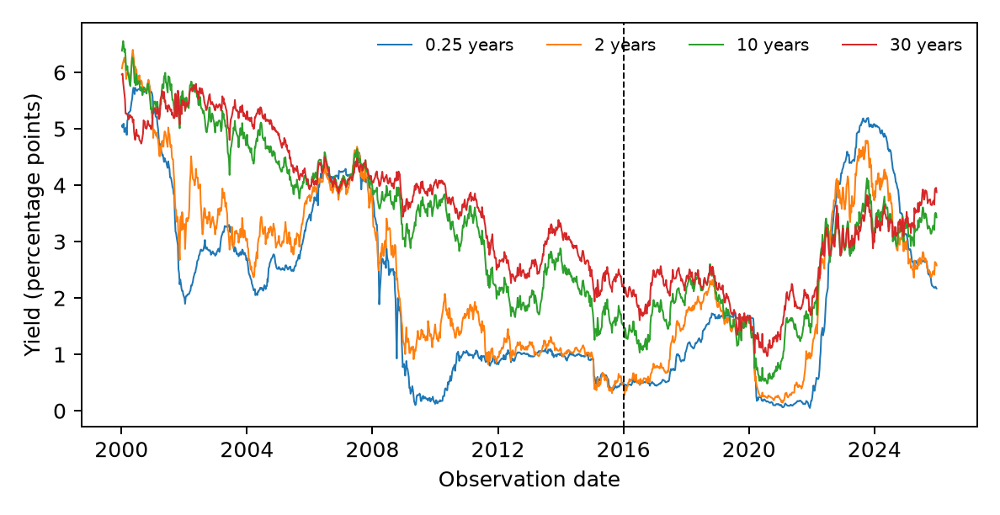
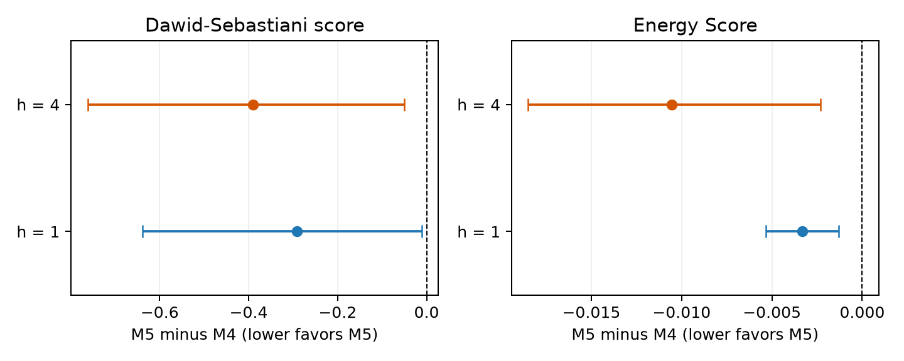
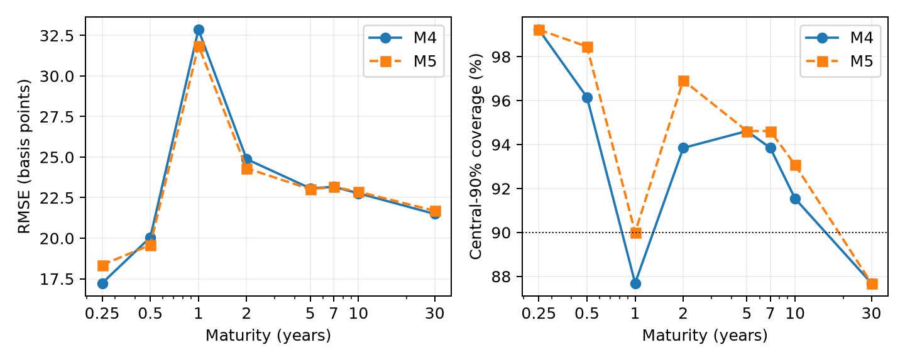

---
format:
  pdf:
    documentclass: scrreprt
    pdf-engine: lualatex
    keep-tex: true
    lof: true
    lot: true
    toc: false
    number-sections: true
fontsize: 12pt
papersize: letter
geometry: margin=1in
linestretch: 1.0
toc-depth: 1
bibliography: ../references.bib
csl: apa.csl
link-citations: true
colorlinks: false
header-includes:
  - |
    \usepackage{chngcntr}
    \counterwithout{equation}{chapter}
    \counterwithout{footnote}{chapter}
    \setkomafont{disposition}{\normalfont\bfseries}
    \RedeclareSectionCommand[beforeskip=0pt,afterskip=1.2\baselineskip]{chapter}
    \setlength{\emergencystretch}{3em}
    \let\MRPListFigures\listoffigures
    \let\MRPListTables\listoftables
    \renewcommand{\listoffigures}{}
    \renewcommand{\listoftables}{}
execute:
  enabled: false
---

```{=latex}
\begin{titlepage}
\centering
\vspace*{1cm}
{\Large\bfseries Probabilistic Forecasting of Canadian Government Yields:\par}
\vspace{0.4cm}
{\Large\bfseries A Bayesian Stochastic-Volatility Extension of Dynamic Nelson--Siegel\par}
\vspace{1.6cm}
{\large Author: Ethan Yao\par}
\vspace{0.7cm}
October 2026\par
\vspace{0.7cm}
Supervisor: Greg Rice\par
\vfill
A project\par
In partial fulfilment of the requirement for\par
Master of Quantitative Finance\par
University of Waterloo\par

\end{titlepage}
\pagenumbering{roman}
\chapter*{Abstract}
\addcontentsline{toc}{chapter}{Abstract}
```

In this study, we develop a probabilistic forecasting framework for Canadian government yields that integrates the Dynamic Nelson–Siegel representation with Bayesian stochastic factor volatility. Building on existing constant-volatility approaches, we introduce a bounded finite-moment prior to explicitly guarantee finite predictive moments and ensure mathematically sound covariance comparisons. The empirical results show that improvements in point-forecast accuracy are limited, whereas the stochastic-volatility extension modestly enhances joint probabilistic forecasting and reduces predictive scoring errors within the matched Bayesian pair. Although a simple random walk remains a formidable overall benchmark, the time-varying volatility mechanism provides a more flexible representation of predictive uncertainty, offering a transparent and mathematically robust approach to evaluating yield-curve distributions in changing interest-rate environments.

```{=latex}
\clearpage
\chapter*{Acknowledgements}
\addcontentsline{toc}{chapter}{Acknowledgements}
```

I am grateful to my supervisor, Greg Rice, for his guidance and feedback throughout this project. I acknowledge the Bank of Canada as the source of the Canadian zero-coupon yield-curve data.

```{=latex}
\clearpage
\setcounter{tocdepth}{0}
\tableofcontents
\setcounter{tocdepth}{2}
\clearpage
\MRPListTables
\clearpage
\MRPListFigures
\clearpage
\pagenumbering{arabic}
```

# Introduction {#sec-introduction}

## Motivation and research problem

A government yield curve relates the interest rate on a zero-coupon claim to the time remaining until its payment. A short-maturity rate and a long-maturity rate need not move together. Consequently, a single forecast of a policy rate or a ten-year yield is not a forecast of the entire curve. Fixed-income risk management requires scenarios describing both the size of yield movements and the way movements at different maturities occur together.

The Dynamic Nelson–Siegel (DNS) representation compresses the curve into three factors with level, slope and curvature loading patterns. This provides a parsimonious starting point for forecasting and an interpretable alternative to a high-dimensional unrestricted yield model. The approved proposal builds on the dynamic forecasting framework of @diebold2006forecasting and the Bayesian stochastic-volatility literature represented by @hautsch2012bayesian.

The central research question is unchanged from the proposal: **does incorporating Bayesian stochastic volatility into DNS factor dynamics improve out-of-sample probabilistic forecasts of Canadian government yields relative to constant-volatility DNS models and standard forecasting benchmarks?** The question concerns predictive uncertainty, not merely whether fitted curves closely reproduce observed yields. A model can have a small cross-sectional reconstruction error and still produce a poorly calibrated distribution for future curves.

A useful distinction is between a point forecast and a predictive distribution. The first summarizes a future curve by its conditional mean. The second assigns probabilities to alternative future curves. Two models can have similar conditional means yet differ materially in forecast variances, interval widths and cross-maturity dependence. The proposal therefore makes a mean–covariance score the primary criterion and supplements it with an ensemble-based distributional score.

## Contribution and scope

The contribution is a controlled comparison of Bayesian DNS with constant factor volatility (M4) and stochastic factor volatility (M5). The models share extracted factors, coefficient priors, forecast dates, reconstruction noise and the prior interpretation of long-run expected innovation variance. M5 alone adds latent volatility dynamics. A finite-moment prior makes the covariance-based comparison mathematically meaningful rather than relying on a finite empirical covariance from a model whose true predictive moments may not exist.

The main experiment is complete: 130 accepted matched origins support comparisons at one and four weeks. Stochastic volatility improves both joint scores within this pair, but the gains are modest, the point-forecast advantage is uncertain, and the random walk remains substantially stronger descriptively. Validated M0–M2 results provide external context, not additional single-change comparisons. M3 is excluded because its existing likelihood fits failed stability checks. Earlier rejected Bayesian computations are not used in any empirical conclusion.

## Organization

@sec-literature motivates the representation and scores. @sec-data defines the historical panel and information set. @sec-methods specifies the accepted models and finite-moment prior. @sec-design states the frozen evaluation and inference protocol. @sec-results reports empirical comparisons; @sec-discussion interprets their scope and limitations, followed by conclusions. Appendices provide derivations and classical robustness results.

# Literature and conceptual framework {#sec-literature}

## Representation versus dynamics

Representation and dynamics are separate choices: extracting a curve's factors does not yet define a predictive distribution. @diebold2006forecasting estimates autoregressive factor dynamics and reports much stronger improvements at a one-year horizon than at one month; its concluding discussion does not claim uniform short-horizon dominance over a random walk. That distinction matters for the present weekly experiment. @diebold2006macroeconomy instead develops a joint latent-state treatment with macroeconomic interactions. Its state-space specification allows correlated factor shocks, unlike the diagonal innovation restriction in this draft's attempted M3.

The interpretation of the three factors follows from their loadings, not from a claim that all factors are stationary or cointegrated. In the convention used here, the level loading is one at every maturity. The slope loading is positive at short maturities and tends toward zero at long maturities. Curvature has a hump-shaped loading. Claims about integration orders or economic identification require further testing and are not inferred from the labels.

A PCA factor model is a useful external comparison because its basis is selected from yield variation rather than prescribed by a parametric maturity function. Its factors do not generally have the same economic interpretation as DNS factors. A favorable comparison between DNS and PCA could reflect representation, mean dynamics, residual covariance or estimation uncertainty. It cannot isolate volatility dynamics in the way the planned Bayesian pair can.

## Stochastic volatility and the controlled comparison

The accessible January 2010 working-paper version of @hautsch2012bayesian studies monthly U.S. zero-coupon yields and reports persistent factor volatility and narrower forecasting uncertainty in low-volatility periods. @caldeira2010bayesian considers common and factor-specific stochastic-volatility structures, including leverage, for DI futures and U.S. Treasury data; its abstract emphasizes better in-sample fit. Neither result establishes better Canadian weekly distributional forecasts. The present proposal is also a two-step approximation, treating extracted factors as observations, not a replication of a unified latent-factor Bayesian model.

@omori2007stochastic is the methodological reference for efficient stochastic-volatility inference using a mixture approximation. The no-leverage model in the proposal is a restriction relative to the leverage setting named in that article. A valid implementation requires the actual approximation coefficients, parameter conventions and full conditional distributions to agree. Merely citing the article does not validate a transcribed table or a custom Gibbs sampler.

The proposal also identifies @sarkisian2024bayesian as a related Master's thesis. Its institutional provenance is distinct from the countries or instruments used empirically. This draft does not infer a Dutch-yield sample from the university's location. Detailed thesis findings and comparisons to this project are contingent on the access evidence recorded in `docs/literature_inventory.md`.

## What proper scoring rules establish

The literature on proper scoring rules motivates evaluation of predictive distributions rather than exclusively point errors [@gneiting2007strictly]. A scoring rule is proper when the expected score is optimized by reporting the relevant true predictive object. Propriety does not eliminate sampling variability, dependence among verification dates, approximation error in simulated ensembles, or errors in the model implementation.

The Dawid–Sebastiani score (DSS) uses a predictive mean and covariance. Its scoring-rule foundation is related to @dawid1999coherent. In the present multivariate form it cannot distinguish two distributions that share the same mean and covariance. It therefore must not be called a strictly discriminating test of the entire posterior-predictive distribution. An Energy Score provides complementary information about simulated yield vectors, while the Variogram Score emphasizes pairwise cross-maturity contrasts [@scheuerer2015variogram].

@patton2011volatility studies comparison using imperfect volatility proxies. It is relevant motivation for thinking carefully about variance losses, but it does not itself establish robustness of every eight-dimensional covariance score used with estimated zero-coupon curves. The observed yield vector here is the forecast target; it is not a direct observation of a latent conditional covariance matrix.

## Comparison uncertainty and evidence limits

@hansen2011model introduces the Model Confidence Set (MCS). The concept is useful when the data cannot sharply distinguish forecasts. Correct implementation requires a documented equal-predictive-ability statistic, an appropriate elimination rule and resampling that respects loss dependence. A set generated by an arbitrary elimination routine is not validated merely by using the MCS name.


# Data and information sets {#sec-data}

## Source and provenance

The primary source is the Bank of Canada's public zero-coupon yield-curve series [@bocdata]. Its source page describes daily curves derived from Government of Canada bonds and treasury bills, a quarterly maturity grid from 0.25 through 30 years, decimal yield units, missing observations marked `na`, and a typical two-week update lag. These are estimated curves rather than a panel of directly traded zero-coupon security prices at all maturities. The Bank identifies @bolder2004canadian as the methodology reference.

The supplied raw Canadian CSV is preserved separately from the processed weekly panel. Its original retrieval transaction is not authenticated, and the historical vintage may contain revisions. A separate official-endpoint check found exact agreement for the eight maturities on 21 complete December 2015 dates; this checks only that slice, not the entire historical panel. Source evidence is retained under `docs/sources/`; `src/prepare_data.py` defines the processor.

## Cleaning, units and weekly sampling

The selected maturity grid is $(0.25,0.5,1,2,5,7,10,30)$ years. Headers are stripped of leading spaces; dates are parsed and checked for uniqueness. A daily observation is eligible only if all eight selected yields are present. The processor converts decimal yields to percentage points by multiplying by 100 and selects the last eligible observation in each ISO calendar week. This is neither averaging nor interpolation.


The research sample excludes the weekly observation dated 31 December 1999 and all dates in 2026. It contains 1,356 weekly observations: 835 through the end of 2015 and 521 in 2016–2025. @tbl-data summarizes this restricted sample. All scores use percentage-point units; hence 0.01 percentage points equals one basis point. Comparisons use identical units across models. Changing units shifts determinant-based scores and rescales distance-based scores.



{#fig-history width=95%}

## Forecast dates and calendar interpretation

Forecast horizons count weekly observations, not a fixed number of trading days. Every fourth weekly observation in the out-of-sample period is considered as an origin. An origin is retained only if both its one- and four-observation-ahead targets lie in 2016–2025. This gives 130 common origins, from 8 January 2016 to 28 November 2025. The otherwise candidate observation near the end of December 2025 is excluded because its four-week target is outside the sample.

Holidays can change the weekday and the number of elapsed calendar days without changing the weekly index horizon. The origin-audit CSV records origin and target dates, training counts and elapsed days. The sample contains no gap exceeding ten calendar days between successive weekly observations. A forecast labeled four weeks should therefore be read as four weekly sampling steps, with the exact target date supplied in the audit.

## Observation-time versus publication-time information

The experiments fit models only to observations dated no later than the origin. Lambda selection also uses only the initial training sample. This prevents future-dated observation leakage within the supplied historical panel. It does **not** establish a real-time forecasting design.

The Bank's typical two-week publication lag means a curve dated $t$ would not normally be publicly available at $t$. The later historical vintage also leaves revision uncertainty. These are therefore **retrospective observation-time forecasts**, not operational forecasts under the public release-time information set. A real-time backtest needs dated releases or a justified availability-lag rule; a fixed lag alone cannot resolve revision uncertainty. No result is interpreted as executable historical trading performance.

# Model specifications {#sec-methods}

## Nelson–Siegel observation equation

Let $Y_t$ be the eight-dimensional yield vector and $f_t=(L_t,S_t,C_t)'$ the factors. For maturity $\tau$ in years define

$$
s(\tau;\lambda)=\frac{1-e^{-\lambda\tau}}{\lambda\tau},
\qquad c(\tau;\lambda)=s(\tau;\lambda)-e^{-\lambda\tau}.
$$ {#eq-loadings}

The row of the loading matrix at $\tau$ is $(1,s,c)$. This fixes the slope sign convention consistently across equations and code. The observation equation is

$$
Y_t=\Lambda(\lambda)f_t+\varepsilon_t,
\qquad \varepsilon_t\sim N(0,R_t).
$$ {#eq-observation}

The decay rate has units of inverse years; it is not a monthly autoregressive parameter. Grid search over 160 values from 0.05 through 2.0 inverse years minimizes initial-window cross-sectional squared errors. The selected value is 0.516038 inverse years and is fixed thereafter. This selection uses the initial window only; sensitivity to the grid and alternative selection losses remains future robustness work.

At each date the two-step factor estimator is

$$
\widehat f_t=(\Lambda'\Lambda)^{-1}\Lambda'Y_t.
$$ {#eq-extraction}

The implementation uses least squares rather than explicitly forming this inverse. Reconstruction variance at each maturity is the origin-specific mean squared reconstruction error, floored at $10^{-6}$ squared percentage points. The diagonal $R_t$ is a modeling approximation, not a proof that residual errors are independent. Small residual eigenvalues can materially affect an eight-dimensional score.

## Model ladder and accepted comparison

| Model | Specification | Empirical status |
|---|---|---|
| M0 | Yield random walk; historical-change covariance | Accepted classical benchmark |
| M1 | Three PCA factors with VAR(1) | Accepted classical benchmark |
| M2 | Two-step DNS; independent Gaussian AR(1) factors | Accepted classical benchmark |
| M3 | Gaussian DNS state-space | Excluded: likelihood-start stability failure |
| M4 | Bayesian two-step DNS; constant factor volatility | Accepted, 130 origins |
| M5 | Bayesian two-step DNS; finite-moment stochastic factor volatility | Accepted, 130 origins; prior-bound checks separate |

: Models and status. Rejected historical scores are not pooled with accepted results. {#tbl-ladder}

## Random-walk and PCA–VAR forecasts

M0 sets the future mean equal to the current curve. For horizon $h$, its covariance is the sample covariance of overlapping historical $h$-step yield changes within the expanding window. This is a zero-drift mean specification; estimating a change covariance does not insert the historical mean change into the forecast. Covariance eigenvalues are floored using the fixed training-only numerical rule.

M1 centers the expanding yield panel, estimates its first three principal components and fits a VAR(1) with an intercept to their scores. If the score equation is $g_{t+1}=d+Ag_t+v_{t+1}$ with innovation covariance $Q$, the recursive forecast is

$$
m_{k+1}=d+Am_k,\qquad V_{k+1}=AV_kA'+Q,
\quad m_0=g_t,\ V_0=0.
$$ {#eq-var-forecast}

The yield mean adds the training center to the basis-projected score mean. The covariance adds diagonal cross-sectional reconstruction error to the projected score uncertainty. The PCA basis and VAR are refitted at every origin, never estimated on the full sample. Finite-horizon forecasts are computed directly; the validated classical runner does not silently impose stationary coefficient clipping.

## Two-step Gaussian DNS

M2 fits a separate Gaussian AR(1) mean equation to each extracted factor:

$$
f_{j,t+1}=a_j+b_j f_{j,t}+\eta_{j,t+1},
\quad \eta_{j,t+1}\sim N(0,q_j).
$$ {#eq-ar}

For the classical benchmark the fitted intercept and slope are unrestricted least-squares estimates. Conditional on fitted parameters, factor forecast moments are

$$
 m_{j,h}=b_j^h f_{j,t}+a_j\sum_{k=0}^{h-1}b_j^k,
\qquad v_{j,h}=q_j\sum_{k=0}^{h-1}b_j^{2k}.
$$ {#eq-ar-moments}

The yield covariance is $\Lambda\operatorname{diag}(v_h)\Lambda'+R_t$. Parameter uncertainty is not added to this classical plug-in forecast. Factor innovation independence is an explicit restriction; PCA–VAR has a full three-dimensional innovation covariance instead. Thus M1 and M2 differ in more than their cross-sectional basis.

## Excluded state-space benchmark

M3's existing Gaussian state-space implementation is not an accepted empirical benchmark: eight origins failed the prespecified across-start likelihood stability criterion despite optimizer success. Its diagnostic evidence is retained. The present comparison neither changes those fits nor uses them to rank forecasts.

## Bayesian constant-volatility DNS

M4 uses the factor AR(1) equation with $|b_j|<1$ and constant innovation variance $\exp(m_j)$. The independent coefficient prior is

$$
(a_j,b_j)'\sim N\!\left((0,0.7)',\operatorname{diag}(25,0.09)\right),\qquad |b_j|<1.
$$ {#eq-coefficient-prior}

This unscaled prior is identical in M5. In both models $m_j\sim N(\mu_{0j},25)$, where $\mu_{0j}$ is frozen from factor residual variances in the original 835-observation training window. This inherited empirical-Bayes calibration uses initial observations both to set hyperparameters and in the likelihood; it is not independent prior elicitation. It is fixed across expanding windows and is not selected using test scores. Four-chain MCMC integrates parameter uncertainty in each model, unlike the classical plug-in M2 forecast.

## Bayesian stochastic-volatility DNS

The approved M5 factor dynamics are

$$
f_{j,t}=a_j+b_j f_{j,t-1}+\eta_{j,t},
\qquad \eta_{j,t}\mid h_{j,t}\sim N(0,e^{h_{j,t}}),
$$ {#eq-sv-factor}

$$
h_{j,t}=\omega_j+\phi_j(h_{j,t-1}-\omega_j)+u_{j,t},
\qquad u_{j,t}\sim N(0,\sigma_{u,j}^2).
$$ {#eq-sv-state}

The factors are estimated separately, with $|b_j|<1$ and $|\phi_j|<1$. A posterior draw must propagate both the factor and log-volatility processes at every future weekly step, not only plug a posterior mean volatility into a Gaussian forecast. Reconstruction noise must be added to each scenario:

$$
Y_{t+h}^{(m)}=\Lambda f_{t+h}^{(m)}+\varepsilon_{t+h}^{(m)},
\qquad \varepsilon_{t+h}^{(m)}\sim N(0,\widehat R_t).
$$ {#eq-predictive}

This includes uncertainty represented by the second-stage posterior, but not full uncertainty from estimating factors in the first stage. Lambda is also fixed after initial estimation. Bayesian output therefore remains conditional on these approximations, even after a correct sampler converges.

To align volatility-prior interpretations and guarantee finite predictive moments, define stationary log-volatility variance $v_j$ and long-run expected-innovation-variance parameter $m_j$ by

$$
q_j=v_j(1-\phi_j^2),\qquad \omega_j=m_j-v_j/2,\qquad
h_{j,1}\sim N(\omega_j,v_j).
$$ {#eq-finite-reparam}

Here $q_j=\sigma_{u,j}^2$. Under stationary log volatility, $E[\exp(h_{j,t})\mid m_j,\phi_j,v_j]=\exp(m_j)$, exactly the M4 constant innovation variance. The remaining independent priors are

$$
\frac{\phi_j+1}{2}\sim\operatorname{Beta}(20,1.5),\qquad
p_U(v_j)=\frac{e^{-v_j}}{1-e^{-U}}\,1_{(0,U)}(v_j).
$$ {#eq-finite-prior}

The main bound $U=4$ and sensitivities $U=2,8$ were specified before aggregate test-score inspection, using training-only and prior-predictive considerations. The main bound limits stationary log-volatility standard deviation to two; the exponential prior regularizes toward constant volatility. Matching $m_j$ matches expected-variance priors, not the full predictive distributions. The inherited standard deviation five for $m_j$ is broad and permits extreme, though finite, prior variance moments.

The bound is scientifically consequential. Under the rejected inverse-gamma innovation-variance formulation, positive exponential moments needed for future innovation variances can diverge. Finite MCMC arrays would not cure that problem. For the declared bounded-$v$ model, Gaussian exponential moments and the proper coefficient priors imply finite posterior-predictive moments at every finite forecast horizon; the appendix gives the argument. This is not a proof of finite unconditional stationary factor variance after mixing over coefficients arbitrarily close to a unit root.

The accepted sampler uses the verified ten-component no-leverage mixture/forward-filtering backward-sampling proposal motivated by @omori2007stochastic, with an exact-versus-mixture Metropolis correction. Transformed-parameter moves retain the stationary initial density and required Jacobians; a reversible global persistence move improves exploration. No inverse-gamma update is used for $v_j$. These computational choices target the declared posterior, not a Gaussian approximation treated as exact.

# Experimental design and evaluation {#sec-design}

## Expanding-window design

Every accepted forecast uses the same target vector and pair of horizons. Factor extraction, PCA centering, dynamics, residual covariance and regularization are based only on the expanding history through the origin observation. The initial 2000–2015 window selects lambda. The scoring period is 2016–2025. Common origins avoid comparing models on different interest-rate episodes.

The accepted classical experiment contains 780 forecast records, with fitted predictive means and covariances computed analytically and 1,024 Gaussian scenarios used for ensemble scores. The matched Bayesian experiment adds 520 records: 130 origins, two horizons and two models. Every Bayesian origin uses four chains with 3,000 warm-up iterations and 6,000 retained draws per chain; accepted representative checkpoints are reused rather than refitted. There are 2,048 posterior-predictive scenarios per Bayesian record.

Bayesian means and covariances use conditional analytic factor moments averaged over posterior draws, including between-draw variation in conditional means. Yield covariance adds the common reconstruction covariance. Ensemble simulation propagates each future volatility and factor step. This reduces moment-estimation noise without replacing the non-Gaussian predictive scenarios used for Energy Score and intervals.

## Mean–covariance and Gaussian log scores

For error $e=Y_{t+h}-\widehat\mu_{t,h}$ the primary score is

$$
\operatorname{DSS}=\log|\widehat\Sigma|+e'\widehat\Sigma^{-1}e.
$$ {#eq-dss}

Smaller is better. Computation uses a Cholesky factor, triangular solves and a log determinant rather than a direct inverse. Positive-definite covariance is essential. If $\Sigma$ is nearly singular, small errors in maturity contrasts can generate large quadratic terms; a low-dimensional fit alone does not guarantee a good DSS.

For an eight-dimensional Gaussian forecast the negative log density is

$$
-\log p(Y)=\tfrac12\{8\log(2\pi)+\operatorname{DSS}\}.
$$ {#eq-logscore}

For Gaussian classical forecasts this transformation is a negative log density. For Bayesian mixtures it is only a Gaussian moment-based quasi-log score, not an exact mixture log predictive density. This paper therefore interprets DSS as a mean–covariance score and does not infer a full mixture density ranking from it.

## Ensemble and marginal evaluation

For predictive draws $X^{(m)}$ and target $y$, the Energy Score estimate is

$$
\widehat{ES}=\frac1M\sum_{m=1}^M\|X^{(m)}-y\|
-\frac{1}{M(M-1)}\sum_{m<n}\|X^{(m)}-X^{(n)}\|.
$$ {#eq-energy}

The second term uses distinct draw pairs. Its Monte Carlo convention targets the distributional Energy Score under independent predictive simulation, rather than the finite-ensemble plug-in convention with an $M^2$ denominator. Both accepted experiments use the distinct-pair convention, although scenario counts differ. Their Monte Carlo precision is therefore not identical. Independent-seed representative checks assess Bayesian predictive stability; the reported time-series bootstrap does not itself integrate MCMC or scenario-simulation uncertainty.

Classical marginal central 90% intervals use analytic Gaussian quantiles. Bayesian intervals use the 5th and 95th percentiles of saved mixture scenarios, not normal intervals reconstructed from the DSS covariance. Coverage is pooled across maturities descriptively, while inference resamples whole origins. Coverage is marginal, not simultaneous eight-dimensional curve coverage. The classical Variogram Score and PIT plots remain supplementary diagnostics; no new Bayesian Variogram Score or formal PIT test is claimed.

Pooled RMSE is the square root of mean squared error across origins and maturities. It is not the average of origin-level root mean squared errors. The latter appeared under an ambiguous label in the original output. MAE is the pooled mean absolute error. Percentages and percentage-point quantities are kept distinct.

## Statistical comparisons and acceptance gates

The primary comparison is paired M5 minus M4 at each common origin. Lower DSS and Energy Score are better. The frozen inference uses the stationary bootstrap [@politis1994stationary]: 9,999 replicates, expected block length eight forecast origins, seed 271026 and 95% percentile intervals. Block lengths four and twelve are prespecified dependence sensitivities, not choices selected to strengthen a result. Geometrically distributed blocks retain temporal dependence within the observed sequence; the expected length is measured in forecast origins, not weeks.

Each resampled index vector selects both models, all maturities and the same observed origins. RMSE is recomputed from resampled squared errors before forming a difference. Thus an interval is not a bootstrap of already-rooted origin errors, nor does it treat maturities as independent dates. The stationary resampling scheme assumes the observed loss dependence is informative about comparison uncertainty; structural change in a decade-long rate sample is an important limitation. Intervals are descriptive, unadjusted for multiple metrics or horizons, and do not establish a population-wide model ranking.

Bayesian acceptance requires the declared finite-moment target, four-chain rank-normalized split $\widehat R\leq1.01$, bulk and tail effective sample sizes at least 400 [@vehtari2021rank], and stable derived predictions. Synthetic and independent-seed checks at initial, stress and late windows were accepted before production. Every origin additionally retains parameter and predictive diagnostics, positive-definiteness checks and reconstructible score evidence. Passing these checks is necessary numerical evidence, not proof of economic specification.

The separate M0–M2 supplementary comparison retains its previously validated HAC summaries and restricted Model Confidence Set. Neither its model universe nor its bootstrap settings is substituted for the frozen M4–M5 protocol.

# Empirical results {#sec-results}

## Accepted experiment

All 130 matched Bayesian origins are accepted, producing 520 model–horizon records. The main read-only analysis is accepted. Across saved parameter and derived diagnostics, maximum rank-normalized $\widehat R$ is 1.00760; minimum bulk and tail ESS are 1,034.3 and 1,969.3. These are results for the finite-moment specification, not a relabeling of rejected historical output. Classical benchmarks are unchanged and share all 130 origin dates.

## Primary four-week comparison



At four weeks, M5 improves mean DSS from −21.450 to −21.840 and Energy Score from 0.4178 to 0.4073. The paired differences are −0.390 and −0.0105. The Energy Score reduction is approximately 2.52% of M4's mean score; percentage changes in DSS are not reported because additive score offsets and negative levels make them uninformative. This is evidence of a modest improvement in joint probabilistic forecasting within the controlled Bayesian pair.

The point-forecast change is much smaller: pooled RMSE falls from 23.577 to 23.415 basis points. The M5-minus-M4 difference is −0.162 basis points, with a 95% interval of [−0.464, 0.151]. There is no clear point-accuracy improvement under this uncertainty calculation. More flexible predictive uncertainty, rather than a materially changed conditional mean, is the main empirical contribution of stochastic volatility here.

External competitiveness is a separate question. The random walk's four-week DSS is −36.006, Energy Score 0.3511 and RMSE 21.318 basis points, all better descriptively than M5. PCA–VAR also has lower four-week Energy Score and RMSE than either Bayesian DNS model. The within-pair gain therefore does not establish that M5 is the best practical forecasting model. No five-model multiple-comparison procedure or new paired inference against the random walk is claimed.

## One-week forecasts



At one week, M5 reduces DSS by 0.291 and Energy Score by 0.00331, or about 1.29% of M4's Energy Score. The point RMSE difference is +0.0064 basis points and is not distinguishable from zero. Hence the four-week Energy Score gain is larger in absolute and relative terms, while the qualitative within-pair score result is present at both horizons. The random walk remains the strongest aggregate descriptive benchmark at one week as well.

```{=latex}
\clearpage
```

## Paired uncertainty and dependence sensitivity



Both DSS and Energy Score intervals exclude zero in favor of M5 at each horizon under the frozen expected block length eight. RMSE and coverage-difference intervals contain zero. These are paired time-series comparisons, not independent-observation tests across 1,040 maturity–origin cells. The four-week DSS interval is [−0.762, −0.051]; the Energy Score interval is [−0.0185, −0.0023].

{#fig-finite-paired width=95%}



The score intervals remain below zero at expected block lengths four and twelve. This supports the direction of the within-pair result under the declared dependence choices; it does not remove uncertainty about structural breaks, finite-sample bootstrap accuracy or multiple comparisons. In particular, the one-week DSS upper endpoint is close to zero, so its evidence should not be overstated.

## Calibration, sharpness and maturities

At four weeks, M4's pooled marginal 90% coverage is 93.08% and M5's is 94.33%. M5 therefore moves farther above the nominal rate, not closer to it. The coverage increase of 1.25 percentage points has a 95% interval containing zero. Mean interval width rises slightly, from 92.143 to 92.719 basis points. Improved proper scores cannot be translated into an unqualified improvement in marginal calibration or narrower forecasts.

At one week, coverage is 94.42% for M4 and 94.71% for M5; average widths are 52.580 and 52.709 basis points. Both models are conservative in this pooled sense. High coverage is not inherently desirable when obtained with excessive width, and a pooled result can hide maturity-specific undercoverage.

{#fig-finite-maturity width=95%}

At four weeks, one-year coverage improves from 87.69% to 90.00%, while 30-year coverage stays at 87.69%. Shorter maturities can substantially overcover. RMSE also changes unevenly: M5 improves the one-year component but worsens the three-month component. A single pooled gain is therefore not a uniform maturity-by-maturity result. The narrow cross-sectional DNS representation and diagonal reconstruction covariance remain potential sources of score differences.

## Prior-bound sensitivity

All six prespecified $U=2/8$ cases passed the existing moment, four-chain and predictive gates at the initial (8 January 2016), stress (27 March 2020) and late (28 November 2025) origins. M4 forecasts were reused unchanged. These are separate from block-length sensitivity and were not used to select the main bound.



At four weeks, changing the bound moves DSS by at most 0.00812 relative to the main $U=4$ forecasts. The DSS ranking is unchanged at each selected origin: M5 wins initially but loses at the stress and late origins. At one week, M4 has lower DSS at all three representative dates under both alternative bounds. Thus the positive full-sample average result is not a uniform improvement, including at the selected stress date.

Energy Score changes are less cleanly separated from numerical variation. At the late four-week origin, the M5-minus-M4 Energy Score difference is +0.0010 for $U=4$, −0.0123 for $U=2$ and −0.0074 for $U=8$. This ranking reversal accompanies independently seeded parameter and scenario simulation; differences must not be interpreted as a precise causal prior effect. The saved predictive Monte Carlo errors are nonzero. The cases demonstrate accepted computation and locally stable DSS, not uniform Energy Score ranking or full-period prior robustness. There is no alternative-bound 130-origin comparison and no prior retuning.

# Discussion and limitations {#sec-discussion}

## What stochastic volatility adds

The evidence answers a narrow but useful question. Conditional on the same two-step DNS representation, coefficient priors, long-run expected-variance prior and reconstruction model, stochastic volatility improves both covariance-sensitive DSS and ensemble-based Energy Score. Agreement between the two criteria is more informative than DSS alone because Energy Score uses simulated curve distances, while DSS depends only on first and second moments. It is still not a proof that all aspects of joint tail dependence are well represented.

At the primary four-week horizon, a 2.52% Energy Score reduction is a modest distributional improvement, not a large change in point accuracy. Time-varying uncertainty can adapt forecasts while mean dynamics remain nearly unchanged. This mechanism is consistent with the observed score and RMSE pattern, but the present experiment does not decompose the gain causally into particular historical episodes or volatility factors. No post-hoc regime test is added to strengthen the conclusion.

The random walk sets a demanding external benchmark. M5's within-pair improvement does not overcome the gap to its simpler joint forecasts. This suggests that additional volatility flexibility is not, on its own, enough to offset the restrictions of this DNS forecasting setup. The experiment does not identify which alternative basis, covariance model or mean process would close that gap.

## Model and prior limitations

Factors are extracted in a first stage and treated as observations thereafter; uncertainty in extraction and in the fixed training-selected decay rate is omitted. Independent factor innovations and diagonal reconstruction noise restrict the predictive dependence structure. Although forecasts are joint, these restrictions do not provide a fully flexible eight-dimensional distribution. They can matter especially for DSS in low-variance curve directions.

The finite-moment prior is an explicit change from an unrestricted innovation-variance prior, not a purely numerical repair. Its bound is required for the stated moment argument and must be part of the scientific specification. Matching $m$ aligns stationary expected-variance priors, but does not match all higher moments. The broad empirical-Bayes prior and its use of training data in both hyperparameter calibration and the likelihood remain limitations. Representative bound sensitivity cannot substitute for a full rolling sensitivity experiment.

Finite-horizon posterior-predictive moments do not establish finite unconditional stationary factor variance under a coefficient-prior mixture approaching $|b|=1$. Nor does a successful synthetic example establish repeated-sampling coverage of every parameter: the retained synthetic intercept interval misses its generating value, as disclosed in the appendix. Convergence diagnostics establish neither model truth nor absence of every Monte Carlo error.

## Data, inference and practical implications

The observation-time experiment does not reconstruct real-time public information. Publication delays and possible historical revisions preclude an executable trading-performance interpretation. The existing assumed-delay classical robustness exercise supports only the limited historical-vintage conclusions reported in the appendix. A release-time Bayesian comparison is not performed.

There are only 130 forecast origins across changing interest-rate regimes. Stationary-bootstrap intervals are conditional descriptive evidence under the declared dependence design, without multiplicity correction or a model-confidence-set claim for the Bayesian pair. They do not include uncertainty from choosing the representation or priors, nor do they fully propagate numerical simulation uncertainty. Coverage is marginal and descriptive; no formal joint-calibration or tail-risk backtest is established.

For a researcher choosing between the two specified Bayesian DNS models, M5 offers a small, reproducible probabilistic-score improvement. For an applied forecaster choosing among all accepted alternatives, the random walk remains the benchmark to beat. Additional computation and complexity should be justified by that external comparison, not merely by a favorable within-family score. No optional portfolio VaR or expected-shortfall extension is needed to reach this conclusion.

# Conclusions {#sec-conclusions}

A completed, scientifically accepted comparison at 130 common Canadian yield-curve forecast origins finds modest distributional value in finite-moment Bayesian stochastic volatility. M5 improves DSS and Energy Score over matched constant-volatility M4 at one and four weeks. At four weeks, the paired DSS difference is −0.390 and Energy Score difference −0.0105; their frozen stationary-bootstrap intervals exclude zero, including under the declared block-length sensitivities.

The economic and statistical qualifications matter. The four-week RMSE gain is only 0.162 basis points and its interval includes zero. Both Bayesian models overcover pooled marginal 90% intervals, and M5 does not beat the random walk on the reported aggregate scores. The main finding is therefore a modest within-DNS probabilistic improvement, not general model dominance or evidence of deployable trading gains.

Future work should prioritize genuinely release-time data, extraction uncertainty and richer dependence or representation choices before optional risk applications. Broader prior robustness and inference across additional samples would assess how far the within-pair finding generalizes. The current contribution is the accepted finite-moment comparison and its bounded interpretation; unsuccessful historical models remain excluded rather than being silently promoted.

```{=latex}
\appendix
```

# Analytical derivations and numerical checks {#sec-appendix}

## Least-squares factor extraction

For fixed $\lambda$, minimize $g(f)=(Y-\Lambda f)'(Y-\Lambda f)$. Differentiation gives $\partial g/\partial f=-2\Lambda'Y+2\Lambda'\Lambda f$. Setting the derivative to zero yields @eq-extraction when the three columns have full rank. Least squares avoids explicitly computing an inverse, which would be less stable if loadings were poorly conditioned.

As $x=\lambda\tau$ approaches zero, $(1-e^{-x})/x$ approaches one. The implementation uses `expm1` to avoid cancellation for small positive $x$. Curvature approaches zero at the short end. At long maturities both nonlevel loadings approach zero. These limits establish interpretation and basic sign checks; they do not identify factors econometrically without further assumptions.

## AR and VAR forecast moments

Repeated substitution gives $f_{t+h}=b^hf_t+a\sum_{k=0}^{h-1}b^k+\sum_{k=0}^{h-1}b^k\eta_{t+h-k}$. Taking expectations yields the mean in @eq-ar-moments. Independent zero-mean innovations eliminate cross terms, giving $q\sum b^{2k}$ for its variance. The finite-sum form remains well defined when a fitted slope is near one.

The matrix version replaces $b^k$ with $A^k$ and yields @eq-var-forecast. If the origin state has filtered covariance $P_t$, an additional term $A^hP_t(A^h)'$ appears. This explains why applying $A^{2h}$ on both sides, as in original M3 code, is wrong: it multiplies diagonal uncertainty by fourth rather than second powers of the horizon transition.

## Yield predictive covariance

For a fixed loading matrix and independent observation noise, $\operatorname{Var}(Y\mid\mathcal I_t)=\Lambda\operatorname{Var}(f\mid\mathcal I_t)\Lambda'+R_t$. Reconstruction uncertainty is added once at the future observation, not at every transition. In a Bayesian model, factor variance must include both conditional innovation uncertainty and dispersion in conditional means across posterior draws.

Estimating an eight-dimensional covariance from a small ensemble can add noise in low-variance directions. Analytic addition of $R_t$ to a factor-level posterior covariance is a useful stability check, but changing the estimator must be documented consistently. The accepted classical run avoids this issue through exact fitted moments.

## Finite-moment prior and transformed target

For one factor, let $n$ be the number of innovations and $e_t=h_t-\omega-\phi(h_{t-1}-\omega)$. With $\omega=m-v/2$ and $q=v(1-\phi^2)$, the stationary path density has log form

$$
\begin{aligned}
\log p(h\mid m,\phi,v)={}&-\frac n2\log(2\pi)-\frac n2\log v
-\frac{n-1}{2}\log(1-\phi^2)\\
&-\frac{1}{2v}\left[(h_1-m+v/2)^2+\frac{\sum_{t=2}^n e_t^2}{1-\phi^2}\right].
\end{aligned}
$$ {#eq-finite-path}

The initial observation contribution cannot be omitted. The sampler works in $\theta=(m,u,s)$ with $u=\operatorname{atanh}(\phi)$ and $s=\log v$. The independent-prior density gains Jacobian $\log(1-\phi^2)+s$. Equivalently, the determinant from these coordinates to $(\omega,\phi,q)$ is $v(1-\phi^2)^2$. The induced physical-coordinate prior is not a product of the old independent priors for $\omega$ and $q$.

At fixed $m,\phi,h$, the $v$ target contains $p_U(v)v^{-n/2}\exp[-A(v)/(2v)]$, where $A(v)$ is the bracketed term in @eq-finite-path and itself depends on $v$. Thus it is not the old inverse-gamma full conditional. Exact-target correction of the reversible mixture proposal retains both the transformed prior and this stationary density.

## Propriety and finite-horizon moments

Conditional on the fixed empirical-Bayes hyperparameters, the factor likelihood satisfies

$$
L(x\mid a,b,h)\leq(2\pi)^{-n/2}\exp\!\left(-\frac12\sum_{t=1}^n h_t\right).
$$ {#eq-likelihood-bound}

After integrating $m\sim N(\mu_0,25)$, the log-volatility vector is Gaussian conditional on $v,\phi$, with mean $(\mu_0-v/2)\mathbf1$ and covariance $25\mathbf1\mathbf1'+vR_\phi$, where $(R_\phi)_{ij}=\phi^{|i-j|}$. Every entry is bounded in absolute value by $25+U$. The logarithm of the expectation of the likelihood bound is therefore bounded above by

$$
-\frac{n\mu_0}{2}+\frac{nU}{4}+\frac{n^2(25+U)}8,
$$ {#eq-normalizer-bound}

apart from the finite $(2\pi)^{-n/2}$ constant. Proper coefficient priors and positivity on a set of positive prior probability give a finite, strictly positive posterior normalizer.

Append a finite future log-volatility path. Multiplying the likelihood bound by any finite exponential linear functional of this extended Gaussian path still has a uniformly finite moment-generating function, because $v<U$. Hence future innovation variances have finite posterior moments of all finite orders. At finite horizon $H$, the factor mean is bounded by $|x_T|+H|a|$ since $|b|<1$. The Gaussian intercept prior has all polynomial moments. Gaussian innovation moments, finite-sum inequalities and the exponential-moment bound then imply finite-order posterior-predictive factor moments. Fixed linear loadings and finite Gaussian reconstruction noise preserve this property for yields. This finite-horizon statement does not integrate an infinite-horizon factor variance proportional to $(1-b^2)^{-1}$.

## Conditional stochastic-volatility forecast moments

At step $k$, conditional on a posterior state,

$$
E[e^{h_{T+k}}\mid\theta,h_T]
=\exp\!\left\{\omega+\phi^k(h_T-\omega)+\frac v2(1-\phi^{2k})\right\}.
$$ {#eq-sv-forecast-variance}

The factor forecast mean is the AR expression in @eq-ar-moments. Its conditional variance is the sum of @eq-sv-forecast-variance weighted by $b^{2(H-k)}$ for $k=1,\ldots,H$. Innovations at different future dates have zero cross moments conditional on volatility, despite dependent volatility levels. Averaging conditional variances and adding the posterior variance of conditional means gives total factor predictive variance. Independent factor posteriors yield a diagonal factor covariance; projection through $\Lambda$ and addition of $R_t$ give the yield covariance used in DSS.

The accepted synthetic validation used a finite-moment generating specification and independent chains. Its intercept truth 0.04 lies just below the retained interval [0.040314, 0.132335]. That single interval miss is disclosed, not removed by tuning or repeated simulation until coverage succeeds. Numerical and predictive acceptance is not a claim that every realized credible interval covers its generating value.

## Score reconstruction and data integrity

The classical archive retains 780 distinct model–horizon–origin records, and the Bayesian archive adds 520 matched records. Saved targets, posterior parameters, analytic moments, scenario arrays and interval endpoints support reconstruction without refitting. The accepted main analysis checks all 130 origin archives, including common keys, unchanged evidence, covariance definiteness, interval reconstruction and DSS consistency; independent Energy Score reconstruction is included at the representative origins. These checks establish consistency of the saved calculation, not truth of the modeling assumptions.

## Existing classical robustness

The restricted M0–M2 90% Model Confidence Set retains M0 at both horizons for both reported losses. It is not a Bayesian-pair comparison or an accepted six-model result. Finite-bootstrap zero exceedances should not be read as population probabilities of zero.



A separate accepted classical exercise excludes curves dated within 14 calendar days of each origin and forecasts across the resulting bridge to the original target. At four weeks, M0 remains the strongest classical benchmark, with DSS −30.628 and pooled RMSE 0.275 percentage points. This is an assumed-delay historical-vintage exercise, not a reconstruction of exact historical publication dates or revisions, and it is not a release-time M4–M5 comparison.




# Bibliography {.unnumbered}

::: {#refs}
:::
