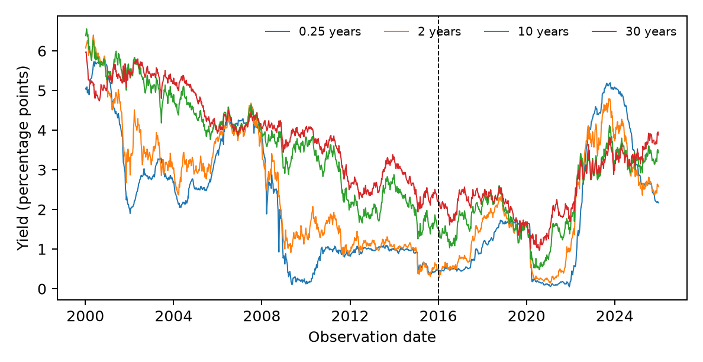
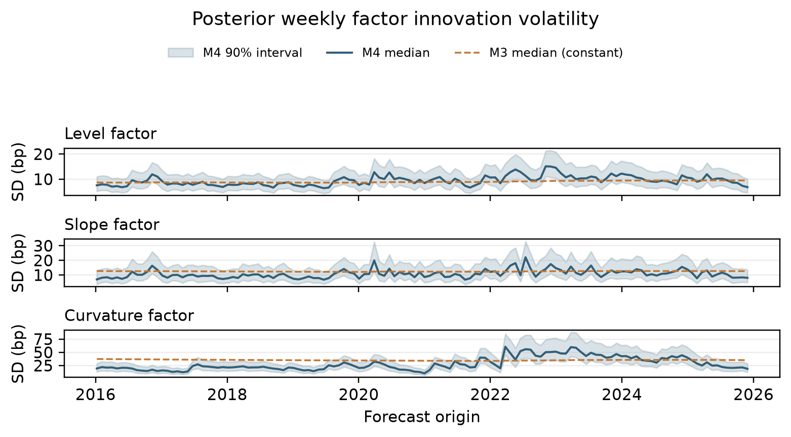
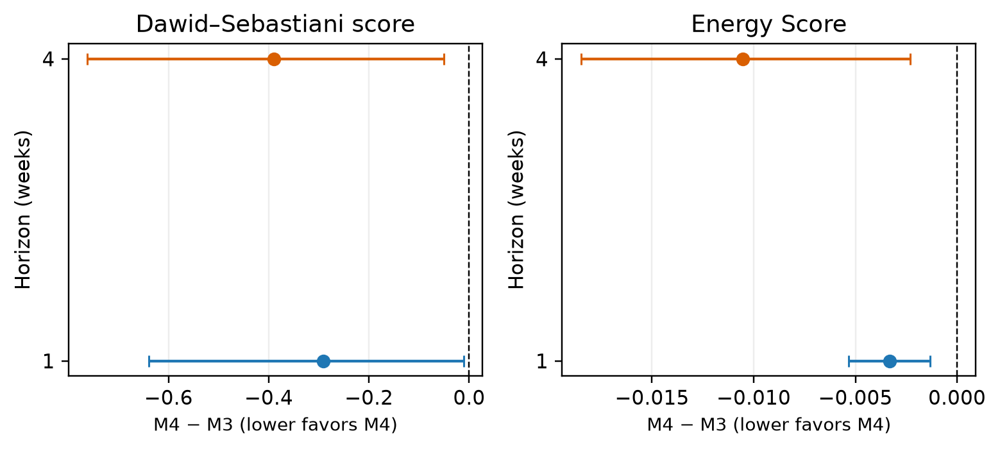
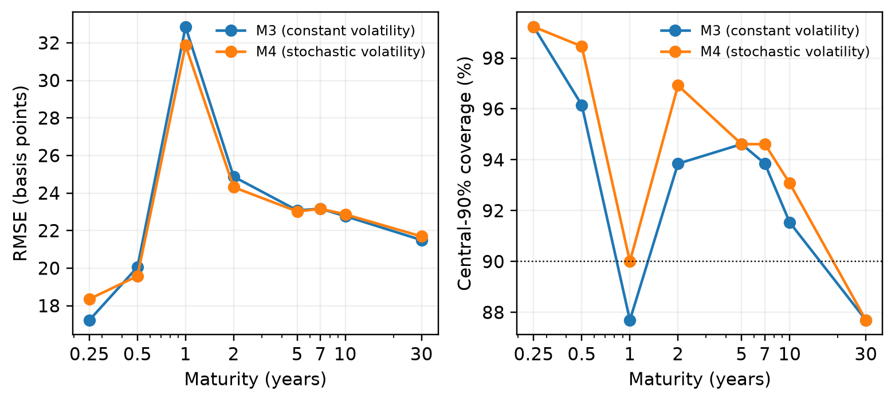

---
format:
  pdf:
    documentclass: scrreprt
    pdf-engine: lualatex
    keep-tex: true
    lof: true
    lot: true
    toc: false
    number-sections: true
fontsize: 12pt
papersize: letter
geometry: margin=1in
linestretch: 1.0
toc-depth: 1
bibliography: ../references.bib
csl: apa.csl
link-citations: true
colorlinks: false
header-includes:
  - |
    \usepackage{chngcntr}
    \counterwithout{equation}{chapter}
    \counterwithout{footnote}{chapter}
    \setkomafont{disposition}{\normalfont\bfseries}
    \RedeclareSectionCommand[beforeskip=0pt,afterskip=1.2\baselineskip]{chapter}
    \setlength{\emergencystretch}{3em}
    \let\MRPListFigures\listoffigures
    \let\MRPListTables\listoftables
    \renewcommand{\listoffigures}{}
    \renewcommand{\listoftables}{}
execute:
  enabled: false
---

```{=latex}
\begin{titlepage}
\centering
\vspace*{1cm}
{\Large\bfseries Probabilistic Forecasting of Canadian Government Yields:\par}
\vspace{0.4cm}
{\Large\bfseries A Bayesian Stochastic-Volatility Extension of Dynamic Nelson--Siegel\par}
\vspace{1.6cm}
{\large Author: Ethan Yao\par}
\vspace{0.7cm}
October 2026\par
\vspace{0.7cm}
Supervisor: Greg Rice\par
\vfill
A project\par
In partial fulfilment of the requirement for\par
Master of Quantitative Finance\par
University of Waterloo\par

\end{titlepage}
\pagenumbering{roman}
\chapter*{Abstract}
\addcontentsline{toc}{chapter}{Abstract}
```

This study investigates whether stochastic factor volatility improves probabilistic forecasts of Canadian government yields. Using weekly yields at eight maturities, we compare Bayesian two-step Dynamic Nelson–Siegel forecasts with constant and stochastic factor volatility at 130 common expanding-window origins over 2016–2025. Stochastic volatility DNS places a bounded prior on stationary log-volatility variance; under the stated priors, this yields finite posterior-predictive moments at finite horizons, so the predictive covariance used in DSS exists.

Relative to constant volatility, stochastic volatility improves mean DSS and Energy Score at both one and four-week horizons. At four weeks, its Energy Score is 2.52% lower, while pooled RMSE falls by only 0.162 basis points and the 95% paired interval includes zero. The random walk performs better than either Bayesian model on aggregate DSS, Energy Score and RMSE. The results therefore indicate a modest probabilistic-forecasting gain from stochastic volatility within the matched DNS pair, not general predictive dominance. Because the historical vintage and publication lag do not provide real-time information sets, the findings are retrospective observation-time comparisons.

```{=latex}
\clearpage
\chapter*{Acknowledgements}
\addcontentsline{toc}{chapter}{Acknowledgements}
```

I am grateful to my supervisor, Greg Rice, for his guidance and feedback throughout this project. I acknowledge the Bank of Canada as the source of the Canadian zero-coupon yield-curve data.

```{=latex}
\clearpage
\setcounter{tocdepth}{0}
\tableofcontents
\setcounter{tocdepth}{2}
\clearpage
\MRPListTables
\clearpage
\MRPListFigures
\clearpage
\pagenumbering{arabic}
```

# Introduction {#sec-introduction}

## Motivation and research problem

The term structure of interest rates describes the relationship between government bond yields and their maturities, providing a fundamental representation of interest-rate conditions across investment horizons. Movements in the yield curve are rarely uniform: changes in monetary policy expectations, inflation uncertainty, and macroeconomic conditions may affect short, intermediate, and long-term yields differently. For fixed-income portfolios, these movements translate into changes in bond valuations and risk exposures that depend not only on the magnitude of individual yield changes but also on their dependence across maturities. Consequently, effective interest-rate risk measurement requires more than forecasts of individual yields; it requires a coherent representation of the joint distribution of future yield-curve movements.

The Dynamic Nelson–Siegel (DNS) model represents the yield curve using three factors: level, slope, and curvature. By reducing the dimensionality of the term structure, DNS offers a tractable framework for modeling yield dynamics and generating forecasts across maturities. The dynamic forecasting approach developed by @diebold2006forecasting provides the foundation for this study. However, conventional DNS specifications typically assume constant factor-innovation variances, potentially limiting their ability to represent changes in predictive uncertainty across different interest-rate environments. In particular, periods of market instability may be associated with substantially different volatility conditions from those observed during more stable periods.

To address this limitation, this paper investigates a Bayesian stochastic-volatility extension of the DNS framework, motivated by the existing literature on stochastic-volatility yield-curve modeling, including @hautsch2012bayesian. The proposed approach retains the conventional two-step DNS factor extraction procedure while introducing time-varying stochastic volatility into the subsequent factor dynamics. Bayesian inference provides a framework for estimating these volatility processes and generating posterior-predictive distributions of future yield curves. The objective is not to develop a new term-structure model, but to examine whether a computationally tractable extension of established methods can improve the representation of yield-curve uncertainty.

The central research question is whether incorporating Bayesian stochastic volatility into DNS factor dynamics improves out-of-sample probabilistic forecasts of Canadian government yields relative to constant-volatility DNS specifications and conventional forecasting benchmarks. The distinction between point forecasting and probabilistic forecasting is central to this investigation. Models with similar conditional mean forecasts may produce substantially different predictive variances, covariance structures, and tail behavior. Moreover, accurately reconstructing the observed yield curve does not necessarily imply that a model can adequately characterize the uncertainty surrounding its future evolution.

Accordingly, the empirical analysis emphasizes the quality of joint predictive distributions rather than point-forecast accuracy alone. Forecast performance is evaluated primarily through the multivariate Gaussian quasi-likelihood, expressed as the Dawid–Sebastiani Score, which assesses predictive means and covariance matrices. The Energy Score provides a complementary assessment of the broader multivariate predictive distribution, while prediction-interval coverage and root mean squared error offer additional calibration and point-forecast diagnostics. Using Canadian government yield data, the study examines whether explicitly modeling stochastic factor volatility produces measurable improvements in forecast uncertainty and whether such improvements remain meaningful relative to simpler forecasting alternatives.

## Contribution and scope

This paper focuses on improving probabilistic yield-curve forecasting within the DNS framework by introducing Bayesian stochastic volatility into the factor dynamics. The study extends the conventional DNS approach to examine whether modeling time-varying factor volatility provides a better representation of forecast uncertainty. The main comparison is between Bayesian DNS with constant factor volatility and Bayesian DNS with stochastic factor volatility. Both models share the same extracted factors, coefficient priors, forecast dates, and yield reconstruction-error treatment, allowing the effect of stochastic volatility to be evaluated within a consistent framework. The prior specifications also preserve a common interpretation of long-run factor innovation variance, while the bounded volatility prior ensures that the required finite-horizon predictive moments exist under the stated model.

The empirical analysis uses Canadian government yield curves across 130 common out-of-sample forecast origins at one- and four-week horizons. The results suggest that introducing stochastic volatility modestly improves joint probabilistic forecasting within the Bayesian DNS framework, although improvements in point-forecast accuracy remain uncertain. Conventional forecasting methods, including the random walk, PCA–VAR, and two-step Diebold–Li models, are included as external benchmarks to place these findings in context, rather than as separate methodological contributions. The random walk remains stronger on aggregate forecasting metrics, highlighting the difficulty of improving yield forecasts at short horizons.

The scope of this study is limited to evaluating probabilistic forecasts within the DNS framework. It does not aim to establish that Bayesian DNS models consistently outperform conventional forecasting approaches. Further extensions, including joint Bayesian state-space estimation and longer forecasting horizons, are left for future research.

## Organization

@sec-literature motivates the representation and scores. @sec-data defines the historical panel and information set. @sec-methods specifies the forecasting models and finite-moment prior. @sec-design describes the evaluation and inference procedures. @sec-results reports empirical comparisons; @sec-discussion interprets their scope and limitations, followed by conclusions. Appendices provide derivations and classical robustness results.

# Literature and conceptual framework {#sec-literature}

## DNS representation and conventional factor forecasting

The DNS framework separates the cross-sectional representation of the yield curve from the time-series dynamics of its factors. @diebold2006forecasting estimates level, slope and curvature factors using fixed Nelson–Siegel loadings, then forecasts those factors with autoregressions. Its reported gains are more pronounced at a one-year horizon than at one month, underscoring that performance depends on the forecasting horizon. The conventional two-step DNS model provides the foundation for the present comparison.

The factors are interpreted through their maturity loadings: level loads equally at every maturity, slope is strongest at short maturities and approaches zero at long maturities, and curvature has a hump-shaped loading. These labels describe the loading patterns; they do not establish factor stationarity, cointegration or economic identification. Factor extraction alone does not specify a predictive distribution; assumptions about factor dynamics and innovations are also required.

PCA–VAR provides a secondary external comparison because its basis is estimated from yield variation rather than imposed by the DNS loading functions. Its factors need not share DNS's economic interpretation. Differences between PCA–VAR and DNS can reflect the representation, dynamics, covariance restrictions or parameter uncertainty, and therefore do not isolate the contribution of stochastic volatility.

## Bayesian inference for DNS

Bayesian DNS retains the two-step factor representation while assigning probability distributions to factor-dynamic parameters. Posterior-predictive forecasts integrate over parameter uncertainty, unlike the plug-in forecasts of classical DNS. A constant-volatility Bayesian specification is a useful control: it preserves the DNS loadings and factor AR(1) mean structure while providing a direct comparison for a stochastic-volatility extension.

The present models are two-step approximations. Extracted factors are treated as observations in the second-stage Bayesian analysis, so uncertainty in factor extraction and the fixed decay parameter is not fully propagated. The results consequently concern Bayesian inference conditional on the estimated factor representation, not a fully joint latent-factor model.

## Stochastic factor volatility

Stochastic-volatility DNS extends the constant-variance factor model by allowing the log innovation variance to evolve over time. @hautsch2012bayesian studies Bayesian stochastic volatility in monthly U.S. yield factors and reports persistent factor volatility; @caldeira2010bayesian examines common and factor-specific volatility structures for futures and Treasury yields. These studies motivate allowing uncertainty to change across market conditions, but they do not establish that the extension improves weekly Canadian yield forecasts. @omori2007stochastic provides a mixture-based approach to stochastic-volatility inference. The current model uses a no-leverage restriction and evaluates the incremental forecasting value of time-varying factor volatility within the same two-step DNS framework.

The central comparison holds the factor extraction, factor AR mean structure, coefficient priors, reconstruction-error treatment, forecast dates and evaluation criteria fixed. It changes the factor innovation-variance specification from constant to stochastic. This controlled comparison is informative about that extension under the stated assumptions, but it is not a causal effect separated from all differences in the resulting volatility priors and predictive distributions.

## Probabilistic forecast evaluation

Proper scoring rules motivate evaluating predictive distributions rather than point forecasts alone [@gneiting2007strictly]. The Dawid–Sebastiani Score (DSS), introduced by Dawid and Sebastiani [@dawid1999coherent], assesses the predictive mean and covariance, while the Energy Score evaluates simulated multivariate yield vectors. DSS cannot distinguish predictive distributions with identical first and second moments; the Energy Score supplies complementary information but is not a guarantee of correct tail dependence. The Variogram Score emphasizes pairwise cross-maturity contrasts [@scheuerer2015variogram]. These scores complement marginal interval coverage and point-forecast RMSE.

The score comparisons remain subject to finite-sample and temporal-dependence uncertainty. @hansen2011model introduces the Model Confidence Set as one approach to forecast comparisons when predictive ability is difficult to distinguish. Here it is reported only for the conventional M0–M2 comparison; inference for the Bayesian pair uses paired stationary-bootstrap intervals. Neither procedure establishes universal model superiority.


# Data and information sets {#sec-data}

## Source and provenance

The primary source is the Bank of Canada's public zero-coupon yield-curve series [@bocdata]. Its source page describes daily curves derived from Government of Canada bonds and treasury bills, a quarterly maturity grid from 0.25 through 30 years, decimal yield units, missing observations marked `na`, and a typical two-week update lag. These are estimated curves rather than a panel of directly traded zero-coupon security prices at all maturities. The Bank identifies @bolder2004canadian as the methodology reference.

The supplied raw Canadian CSV is preserved separately from the processed weekly panel. Its original retrieval transaction is not authenticated, and the historical vintage may contain revisions. A separate official-endpoint check found exact agreement for the eight maturities on 21 complete December 2015 dates; this checks only that slice, not the entire historical panel. Source evidence is retained under `docs/sources/`; `src/prepare_data.py` defines the processor.

## Cleaning, units and weekly sampling

The selected maturity grid is $(0.25,0.5,1,2,5,7,10,30)$ years. Headers are stripped of leading spaces; dates are parsed and checked for uniqueness. A daily observation is eligible only if all eight selected yields are present. The processor converts decimal yields to percentage points by multiplying by 100 and selects the last eligible observation in each ISO calendar week. This is neither averaging nor interpolation.


The research sample excludes the weekly observation dated 31 December 1999 and all dates in 2026. It contains 1,356 weekly observations: 835 through the end of 2015 and 521 in 2016–2025. @tbl-data summarizes this restricted sample. All scores use percentage-point units; hence 0.01 percentage points equals one basis point. Comparisons use identical units across models. Changing units shifts determinant-based scores and rescales distance-based scores.



{#fig-history width=95%}

## Forecast dates and calendar interpretation

Forecast horizons count weekly observations, not a fixed number of trading days. Every fourth weekly observation in the out-of-sample period is considered as an origin. An origin is retained only if both its one- and four-observation-ahead targets lie in 2016–2025. This gives 130 common origins, from 8 January 2016 to 28 November 2025. The otherwise candidate observation near the end of December 2025 is excluded because its four-week target is outside the sample.

Public holidays can change the weekday and elapsed calendar time between observations without changing the weekly index. No interval between successive observations exceeds ten calendar days. Accordingly, a four-week forecast denotes four steps ahead in the weekly sample; its target date follows from the observed calendar rather than a fixed 28-day interval.

## Observation-time versus publication-time information

The experiments fit models only to observations dated no later than the origin. Lambda selection also uses only the initial training sample. This prevents future-dated observation leakage within the supplied historical panel. It does **not** establish a real-time forecasting design.

The Bank's typical two-week publication lag means a curve dated $t$ would not normally be publicly available at $t$. The later historical vintage also leaves revision uncertainty. These are therefore **retrospective observation-time forecasts**, not operational forecasts under the public release-time information set. A real-time backtest needs dated releases or a justified availability-lag rule; a fixed lag alone cannot resolve revision uncertainty. No result is interpreted as executable historical trading performance.

# Model specifications {#sec-methods}

## Nelson–Siegel observation equation

Let $Y_t$ be the eight-dimensional yield vector and $f_t=(L_t,S_t,C_t)'$ the factors. For maturity $\tau$ in years define

$$
s(\tau;\lambda)=\frac{1-e^{-\lambda\tau}}{\lambda\tau},
\qquad c(\tau;\lambda)=s(\tau;\lambda)-e^{-\lambda\tau}.
$$ {#eq-loadings}

The row of the loading matrix at $\tau$ is $(1,s,c)$. Level loads equally at all maturities, slope declines toward zero at longer maturities, and curvature has a hump-shaped loading. The observation equation is

$$
Y_t=\Lambda(\lambda)f_t+\varepsilon_t,
\qquad \varepsilon_t\sim N(0,R_t).
$$ {#eq-observation}

The decay rate has units of inverse years; it is not a monthly autoregressive parameter. A grid search over 160 values from 0.05 through 2.0 inverse years minimizes initial-window cross-sectional squared error. The selected value, 0.516038 inverse years, is fixed throughout the forecast exercise.

At each date the two-step factor estimator is

$$
\widehat f_t=(\Lambda'\Lambda)^{-1}\Lambda'Y_t.
$$ {#eq-extraction}

The factor estimator is obtained by least squares rather than by explicitly forming the inverse. The maturity-specific diagonal of $R_t$ is the origin-specific mean squared reconstruction error, floored at $10^{-6}$ squared percentage points. This parsimonious reconstruction-error model is shared across specifications; it does not imply that actual residual errors are independent.

## Conventional two-step DNS

M2 fits a separate Gaussian AR(1) mean equation to each extracted factor:

$$
f_{j,t+1}=a_j+b_j f_{j,t}+\eta_{j,t+1},
\quad \eta_{j,t+1}\sim N(0,q_j).
$$ {#eq-ar}

For the classical benchmark the fitted intercept and slope are unrestricted least-squares estimates. Conditional on fitted parameters, factor forecast moments are

$$
 m_{j,h}=b_j^h f_{j,t}+a_j\sum_{k=0}^{h-1}b_j^k,
\qquad v_{j,h}=q_j\sum_{k=0}^{h-1}b_j^{2k}.
$$ {#eq-ar-moments}

The yield covariance is $\Lambda\operatorname{diag}(v_h)\Lambda'+R_t$. Parameter uncertainty is not added to this classical plug-in forecast. Factor innovation independence is an explicit restriction; PCA–VAR instead estimates a full covariance for its three factor innovations.

## Bayesian constant-volatility DNS

M3 is the primary control. It retains the factor AR(1) mean equation and assumes a constant innovation variance $\exp(m_j)$. Its coefficient prior is

$$
(a_j,b_j)'\sim N\!\left((0,0.7)',\operatorname{diag}(25,0.09)\right),\qquad |b_j|<1.
$$ {#eq-coefficient-prior}

Here $b_j$ controls factor persistence. The restriction $|b_j|<1$ is consistent with the stationary AR(1) specification. Before truncation, its prior is centered at 0.7 with standard deviation 0.3, allowing a broad range of moderately persistent dynamics. These choices are inherited modeling assumptions, not parameters selected using test scores.

The constant innovation variance has the prior

$$
m_j\sim N(\mu_{0j},25).
$$ {#eq-constant-variance-prior}

The parameter $m_j$ is the log of the long-run expected factor innovation variance. The center $\mu_{0j}$ is calibrated from factor residual variances in the initial 835-observation training sample and held fixed across expanding windows. The same interpretation and calibration are used in both Bayesian specifications. A standard deviation of five on the log-variance scale is deliberately broad. Because the initial observations calibrate the prior and also enter the likelihood, this is an empirical-Bayes choice rather than independent prior elicitation. Posterior-predictive simulation averages over parameter draws, propagates future factor innovations and adds the common reconstruction error, incorporating second-stage parameter uncertainty omitted by classical M2.

## Bayesian DNS with stochastic factor volatility

The main extension, M4, changes the factor innovation variance while retaining the same factor extraction, maturity loadings, AR(1) mean structure, coefficient priors, long-run expected-variance interpretation and reconstruction-error treatment as M3:

$$
f_{j,t}=a_j+b_j f_{j,t-1}+\eta_{j,t},
\qquad \eta_{j,t}\mid h_{j,t}\sim N(0,e^{h_{j,t}}),
$$ {#eq-sv-factor}

$$
h_{j,t}=\omega_j+\phi_j(h_{j,t-1}-\omega_j)+u_{j,t},
\qquad u_{j,t}\sim N(0,\sigma_{u,j}^2).
$$ {#eq-sv-state}

The latent state $h_{j,t}$ allows the factor innovation variance to change over time. Its persistence parameter has the transformed prior

$$
\frac{\phi_j+1}{2}\sim\operatorname{Beta}(20,1.5),
\qquad E[\phi_j]=2\frac{20}{21.5}-1\approx0.86.
$$ {#eq-volatility-persistence-prior}

This transformation restricts $\phi_j$ to $(-1,1)$, and the prior favors persistent log volatility, a common feature of financial volatility processes. The particular Beta hyperparameters remain modeling choices.

To match the interpretation of $m_j$ across M3 and M4, let $v_j$ be the stationary variance of log volatility and set

$$
\omega_j=m_j-v_j/2,\qquad \sigma_{u,j}^2=v_j(1-\phi_j^2),\qquad
h_{j,1}\sim N(\omega_j,v_j).
$$ {#eq-finite-reparam}

Then, under the stationary log-volatility process,
$E[\exp(h_{j,t})\mid m_j,\phi_j,v_j]=\exp(m_j)$. The models share a prior interpretation for long-run expected innovation variance, but not their full predictive distributions: M4 additionally allows volatility to vary over time.

For $v_j$, the main specification uses a rate-one exponential prior truncated to $(0,U)$:

$$
p_U(v_j)=\frac{e^{-v_j}}{1-e^{-U}}\,1_{(0,U)}(v_j),
\qquad U=4.
$$ {#eq-finite-prior}

The bound restricts stationary log-volatility variance to below four, or its standard deviation to below two; it does not bound realized volatility itself. The exponential density places more mass on smaller $v_j$, regularizing toward constant volatility. An untruncated rate-one exponential would place $e^{-4}\approx1.83\%$ probability above four. Initial-window log-squared OLS residual variances are approximately 4.87, 5.67 and 5.91, compared with about 4.935 for the $\log(\chi_1^2)$ noise variance. This is only a rough plausibility check for latent variances of order one or smaller, not a fitted stochastic-volatility variance estimate or evidence that $U=4$ is optimal. The bound is a modeling assumption; $U=2$ and $U=8$ are evaluated at three representative origins only.

The bounded $v_j$ prior and stated proper priors imply finite posterior-predictive moments at each finite forecast horizon; the appendix gives the argument. In particular, the predictive covariance needed for DSS exists under these assumptions. This result does not guarantee realistic uncertainty forecasts or good calibration, and finite-horizon moments do not establish finite unconditional stationary factor variance after mixing over coefficients arbitrarily close to a unit root.

Posterior-predictive simulation propagates the factor and log-volatility states at each future weekly step and adds the common reconstruction error:

$$
Y_{t+h}^{(s)}=\Lambda f_{t+h}^{(s)}+\varepsilon_{t+h}^{(s)},
\qquad \varepsilon_{t+h}^{(s)}\sim N(0,\widehat R_t).
$$ {#eq-predictive}

The two-step method treats extracted factors as observations, so it does not fully propagate first-stage factor-extraction or fixed-$\lambda$ uncertainty. Inference uses a Metropolis-corrected mixture sampler targeting the exact likelihood, following @omori2007stochastic.

## Conventional forecasting benchmarks

M0, the essential external benchmark, sets the future mean equal to the current yield curve. At horizon $h$, its covariance is the sample covariance of overlapping historical $h$-step yield changes within the expanding window. It is a zero-drift mean specification; covariance eigenvalues follow the fixed training-only floor.

M1 provides secondary external context. It centers the expanding yield panel, estimates its first three principal components, and fits a VAR(1) with an intercept to their scores. For score dynamics $g_{t+1}=d+Ag_t+v_{t+1}$ with innovation covariance $Q$, the recursive forecast is

$$
m_{k+1}=d+Am_k,\qquad V_{k+1}=AV_kA'+Q,
\quad m_0=g_t,\ V_0=0.
$$ {#eq-var-forecast}

The yield mean adds the training center to the basis-projected score mean; the covariance adds diagonal cross-sectional reconstruction error. The PCA basis and VAR are refitted at every origin, and finite-horizon forecasts do not impose a stationarity restriction on the estimated VAR.

| Model | Specification | Role in evaluation |
|---|---|---|
| M0 | Yield random walk; historical-change covariance | Essential external benchmark |
| M1 | Three PCA factors with VAR(1) | Secondary external benchmark |
| M2 | Two-step DNS; independent Gaussian AR(1) factors | Conventional DNS benchmark |
| M3 | Bayesian two-step DNS; constant factor volatility | Primary control |
| M4 | Bayesian two-step DNS; finite-moment stochastic factor volatility | Main extension |

: Forecasting specifications and their roles in the comparison. {#tbl-ladder}

# Experimental design and evaluation {#sec-design}

## Expanding-window design

All models are evaluated on the same target curves and at the same two horizons. Factor extraction, PCA centering, dynamics, residual covariance and regularization use only observations dated no later than each forecast origin. The initial 2000–2015 window selects $\lambda$, and the scoring period is 2016–2025. Common origins ensure comparisons use the same interest-rate episodes.

The classical benchmarks yield 780 model–horizon–origin forecasts, with predictive means and covariances computed analytically and 1,024 Gaussian scenarios used for ensemble scores. The Bayesian comparison yields 520 forecasts: 130 origins, two horizons and two models. Each Bayesian fit uses four chains, 3,000 warm-up iterations and 6,000 retained draws per chain, followed by 2,048 posterior-predictive scenarios per model–horizon–origin.

Bayesian means and covariances use conditional analytic factor moments averaged over posterior draws, including between-draw variation in conditional means. Yield covariance adds the common reconstruction covariance. Ensemble simulation propagates each future volatility and factor step. This reduces moment-estimation noise without replacing the non-Gaussian predictive scenarios used for Energy Score and intervals.

## Mean–covariance and Gaussian log scores

For error $e=Y_{t+h}-\widehat\mu_{t,h}$ the primary score is

$$
\operatorname{DSS}=\log|\widehat\Sigma|+e'\widehat\Sigma^{-1}e.
$$ {#eq-dss}

Smaller is better. Computation uses a Cholesky factor, triangular solves and a log determinant rather than a direct inverse. Positive-definite covariance is essential. If $\Sigma$ is nearly singular, small errors in maturity contrasts can generate large quadratic terms; a low-dimensional fit alone does not guarantee a good DSS.

For an eight-dimensional Gaussian forecast the negative log density is

$$
-\log p(Y)=\tfrac12\{8\log(2\pi)+\operatorname{DSS}\}.
$$ {#eq-logscore}

For Gaussian classical forecasts this transformation is a negative log density. For Bayesian mixtures it is only a Gaussian moment-based quasi-log score, not an exact mixture log predictive density. This paper therefore interprets DSS as a mean–covariance score and does not infer a full mixture density ranking from it.

## Ensemble and marginal evaluation

For predictive draws $X^{(m)}$ and target $y$, the Energy Score estimate is

$$
\widehat{ES}=\frac1M\sum_{m=1}^M\|X^{(m)}-y\|
-\frac{1}{M(M-1)}\sum_{m<n}\|X^{(m)}-X^{(n)}\|.
$$ {#eq-energy}

The second term uses distinct draw pairs. This Monte Carlo estimator targets the distributional Energy Score under independent predictive simulation, rather than the finite-ensemble plug-in convention with an $M^2$ denominator. Both classical and Bayesian forecasts use the distinct-pair convention, although their scenario counts differ and therefore their Monte Carlo precision is not identical. Independent-seed checks at representative origins assess Bayesian predictive stability; the time-series bootstrap does not integrate MCMC or scenario-simulation uncertainty.

Classical marginal central 90% intervals use analytic Gaussian quantiles. Bayesian intervals use the 5th and 95th percentiles of saved mixture scenarios, not normal intervals reconstructed from the DSS covariance. Coverage is pooled across maturities descriptively, while inference resamples whole origins. Coverage is marginal, not simultaneous eight-dimensional curve coverage. The classical Variogram Score and PIT plots remain supplementary diagnostics; no new Bayesian Variogram Score or formal PIT test is claimed.

Pooled RMSE is the square root of mean squared error across origins and maturities, not the average of origin-level root mean squared errors. MAE is the pooled mean absolute error. Percentages and percentage-point quantities are kept distinct.

## Inference and computational diagnostics

The primary comparison is the paired M4-minus-M3 score difference at each common origin; lower DSS and Energy Score are better. We use a stationary bootstrap [@politis1994stationary] with 9,999 replicates, an expected block length of eight forecast origins and 95% percentile intervals. Expected block lengths of four and twelve assess sensitivity to the dependence assumption. Geometrically distributed blocks preserve local temporal dependence; block length is measured in forecast origins, not weeks.

Each resampled index vector selects both models, all maturities and the same observed origins. RMSE is recomputed from resampled squared errors before forming a difference. Thus an interval is not a bootstrap of already-rooted origin errors, nor does it treat maturities as independent dates. The stationary resampling scheme assumes the observed loss dependence is informative about comparison uncertainty; structural change in a decade-long rate sample is an important limitation. Intervals are descriptive, unadjusted for multiple metrics or horizons, and do not establish a population-wide model ranking.

Four-chain convergence is assessed using rank-normalized split $\widehat R\leq1.01$ and bulk and tail effective sample sizes of at least 400 [@vehtari2021rank]. Synthetic recovery and independent-seed checks at initial, stress and late windows assess sampler and predictive stability. At every origin, predictive covariances are checked for positive definiteness and forecast scores are reconstructed from the stored moments and scenarios. These checks assess numerical reliability, not the economic adequacy of the model.

For M0–M2, we report HAC summaries and a restricted Model Confidence Set. That comparison has a different model universe and resampling specification from the primary M3–M4 analysis.

# Empirical results {#sec-results}

## Forecast sample and diagnostics

The rolling evaluation contains 130 common origins and 520 Bayesian model–horizon forecasts. The maximum rank-normalized $\widehat R$ is 1.00760; the minimum bulk and tail effective sample sizes are 1,034.3 and 1,969.3. The conventional benchmarks use the same origins.

## Primary four-week comparison



At four weeks, stochastic-volatility M4 improves mean DSS from −21.450 to −21.840 and Energy Score from 0.4178 to 0.4073 relative to constant-volatility M3. The paired M4-minus-M3 differences are −0.3899 for DSS and −0.01053 for Energy Score; the latter is a 2.52% reduction from M3's mean score. The point-forecast change is smaller: pooled RMSE falls from 23.577 to 23.415 basis points, a difference of −0.162 with a 95% interval of [−0.464, 0.151]. Thus the main gain is in distributional scores rather than clearly improved point accuracy.

The volatility estimates in @fig-factor-volatility illustrate the time-varying uncertainty represented by M4. The figure reports posterior estimates of terminal weekly factor innovation standard deviations at each forecast origin, not direct observations of volatility. The curvature-factor median rises sharply in 2022, reaches 60.6 basis points on 25 March 2022 and remains near that level in early 2023 before declining. Level and slope volatility also rise around 2022, but less markedly.

{#fig-factor-volatility width=95%}

## One-week comparison



At one week, M4 reduces DSS by 0.291 and Energy Score by 0.00331, about 1.29% of M3's mean Energy Score. The RMSE difference is +0.0064 basis points and is not distinguishable from zero. The within-pair score changes therefore have the same direction at both horizons, with a larger Energy Score gain at four weeks.

```{=latex}
\clearpage
```

## Paired uncertainty, calibration and maturity patterns



The paired DSS and Energy Score intervals exclude zero in favor of M4 at both horizons for the primary expected block length of eight origins. RMSE and coverage-difference intervals contain zero. These are paired time-series comparisons, not tests treating the 1,040 maturity–origin cells as independent observations. At four weeks, the DSS interval is [−0.762, −0.051] and the Energy Score interval is [−0.0185, −0.0023].

{#fig-finite-paired width=95%}



The score intervals remain below zero at expected block lengths four and twelve. This supports the direction of the within-pair result under these dependence assumptions, but does not remove uncertainty about structural breaks, finite-sample bootstrap accuracy or multiple comparisons. The one-week DSS upper endpoint is close to zero and should not be overstated.

At four weeks, M3's pooled marginal 90% coverage is 93.08% and M4's is 94.33%. M4 therefore moves farther above the nominal rate, not closer to it. The coverage difference of 1.25 percentage points has a 95% interval containing zero. Mean interval width rises slightly, from 92.143 to 92.719 basis points. At one week, coverage is 94.42% for M3 and 94.71% for M4, with widths of 52.580 and 52.709 basis points. Both models overcover in this pooled sense; improved proper scores do not imply better marginal calibration or narrower forecasts.

{#fig-finite-maturity width=95%}

At four weeks, one-year coverage rises from 87.69% under M3 to 90.00% under M4, while 30-year coverage is 87.69% for both. RMSE changes unevenly across maturities: M4 improves the one-year component but worsens the three-month component. The pooled result is therefore not a uniform maturity-by-maturity improvement.

## External benchmark comparison

The random walk M0 remains stronger than both Bayesian DNS models on reported aggregate DSS, Energy Score and RMSE at both horizons. At four weeks it has DSS −36.006, Energy Score 0.351 and RMSE 21.318 basis points, compared with M4's 0.407 and 23.415 basis points for the latter two measures. Its marginal coverage is lower (87.12%) and its average interval is narrower (63.37 versus 92.72 basis points), so lower scores do not imply uniformly better calibration. PCA–VAR M1 also has lower four-week DSS, Energy Score and RMSE than the Bayesian pair; M2 is the conventional DNS reference. These external rankings are descriptive; paired inference is conducted for M3 versus M4, not for all five specifications.

## Prior-bound sensitivity

We evaluated $U=2$ and $U=8$ at the initial (8 January 2016), stress (27 March 2020) and late (28 November 2025) origins. Constant-volatility M3 is unchanged in these comparisons. This sensitivity analysis is distinct from the block-length checks and covers three representative origins, not all 130.



At four weeks, changing the bound moves DSS by at most 0.00812 relative to the main $U=4$ forecasts. M4 has lower DSS initially but loses to M3 at the stress and late origins. At one week, M3 has lower DSS at all three representative dates under both alternative bounds. The positive full-sample average result is therefore not a uniform improvement.

Energy Score rankings also change with the bound. At the late four-week origin, the M4-minus-M3 difference is +0.0010 for $U=4$, −0.0123 for $U=2$ and −0.0074 for $U=8$. These representative cases support local DSS stability, not uniform Energy Score improvement or full-period prior robustness. No 130-origin comparison under alternative bounds was performed, and the bound was not retuned.

# Discussion and limitations {#sec-discussion}

## What stochastic volatility adds

The evidence answers a narrow but useful question. Conditional on the shared two-step DNS representation, coefficient priors, long-run expected-variance interpretation and reconstruction model, M4 improves both covariance-sensitive DSS and ensemble-based Energy Score relative to M3. Agreement between these criteria is more informative than DSS alone because Energy Score uses simulated curve distances, while DSS depends only on first and second moments. It does not establish that all aspects of joint tail dependence are well represented.

At the primary four-week horizon, a 2.52% Energy Score reduction is a modest distributional improvement, not a large change in point accuracy. Time-varying uncertainty can adapt forecasts while mean dynamics remain nearly unchanged. This mechanism is consistent with the score and RMSE pattern, but the experiment does not isolate a causal contribution from particular episodes or factors.

## Why the random walk remains competitive

At both horizons, the random walk has lower aggregate DSS, Energy Score and RMSE than stochastic-volatility M4. Its RMSE is 9.972 basis points at one week and 21.318 at four weeks, versus 13.883 and 23.415 for M4; its four-week Energy Score is 0.351 versus 0.407. Its four-week marginal 90% coverage is lower (87.12% versus 94.33%), however, and its mean interval is narrower (63.37 versus 92.72 basis points). The lower scores therefore do not imply uniformly better calibration.

Several design features could contribute, though the experiment does not isolate their effects. The random walk forecasts each yield from its latest value and estimates the eight-dimensional covariance directly from historical changes, avoiding short-run mean estimation while retaining observed cross-maturity co-movement. DNS instead uses a fixed three-factor representation, factor AR dynamics, independent factor innovations and diagonal reconstruction noise. These restrictions may miss movements outside the factor span or in low-variance maturity contrasts. Stochastic volatility adapts uncertainty but does not relax these restrictions, so need not eliminate the associated forecast error.

Limited short-horizon predictability is one possible explanation, but it is not directly tested. PCA–VAR also outperforms M4 on four-week DSS, Energy Score and RMSE, so the external advantage is not specific to the random-walk design. The paired bootstrap compares M4 only with M3; external rankings are descriptive, not tests of superiority over the random walk.

## Model and prior limitations

Factors are extracted in a first stage and treated as observations thereafter; uncertainty in extraction and in the fixed training-selected decay rate is omitted. Independent factor innovations and diagonal reconstruction noise restrict the predictive dependence structure. Although forecasts are joint, these restrictions do not provide a fully flexible eight-dimensional distribution. They can matter especially for DSS in low-variance curve directions.

The finite-moment prior is an explicit change from an unrestricted innovation-variance prior, not a purely numerical repair. Its bound is required for the stated moment argument and must be part of the scientific specification. Matching $m$ aligns stationary expected-variance priors, but does not match all higher moments. The broad empirical-Bayes prior and its use of training data in both hyperparameter calibration and the likelihood remain limitations. Because the alternative-bound analysis covers only three selected origins, it provides local rather than full-period sensitivity evidence.

Finite-horizon posterior-predictive moments do not establish finite unconditional stationary factor variance under a coefficient-prior mixture approaching $|b|=1$. In the synthetic exercise, the 95% interval for the intercept did not contain its generating value. This single replication is a computational diagnostic, not an assessment of repeated-sampling coverage. Convergence diagnostics also establish neither model truth nor the absence of all Monte Carlo error.

## Data, inference and practical implications

The observation-time experiment does not reconstruct real-time public information. Publication delays and possible historical revisions preclude an executable trading-performance interpretation. The existing assumed-delay classical robustness exercise supports only the limited historical-vintage conclusions reported in the appendix. A release-time Bayesian comparison is not performed.

There are only 130 forecast origins across changing interest-rate regimes. Stationary-bootstrap intervals are conditional descriptive evidence under the declared dependence design, without multiplicity correction or a model-confidence-set claim for the Bayesian pair. They do not include uncertainty from choosing the representation or priors, nor do they fully propagate numerical simulation uncertainty. Coverage is marginal and descriptive; no formal joint-calibration or tail-risk backtest is established.

For a researcher choosing between the two specified Bayesian DNS models, M4 offers a small probabilistic-score improvement over M3. For an applied forecaster choosing among the models studied here, the random walk remains the strongest benchmark. Additional computation and complexity should be justified by that external comparison, not merely by a favorable within-family score.

# Conclusions {#sec-conclusions}

A comparison at 130 common Canadian yield-curve forecast origins finds modest distributional value in finite-moment Bayesian stochastic volatility. M4 improves DSS and Energy Score over matched constant-volatility M3 at one and four weeks. At four weeks, the paired DSS difference is −0.390 and Energy Score difference −0.0105; their stationary-bootstrap intervals exclude zero, including under the block-length sensitivity checks.

The economic and statistical qualifications matter. The four-week RMSE gain is only 0.162 basis points and its interval includes zero. Both Bayesian models overcover pooled marginal 90% intervals, and M4 does not beat the random walk on the reported aggregate scores. The main finding is therefore a modest within-DNS probabilistic improvement, not general model dominance or evidence of deployable trading gains.

Future work should prioritize genuinely release-time data, extraction uncertainty and richer dependence or representation choices before optional risk applications. Broader prior robustness and inference across additional samples would assess how far the within-pair finding generalizes. The contribution is a bounded finite-moment comparison whose scope is deliberately limited to the matched Bayesian DNS pair; the random-walk result remains the stronger external benchmark.

```{=latex}
\appendix
```

# Analytical derivations and numerical checks {#sec-appendix}

## Least-squares factor extraction

For fixed $\lambda$, minimize $g(f)=(Y-\Lambda f)'(Y-\Lambda f)$. Differentiation gives $\partial g/\partial f=-2\Lambda'Y+2\Lambda'\Lambda f$. Setting the derivative to zero yields @eq-extraction when the three columns have full rank. Least squares avoids explicitly computing an inverse, which would be less stable if loadings were poorly conditioned.

As $x=\lambda\tau$ approaches zero, $(1-e^{-x})/x$ approaches one. The implementation uses `expm1` to avoid cancellation for small positive $x$. Curvature approaches zero at the short end. At long maturities both nonlevel loadings approach zero. These limits establish interpretation and basic sign checks; they do not identify factors econometrically without further assumptions.

## AR and VAR forecast moments

Repeated substitution gives $f_{t+h}=b^hf_t+a\sum_{k=0}^{h-1}b^k+\sum_{k=0}^{h-1}b^k\eta_{t+h-k}$. Taking expectations yields the mean in @eq-ar-moments. Independent zero-mean innovations eliminate cross terms, giving $q\sum b^{2k}$ for its variance. The finite-sum form remains well defined when a fitted slope is near one.

The matrix version replaces $b^k$ with $A^k$ and yields @eq-var-forecast. If the origin state has filtered covariance $P_t$, an additional term $A^hP_t(A^h)'$ appears, accounting for uncertainty in the initial state.

## Yield predictive covariance

For a fixed loading matrix and independent observation noise, $\operatorname{Var}(Y\mid\mathcal I_t)=\Lambda\operatorname{Var}(f\mid\mathcal I_t)\Lambda'+R_t$. Reconstruction uncertainty is added once at the future observation, not at every transition. In a Bayesian model, factor variance must include both conditional innovation uncertainty and dispersion in conditional means across posterior draws.

Estimating an eight-dimensional covariance from a small ensemble can add noise in low-variance directions. Analytic addition of $R_t$ to a factor-level posterior covariance is a useful stability check, but changing the estimator must be documented consistently. The classical forecasts avoid this issue through exact fitted moments.

## Finite-moment prior and transformed target

For one factor, let $n$ be the number of innovations and $e_t=h_t-\omega-\phi(h_{t-1}-\omega)$. With $\omega=m-v/2$ and $q=v(1-\phi^2)$, the stationary path density has log form

$$
\begin{aligned}
\log p(h\mid m,\phi,v)={}&-\frac n2\log(2\pi)-\frac n2\log v
-\frac{n-1}{2}\log(1-\phi^2)\\
&-\frac{1}{2v}\left[(h_1-m+v/2)^2+\frac{\sum_{t=2}^n e_t^2}{1-\phi^2}\right].
\end{aligned}
$$ {#eq-finite-path}

The initial observation contribution cannot be omitted. The sampler works in $\theta=(m,u,s)$ with $u=\operatorname{atanh}(\phi)$ and $s=\log v$. The independent-prior density gains Jacobian $\log(1-\phi^2)+s$. Equivalently, the determinant from these coordinates to $(\omega,\phi,q)$ is $v(1-\phi^2)^2$. The induced physical-coordinate prior is not a product of the old independent priors for $\omega$ and $q$.

At fixed $m,\phi,h$, the $v$ target contains $p_U(v)v^{-n/2}\exp[-A(v)/(2v)]$, where $A(v)$ is the bracketed term in @eq-finite-path and itself depends on $v$. Thus it is not the old inverse-gamma full conditional. Exact-target correction of the reversible mixture proposal retains both the transformed prior and this stationary density.

## Propriety and finite-horizon moments

Conditional on the fixed empirical-Bayes hyperparameters, the factor likelihood satisfies

$$
L(x\mid a,b,h)\leq(2\pi)^{-n/2}\exp\!\left(-\frac12\sum_{t=1}^n h_t\right).
$$ {#eq-likelihood-bound}

After integrating $m\sim N(\mu_0,25)$, the log-volatility vector is Gaussian conditional on $v,\phi$, with mean $(\mu_0-v/2)\mathbf1$ and covariance $25\mathbf1\mathbf1'+vR_\phi$, where $(R_\phi)_{ij}=\phi^{|i-j|}$. Every entry is bounded in absolute value by $25+U$. The logarithm of the expectation of the likelihood bound is therefore bounded above by

$$
-\frac{n\mu_0}{2}+\frac{nU}{4}+\frac{n^2(25+U)}8,
$$ {#eq-normalizer-bound}

apart from the finite $(2\pi)^{-n/2}$ constant. Proper coefficient priors and positivity on a set of positive prior probability give a finite, strictly positive posterior normalizer.

Append a finite future log-volatility path. Multiplying the likelihood bound by any finite exponential linear functional of this extended Gaussian path still has a uniformly finite moment-generating function, because $v<U$. Hence future innovation variances have finite posterior moments of all finite orders. At finite horizon $H$, the factor mean is bounded by $|x_T|+H|a|$ since $|b|<1$. The Gaussian intercept prior has all polynomial moments. Gaussian innovation moments, finite-sum inequalities and the exponential-moment bound then imply finite-order posterior-predictive factor moments. Fixed linear loadings and finite Gaussian reconstruction noise preserve this property for yields. This finite-horizon statement does not integrate an infinite-horizon factor variance proportional to $(1-b^2)^{-1}$.

## Conditional stochastic-volatility forecast moments

At step $k$, conditional on a posterior state,

$$
E[e^{h_{T+k}}\mid\theta,h_T]
=\exp\!\left\{\omega+\phi^k(h_T-\omega)+\frac v2(1-\phi^{2k})\right\}.
$$ {#eq-sv-forecast-variance}

The factor forecast mean is the AR expression in @eq-ar-moments. Its conditional variance is the sum of @eq-sv-forecast-variance weighted by $b^{2(H-k)}$ for $k=1,\ldots,H$. Innovations at different future dates have zero cross moments conditional on volatility, despite dependent volatility levels. Averaging conditional variances and adding the posterior variance of conditional means gives total factor predictive variance. Independent factor posteriors yield a diagonal factor covariance; projection through $\Lambda$ and addition of $R_t$ give the yield covariance used in DSS.

Synthetic validation used a finite-moment generating specification and independent chains. The true intercept, 0.04, lies just below the retained interval [0.040314, 0.132335]. This interval miss is reported rather than removed through tuning or repeated simulation. Computational diagnostics do not imply that every realized credible interval contains its generating value.

## Score reconstruction and data integrity

The saved results comprise 780 classical and 520 Bayesian model–horizon–origin records. Targets, posterior parameters, analytic moments, scenario arrays and interval endpoints permit reconstruction without refitting. Across the 130 origins, checks cover common keys, covariance definiteness, interval reconstruction and DSS consistency; independent Energy Score reconstruction is also performed at representative origins. These checks establish consistency of the saved calculations, not the truth of the modeling assumptions.

## Existing classical robustness

The restricted M0–M2 90% Model Confidence Set retains M0 at both horizons for both reported losses. It does not compare the Bayesian pair or all five specifications. Zero exceedances in a finite bootstrap should not be read as a population probability of zero.



A separate classical exercise excludes curves dated within 14 calendar days of each origin and forecasts across the resulting bridge to the original target. At four weeks, M0 remains the strongest classical benchmark, with DSS −30.628 and pooled RMSE 0.275 percentage points. This assumed-delay historical-vintage exercise is not a reconstruction of exact historical publication dates or revisions, and it is not a release-time M3–M4 comparison.




# Bibliography {.unnumbered}

::: {#refs}
:::
