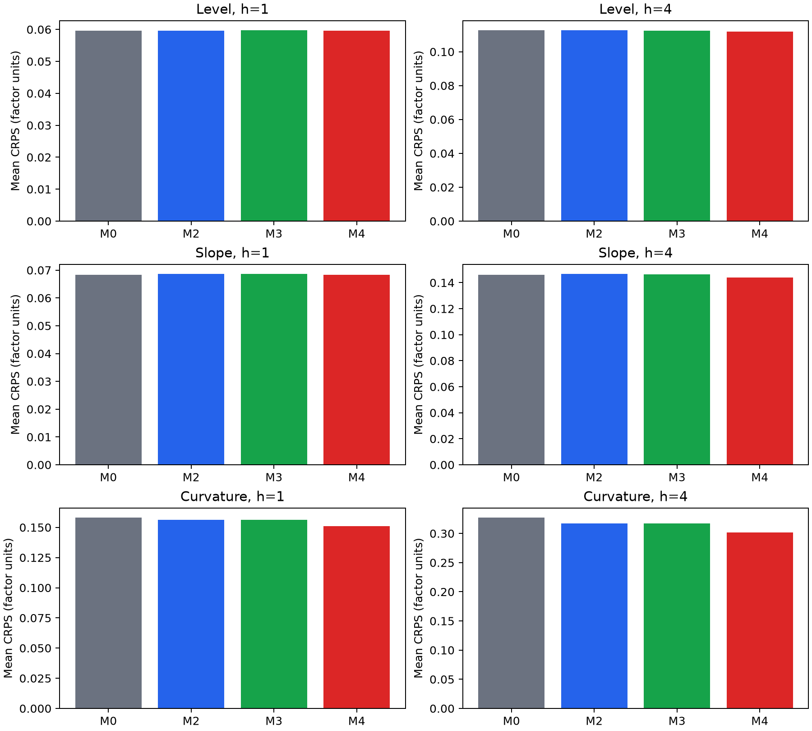
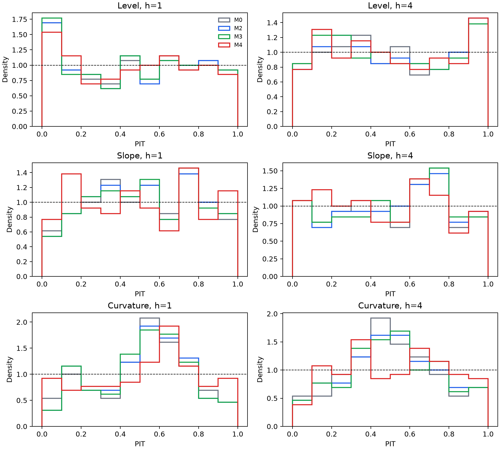

---
format:
  pdf:
    documentclass: scrreprt
    pdf-engine: lualatex
    keep-tex: true
    lof: true
    lot: true
    toc: false
    number-sections: true
fontsize: 12pt
papersize: letter
geometry: margin=1in
linestretch: 1.0
toc-depth: 1
bibliography: ../references.bib
csl: apa.csl
link-citations: true
colorlinks: false
header-includes:
  - |
    \usepackage{chngcntr}
    \counterwithout{equation}{chapter}
    \counterwithout{footnote}{chapter}
    \setkomafont{disposition}{\normalfont\bfseries}
    \RedeclareSectionCommand[beforeskip=0pt,afterskip=1.2\baselineskip]{chapter}
    \setlength{\emergencystretch}{3em}
    \let\MRPListFigures\listoffigures
    \let\MRPListTables\listoftables
    \renewcommand{\listoffigures}{}
    \renewcommand{\listoftables}{}
execute:
  enabled: false
---

```{=latex}
\begin{titlepage}
\centering
\vspace*{1cm}
{\Large\bfseries Probabilistic Forecasting of Canadian Government-Yield Factors:\par}
\vspace{0.4cm}
{\Large\bfseries A Bayesian Stochastic-Volatility Extension of Dynamic Nelson--Siegel\par}
\vspace{1.6cm}
{\large Author: Ethan Yao\par}
\vspace{0.7cm}
November 2026\par
\vspace{0.7cm}
Supervisor: Greg Rice\par
\vfill
A project\par
In partial fulfilment of the requirement for\par
Master of Quantitative Finance\par
University of Waterloo\par

\end{titlepage}
\pagenumbering{roman}
\chapter*{Abstract}
\addcontentsline{toc}{chapter}{Abstract}
```

This study evaluates marginal probabilistic forecasts of the level, slope, and curvature factors extracted from eight Canadian government zero-coupon yields using fixed Nelson–Siegel loadings. It compares a factor random walk, an unrestricted factor AR(1), and two Bayesian Dynamic Nelson–Siegel specifications: constant-volatility M3 and stochastic-volatility M4. The Bayesian forecasts use the accepted posterior draws; no sampler, prior, or accepted yield forecast is changed. The 130 common rolling origins span 2016–2025, with one- and four-observation-ahead targets.

The primary score is the continuous ranked probability score (CRPS), supplemented by a moment-based Dawid–Sebastiani score, point accuracy, probability integral transforms, and marginal interval coverage. Stochastic volatility has lower mean CRPS than constant volatility in all six factor-by-horizon comparisons, with the largest differences for curvature. However, none of the six paired comparisons is significant after Holm adjustment. Level and slope scores are close across all four models, and point-forecast differences are small. A duration-based five-year yield illustration translates each factor marginal separately; it is not a joint portfolio-risk forecast. Results are conditional on fixed loadings and OLS-extracted factor proxies and do not establish calibration of the full yield curve or general model superiority.

```{=latex}
\clearpage
\chapter*{Acknowledgements}
\addcontentsline{toc}{chapter}{Acknowledgements}
```

I am grateful to my supervisor, Greg Rice, for his guidance and feedback throughout this project. I acknowledge the Bank of Canada as the source of the Canadian zero-coupon yield-curve data.

```{=latex}
\clearpage
\setcounter{tocdepth}{0}
\tableofcontents
\setcounter{tocdepth}{2}
\clearpage
\MRPListTables
\clearpage
\MRPListFigures
\clearpage
\pagenumbering{arabic}
```

# Introduction {#sec-introduction}

## Motivation and research problem

Government-bond yield movements are often summarized by level, slope, and curvature factors. These labels describe maturity-loading shapes, not formal economic identification. The Nelson–Siegel representation provides a parsimonious fixed-loading basis for extracting those factors from the eight-maturity Canadian yield curve (@diebold2006forecasting). The factors are useful summaries for fixed-income analysis, but a factor model is not by itself a calibrated joint model of every yield movement.

The original project evaluated joint forecasts across eight maturities. A subsequent residual-subspace sensitivity experiment improved yield-level DSS but left substantial residual dependence and joint undercoverage; it remains a sensitivity analysis, not the primary result of this paper (see the [structural-recovery report](../docs/residual_subspace_experiment/STRUCTURAL_RECOVERY_REPORT.md)). This revision instead asks whether the accepted Bayesian DNS specifications forecast the three extracted factor distributions well relative to a random walk and a conventional AR(1), and whether stochastic factor volatility adds predictive value over constant volatility. The financial discussion is limited to factor-isolated yield and duration sensitivities.

The two-step procedure first extracts factors by cross-sectional least squares using fixed loadings, then fits the factor dynamics. The paper compares four marginal forecast distributions at 130 common origins and two horizons. CRPS is the primary score because it evaluates univariate predictive distributions; point errors, interval coverage, PIT summaries, and moment-based DSS are complementary. The study does not estimate cross-factor dependence or claim a joint yield-curve forecast.

## Contribution and scope

The contribution is a matched, factor-level comparison of constant- and stochastic-volatility Bayesian DNS against M0 and M2. The Bayesian specifications retain the same factor extraction, fixed loading representation, AR mean equation, and previously accepted priors and posterior draws. The paper reports marginal factor scores and one-at-a-time five-year risk sensitivities. It does not claim full-curve calibration, portfolio VaR, economic identification of the factor labels, or general forecast dominance.

# Methodology and conceptual framework {#sec-literature}

## DNS representation and conventional factor forecasting

The DNS framework separates cross-sectional yield loadings from factor dynamics. @diebold2006forecasting estimates level, slope and curvature factors using fixed Nelson–Siegel loadings and forecasts them with autoregressions. The labels describe maturity-loading patterns, not factor stationarity or economic identification. This paper compares forecasts of those extracted factors; it does not include a separate PCA–VAR forecast.

## Bayesian inference for DNS

Bayesian DNS integrates over factor-dynamic parameter uncertainty. Diebold, Li, and Yue provide a related two-step precedent: they use OLS-extracted country factors as observed data in a Bayesian second stage while retaining latent global factors [@diebold2007global]. In contrast, Hautsch and Yang jointly estimate yield factors and volatility in a state-space MCMC model [@hautsch2010svns; @hautsch2012bayesian]. This study adopts the two-step design because the original expanding-window estimation required fits at 130 forecast origins: conditioning on fixed loadings and cross-sectionally extracted factors reduces each fit to three separate, low-dimensional factor regressions rather than repeated joint latent-state estimation. It is a deliberate conditional analysis: uncertainty in extracted factors and the selected decay parameter is not propagated. The present factor evaluation reuses the accepted posterior draws rather than rerunning those fits.

## Stochastic factor volatility

Stochastic-volatility DNS allows factor log innovation variances to evolve. @hautsch2012bayesian and @caldeira2010bayesian motivate this flexibility in yield applications, while @omori2007stochastic provides a mixture-based inference method. The present no-leverage model changes constant to stochastic factor variance while holding extraction, mean dynamics and forecast design fixed. The resulting comparison is conditional on the specified models and priors, not a causal effect isolated from every distributional difference.

## Probabilistic forecast evaluation

Proper scoring rules evaluate predictive distributions rather than point forecasts alone [@gneiting2007strictly]. This study uses the univariate CRPS as its primary score for each extracted factor and horizon. The Dawid–Sebastiani score, introduced by Dawid and Sebastiani [@dawid1999coherent], is computed from predictive means and variances as a complementary Gaussian-moment diagnostic; for non-Gaussian posterior mixtures it is not the exact negative log predictive density. RMSE, PIT summaries, and central interval coverage describe point accuracy and marginal calibration. No Energy Score or yield-curve coverage is computed for the new factor evaluation because the three factors are forecast separately and their joint dependence is not identified.

The confirmatory comparison is the paired M4-minus-M3 CRPS difference for each factor and horizon. A stationary bootstrap [@politis1994stationary] preserves local dependence across rolling origins; the six raw p-values are adjusted by Holm's procedure. Comparisons with M0 and M2 are descriptive. Neither the bootstrap nor the scores establish universal model superiority.


# Data and information sets {#sec-data}

## Source and provenance

The study uses the Bank of Canada's publicly available zero-coupon Government of Canada yield-curve estimates [@bocdata], covering the period from 2000 to 2025. These daily yield curves are estimated from Government of Canada bonds and treasury bills using the term-structure estimation methodology documented by @bolder2004canadian. The published series provides yields across maturities from three months to 30 years at quarterly-year intervals. The consistent cross-section permits the fixed-loading factor extraction used in this paper; the resulting factors remain statistical proxies rather than observed market securities.

The empirical analysis focuses on eight representative maturities: 0.25, 0.5, 1, 2, 5, 7, 10, and 30 years, sampled weekly from the daily series. The data are drawn from a historical extract rather than reconstructed real-time publication vintages. Although a limited comparison against the Bank's official series confirmed agreement across all eight maturities for 21 observations in December 2015, the provenance and revision status of the complete historical extract have not been independently verified. Furthermore, the Bank's typical publication delay of approximately two weeks means that observation dates do not necessarily correspond to contemporaneous public information availability. These limitations are considered when interpreting the retrospective forecasting results.

## Cleaning, units and weekly sampling

The analysis uses eight representative maturities, $0.25, 0.5, 1, 2, 5, 7, 10, 30$ years, spanning the short, intermediate, and long ends of the Canadian government yield curve. Daily observations are retained only when yields are available at all eight maturities, ensuring a consistent cross-sectional representation throughout the sample. Yields are converted from decimal form to percentage points by multiplying by 100. To construct the weekly series, the last available complete observation in each ISO calendar week is selected, without averaging or interpolating yields across dates.

The sample is restricted to 2000–2025 and contains 1,356 weekly yield-curve observations. Of these, 835 observations from 2000–2015 form the initial estimation sample, while the remaining 521 observations from 2016–2025 constitute the out-of-sample evaluation period. Summary statistics for the selected maturities are reported in @tbl-data. The selection of forecast origins within the evaluation period is described in Section 3.3.

The yield inputs and extracted factors are in percentage points, with one basis point corresponding to 0.01 percentage points. Factor CRPS values therefore use percentage-point units.



{#fig-history width=95%}

## Forecast dates and calendar interpretation

Forecast horizons count weekly observations, not a fixed number of trading days. Every fourth weekly observation in the out-of-sample period is considered as an origin. An origin is retained only if both its one and four-observation-ahead targets lie in 2016–2025. This gives 130 common origins, from 8 January 2016 to 28 November 2025. The otherwise candidate observation near the end of December 2025 is excluded because its four-week target is outside the sample.

Public holidays can change the weekday and elapsed calendar time between observations without changing the weekly index. No interval between successive observations exceeds ten calendar days. Accordingly, a four-week forecast denotes four steps ahead in the weekly sample where its target date follows from the observed calendar rather than a fixed 28-day interval.

# Model specifications {#sec-methods}

## Nelson–Siegel observation equation

The Nelson–Siegel yield representation describes the zero-coupon yield $y_t(\tau)$ observed at time $t$ for maturity $\tau$ in years using three time-varying factors [@diebold2006forecasting]:

$$
\begin{aligned}
y_t(\tau)={}&L_t
+S_t\left(\frac{1-e^{-\lambda\tau}}{\lambda\tau}\right)\\
&+C_t\left(\frac{1-e^{-\lambda\tau}}{\lambda\tau}-e^{-\lambda\tau}\right).
\end{aligned}
$$

The level factor $L_t$ loads equally across maturities; the slope loading declines from the short end toward zero at long maturities; and the curvature loading peaks at intermediate maturities. Thus, the factor labels describe loading shapes, not formal economic identification. The decay parameter $\lambda>0$ controls the slope and curvature loading profiles.

The empirical specification adds a maturity-specific reconstruction error:

$$
y_t(\tau)=L_t+S_t s(\tau;\lambda)+C_t c(\tau;\lambda)+\varepsilon_t(\tau).
$$

Define the slope and curvature loadings as

$$
s(\tau;\lambda)=\frac{1-e^{-\lambda\tau}}{\lambda\tau},
\qquad c(\tau;\lambda)=s(\tau;\lambda)-e^{-\lambda\tau}.
$$ {#eq-loadings}

Let $Y_t$ be the eight-dimensional yield vector, $f_t=(L_t,S_t,C_t)'$, and $\Lambda(\lambda)$ the loading matrix. The matrix observation equation is

$$
Y_t=\Lambda(\lambda)f_t+\varepsilon_t,
\qquad \varepsilon_t\sim N(0,R_t).
$$ {#eq-observation}

For maturity $\tau$, a row of $\Lambda(\lambda)$ is $(1,s(\tau;\lambda),c(\tau;\lambda))$. The decay parameter is in inverse years; a 160-value grid from 0.05 to 2.0 minimizes initial-training-window cross-sectional squared error, selecting $\lambda=0.5160377358490565$ for the full forecast exercise.

At each date, the two-step procedure extracts the factors by cross-sectional least squares:

$$
\widehat f_t=(\Lambda'\Lambda)^{-1}\Lambda'Y_t.
$$ {#eq-extraction}

The estimator is computed by least squares without explicitly forming the inverse. By the OLS normal equations, each maturity-residual vector is orthogonal to the loading columns, $\Lambda'\widehat\varepsilon_t=0$, and lies in their five-dimensional orthogonal complement. This cross-sectional projection condition does not imply zero correlation over time between residual series at different maturities: in the initial 835-observation window, their mean absolute pairwise correlation is 0.659611, reaching 0.988809 for the 3-month and 1-year yields. The legacy yield-level forecast construction retains diagonal $R_t$, with maturity-specific expanding-window residual mean squares floored at $10^{-6}$ squared percentage points. This preserves the accepted plug-in construction without introducing a separately regularized cross-maturity covariance estimator; it is a practical consistency choice, not an assumption supported by the residual correlations. $R_t$ enters yield forecasts, not the factor likelihood or the revised factor scores. Separately, $B=\operatorname{diag}(b_L,b_S,b_C)$ and $Q=\operatorname{diag}(e^{m_j})$ in M3 or $Q_t=\operatorname{diag}(e^{h_{j,t}})$ in M4. Extracted factors are observed inputs; only their dynamics and volatility change.

## Conventional two-step DNS

M2 fits a separate Gaussian AR(1) mean equation to each extracted factor:

$$
f_{j,t+1}=a_j+b_j f_{j,t}+\eta_{j,t+1},
\quad \eta_{j,t+1}\sim N(0,q_j).
$$ {#eq-ar}

For the classical benchmark the fitted intercept and slope are unrestricted least-squares estimates. To distinguish forecast moments from the stochastic-volatility parameters defined below, denote the horizon-$h$ forecast mean and variance of factor $j$ by $\mu^{\mathrm{fc}}_{j,h}$ and $V^{\mathrm{fc}}_{j,h}$:

$$
\mu^{\mathrm{fc}}_{j,h}=b_j^h f_{j,t}+a_j\sum_{k=0}^{h-1}b_j^k,
\qquad V^{\mathrm{fc}}_{j,h}=q_j\sum_{k=0}^{h-1}b_j^{2k}.
$$ {#eq-ar-moments}

The legacy yield covariance is $\Lambda\operatorname{diag}(V^{\mathrm{fc}}_h)\Lambda'+R_t$. Parameter uncertainty is not added to that classical plug-in forecast. The factor innovations are estimated separately, so cross-factor dependence is not part of the present forecast evaluation.

## Bayesian constant-volatility DNS

M3 is the primary control. It retains the factor AR(1) mean equation and assumes a constant innovation variance $\exp(m_j)$. The intercept $a_j$ determines the drift, while $b_j$ controls persistence. For $|b_j|<1$, their implied long-run factor mean is $\mu_j=a_j/(1-b_j)$. We specify independent priors on this mean and persistence and derive the intercept:

$$
\mu_j\sim N\!\left(\bar f_{j,\mathrm{train}},(2s_{j,\mathrm{train}})^2\right),
\qquad b_j\sim N(\hat b_{j,\mathrm{OLS}},0.03^2)\ \text{truncated to }(-1,1),
\qquad a_j=(1-b_j)\mu_j.
$$ {#eq-coefficient-prior}

Here $\bar f_{j,\mathrm{train}}$ and $s_{j,\mathrm{train}}$ are the initial-factor mean and sample SD, and $\hat b_{j,\mathrm{OLS}}$ is the auxiliary AR(1) slope. For level, slope and curvature, their means are 4.329855, −2.174505 and −1.109836; SDs are 1.055927, 1.406094 and 1.824830; OLS persistence centers are 0.997223, 0.995512 and 0.976815. These hyperparameters are fixed across expanding windows.

The normal prior is placed directly on the long-run mean, which has finite moments even when persistence approaches one; an independent diffuse intercept prior would make $a_j/(1-b_j)$ heavy-tailed. Its multiplier 2 is a deliberately broad, project-specific scale: the central 90% interval spans $\pm3.29$ training SDs (multipliers 1 and 3 give $\pm1.65$ and $\pm4.93$). In 100,000 training-only draws, the revised joint prior put the mean outside the observed range in 23–34% of draws, versus 72–89% under the original prior. Because both the mean parameterization and persistence prior changed, this supports the joint revision, not multiplier 2 alone.

The truncated-normal persistence family uses the initial-sample OLS centers and restricts draws to the stationary region; its SD of 0.03 is a project-specific choice, not a literature-calibrated value. It yields central 90% intervals of 0.939–0.998 (level), 0.938–0.998 (slope) and 0.924–0.996 (curvature), with median half-lives of 21.6–32.2 weeks. Prior-only SDs of 0.015 and 0.06 widen the cross-factor 5th–95th half-life envelope to 14–635 and 4.8–177 weeks. The training-only audit changed the mean prior jointly, so it does not validate SD 0.03 in isolation.

The constant innovation variance has the prior

$$
m_j\sim N(\mu_{0j},1).
$$ {#eq-constant-variance-prior}

The parameter $m_j$ is the log of the long-run expected factor innovation variance. To define its prior center precisely, let $\tilde f_{j,t}$ denote the extracted factor in the initial 835-observation training sample. For each factor, estimate an auxiliary OLS AR(1),
$$
(\hat\alpha_j^{\mathrm{OLS}},\hat\beta_j^{\mathrm{OLS}})
=\arg\min_{\alpha,\beta}\sum_{t=2}^{835}
(\tilde f_{j,t}-\alpha-\beta\tilde f_{j,t-1})^2,
\qquad
\hat e_{j,t}=\tilde f_{j,t}-\hat\alpha_j^{\mathrm{OLS}}
-\hat\beta_j^{\mathrm{OLS}}\tilde f_{j,t-1},
$$
and set
$$
\mu_{0j}=\log\!\left(\frac{1}{834}\sum_{t=2}^{835}\hat e_{j,t}^{\,2}\right).
$$
For level, slope and curvature, $\mu_{0j}$ is $-4.888703$, $-4.122200$ and $-1.969807$, corresponding to innovation-variance medians $0.007531$, $0.016209$ and $0.139484$ squared percentage points. The centers are fixed across windows.

The Gaussian prior on log variance keeps the innovation variance positive after exponentiation. SD one gives prior mean innovation variances of 0.0124, 0.0267 and 0.2300, with a central 90% range of 0.19–5.18 times each median; the former SD of five gave means 162,755 times larger. The 100,000-draw training-only audit gives revised median curve-change RMS of 0.167–0.174 at one week and 0.357–0.365 at four weeks, near training 95th-percentile thresholds 0.1845 and 0.3849. Original-prior medians were 4.63–4.70 and 10.32–10.44, with over 99.9% above threshold. Because several priors changed jointly, the audit does not establish SD one as optimal. These empirical-Bayes choices followed evaluation of the original specification but used training-only evidence, not evaluation-period scores.

## Bayesian DNS with stochastic factor volatility

The main extension, M4, changes the factor innovation variance while retaining the same factor extraction, maturity loadings, AR(1) mean structure, coefficient priors, long-run expected-variance interpretation and reconstruction-error treatment as M3:

$$
f_{j,t}=a_j+b_j f_{j,t-1}+\eta_{j,t},
\qquad \eta_{j,t}\mid h_{j,t}\sim N(0,e^{h_{j,t}}),
$$ {#eq-sv-factor}

$$
h_{j,t}=\omega_j+\phi_j(h_{j,t-1}-\omega_j)+u_{j,t},
\qquad u_{j,t}\sim N(0,\sigma_{u,j}^2).
$$ {#eq-sv-state}

The latent state $h_{j,t}$ allows the factor innovation variance to change over time. Before reparameterization, $\omega_j$ is the unconditional mean of log variance, whereas $m_j=\log E[\exp(h_{j,t})]$ is the log of the long-run expected innovation variance. If the stationary log-volatility variance (denoted $v_j$ below) is $v_j$, then $h_{j,t}\sim N(\omega_j,v_j)$ and $E[\exp(h_{j,t})]=\exp(\omega_j+v_j/2)$; hence $m_j=\omega_j+v_j/2$. The persistence parameter $\phi_j$ has the transformed prior

$$
\frac{\phi_j+1}{2}\sim\operatorname{Beta}(20,1.5),
\qquad E[\phi_j]=2\frac{20}{21.5}-1\approx0.86.
$$ {#eq-volatility-persistence-prior}

Kim, Shephard, and Chib motivate the Beta family by stationarity and near-unit-root concerns [@kim1998stochastic]. Omori et al. explain the high-persistence rationale for these numerical parameters and apply them to daily TOPIX returns in a leveraged SV model [@omori2007stochastic]. Here, $\mathrm{Beta}(20,1.5)$ gives mean 0.8605 and central 90% interval 0.649–0.983, implying weekly half-lives of 4.61 weeks at the mean and 1.60–39.71 weeks over the interval. The daily univariate source applications do not calibrate a weekly DNS prior; no alternative Beta hyperparameters were tested.

To retain the same interpretation of $m_j$ as in M3, let $v_j$ be the stationary variance of log volatility and set

$$
\omega_j=m_j-v_j/2,\qquad \sigma_{u,j}^2=v_j(1-\phi_j^2),\qquad
h_{j,1}\sim N(\omega_j,v_j).
$$ {#eq-finite-reparam}

Then, under the stationary log-volatility process,
$E[\exp(h_{j,t})\mid m_j,\phi_j,v_j]=\exp(m_j)$. The models share a prior interpretation for long-run expected innovation variance, but not their full predictive distributions: M4 additionally allows volatility to vary over time.

The symbols $\mu^{\mathrm{fc}}_{j,h}$ and $V^{\mathrm{fc}}_{j,h}$ above denote forecast moments; $m_j$ and $v_j$ here are parameters of the stochastic-volatility specification.

For $v_j$, the main specification uses a rate-one exponential prior truncated to $(0,U)$:

$$
p_U(v_j)=\frac{e^{-v_j}}{1-e^{-U}}\,1_{(0,U)}(v_j),
\qquad U=4.
$$ {#eq-finite-prior}

The exponential family favors smaller stationary log-volatility variances; rate one and $U=4$ are project-specific regularization choices. The truncated prior has mean 0.925, median 0.675 and 95th percentile 2.697; rates 0.5 and 2 would change the mean to 1.374 and 0.499. The rate-one scale is comparable to noisy training-only auxiliary estimates of $v_j$ (0, 0.65 and 0.95), not a precise empirical calibration. At the bound, $\operatorname{SD}(\log\sigma_{j,t})=1$, giving a stationary 95% volatility range 0.141–7.10 times its conditional median; this is a boundary scenario, not a typical range. The prior-predictive assessment follows the principle of checking implied observations against training data [@gelman2017prior]: the RMS movement medians/95th percentiles are 0.168/0.423 at one week and 0.357/1.063 at four weeks, versus training 95th percentiles 0.1845/0.3849, with about 46% of four-week draws above that threshold. Raising $U$ from four to eight changes the four-week 99th percentile by about 0.1%, but tails remain broad. No yield-movement simulation varied the rate, and the saved posterior cannot establish behavior above $U=4$.

Bounded $v_j$ and proper coefficient priors imply finite posterior-predictive moments at finite horizons. Stationarity gives an untruncated rate-one exponential prior finite prior-predictive second moments but an infinite innovation fourth moment. Thus $U=4$ is sufficient for the posterior-moment proof, not shown necessary for prior moments; unbounded posterior tails are unproved. This does not imply finite infinite-horizon factor variance as $b_j$ approaches one.

Posterior-predictive simulation propagates the factor and log-volatility states at each future weekly step and adds the common reconstruction error:

$$
Y_{t+h}^{(s)}=\Lambda f_{t+h}^{(s)}+\varepsilon_{t+h}^{(s)},
\qquad \varepsilon_{t+h}^{(s)}\sim N(0,\widehat R_t).
$$ {#eq-predictive}

Inference uses a Gaussian-mixture representation for log-squared innovations, with an in-chain Metropolis correction targeting the exact likelihood [@kim1998stochastic; @omori2007stochastic].

## Factor-level forecast benchmarks

M0 is a factor random walk. For each extracted factor, estimate the innovation variance from training-only first differences through the forecast origin and use

$$
f_{j,t+h}\mid\mathcal F_t\sim
N\!\left(f_{j,t},h\widehat\sigma_{\Delta f_j}^{\,2}\right).
$$ {#eq-factor-rw}

M2 is the unrestricted OLS AR(1) in @eq-ar. Its forecast moments are given in @eq-ar-moments; the persistence estimate is not clipped. M3 and M4 use the accepted Bayesian constant- and stochastic-volatility models, respectively. All four models produce one marginal predictive distribution per factor and horizon. M0 and M2 have Gaussian predictive distributions; Bayesian M3/M4 distributions integrate over posterior parameter draws and future factor innovations.

| Model | Specification | Role in evaluation |
|---|---|---|
| M0 | Factor random walk; training-only change variance | Random-walk benchmark |
| M2 | Two-step DNS; unrestricted OLS AR(1) by factor | Conventional DNS benchmark |
| M3 | Bayesian two-step DNS; constant factor volatility | Bayesian control |
| M4 | Bayesian two-step DNS; finite-moment stochastic factor volatility | Bayesian extension |

: Forecasting specifications and their roles in the comparison. {#tbl-ladder}

# Experimental design and evaluation {#sec-design}

## Expanding-window design

The initial 2000–2015 window selects $\lambda$ and calibrates the accepted Bayesian priors. The evaluation period is 2016–2025. There are 130 common origins, sampled every fourth weekly observation, and horizons of one and four observations. Each model is estimated only with factor information available through its origin. The fixed panel has 1,356 observations from 2000 through 2025; the source panel also contains later observations, which are excluded from this evaluation.

The evaluation contains 3,120 factor forecasts: 130 origins, four models, three factors and two horizons. The Bayesian component contributes 1,560 factor forecasts. It uses the accepted posterior archive, comprising four chains and 6,000 retained draws per chain for each factor and model at each origin. No MCMC is rerun, and the original posterior and yield-level forecast archives remain unchanged.

For M0, the random-walk variance is the sample variance of training-only factor changes multiplied by the horizon. For M2, the AR(1) is fit by unrestricted OLS and its innovation variance is the mean squared training residual. Bayesian predictive means and variances are computed draw by draw and averaged using the law of total variance. Factor-only scenarios are drawn from the accepted posterior draws for CRPS and interval summaries; the archived eight-yield scenarios are not projected back to factors.

## Continuous ranked probability score and DSS

The primary evaluation criterion is the univariate CRPS. For predictive distribution $F$ and realized factor value $y$, it is

$$
\operatorname{CRPS}(F,y)=
E_F|X-y|-\frac12E_F|X-X'|,
\qquad X,X'\stackrel{\mathrm{iid}}{\sim}F.
$$ {#eq-crps}

M0 and M2 have Gaussian predictive distributions, so their CRPS is computed analytically. For M3/M4, the two expectations are estimated from two independent sets of 8,192 factor scenarios per origin, factor and horizon. Eight batches of 1,024 paired scenarios provide a Monte Carlo standard-error diagnostic. The factor percentage-point unit is retained in all reported CRPS values; lower scores are better.

The Dawid–Sebastiani score is a complementary moment-based diagnostic. For forecast error $e_{j,t,h}=f_{j,t+h}-\widehat{\mu}_{j,t,h}$ and predictive variance $\widehat V_{j,t,h}$, it is

$$
\operatorname{DSS}_{j,t,h}
=\log \widehat V_{j,t,h}
+\frac{e_{j,t,h}^{\,2}}{\widehat V_{j,t,h}}.
$$ {#eq-dss}

Lower DSS is better. It is a proper score within a Gaussian forecast family, but for the Bayesian posterior mixtures it uses only the predictive mean and variance and is not the exact mixture log score. CRPS remains the primary distributional comparison.

## Ensemble and marginal evaluation

The PIT is $F(y)$; for Bayesian mixtures it is evaluated by averaging the draw-specific Gaussian CDFs. Central 50%, 80%, and 90% interval endpoints are analytic for M0/M2 and empirical quantiles of the 8,192 Bayesian factor scenarios for M3/M4. We report coverage and mean width by factor and horizon. PIT histograms and coverage are descriptive with 130 origins and do not imply joint factor or yield-curve calibration. Point accuracy is summarized by RMSE and MAE of the predictive mean.

The predictive factor distributions are evaluated marginally. We do not compute a multivariate Energy Score or a joint coverage statistic because the factor models are estimated separately and no joint factor predictive distribution is available. RMSE is the square root of the mean squared factor error across origins within each model–factor–horizon group; MAE is the mean absolute factor error.

## Inference and computational diagnostics

The confirmatory comparison is the paired M4-minus-M3 CRPS difference for each of the three factors and two horizons. We use the stationary bootstrap [@politis1994stationary] with 9,999 replicates, an expected block length of four forecast origins, and 95% percentile intervals. A common resampled index vector is used across the six comparisons. The six two-sided p-values are adjusted by Holm's procedure. Comparisons with M0 or M2 are descriptive. The resampling uncertainty is conditional on the observed origins and includes the realized Monte Carlo score noise; it does not capture model, prior, data-vintage or factor-extraction uncertainty.

The accepted four-chain diagnostics use rank-normalized split $\widehat R$ and bulk and tail effective sample size [@vehtari2021rank]. All accepted posterior files are hash-checked and the saved factor predictive moments are reconstructed before the new evaluation. Convergence and archive-integrity checks assess numerical reproducibility, not forecast calibration or model adequacy.

# Empirical results {#sec-results}

## Forecast sample and accepted posterior checks

The evaluation covers 130 origins from 8 January 2016 through 28 November 2025, at one- and four-observation horizons. It contains 3,120 marginal factor forecasts across four models, three factors and two horizons. The Bayesian subset contains 1,560 forecasts from the accepted posterior archive. Before scoring, all 130 origin manifests and 3,120 chain checkpoints passed hash checks; the reconstructed posterior factor means and variances matched all 520 saved model-by-horizon records exactly.

Across 5,850 archived parameter diagnostic records, the maximum rank-normalized $\widehat R$ is 1.00965 and minimum bulk and tail effective sample sizes are 1,057.6 and 2,094.5. These are sampler diagnostics, not evidence that the forecast distributions are calibrated. No MCMC was rerun for the factor-level analysis.

## Posterior parameter behavior

To show how the data update the stochastic-volatility parameters, @tbl-posterior-parameters reports the final fit at the 28 November 2025 origin. The table summarizes the 24,000 retained draws for M4, the stochastic-volatility specification (four chains of 6,000 draws), pooled across chains. The intervals are equal-tailed 90% posterior intervals; this is the latest rolling fit, not a pooling of parameters across forecast origins.



The truncated persistence-prior medians are 0.979, 0.978 and 0.968 for level, slope and curvature, respectively; the posterior medians are higher and their intervals narrower. The corresponding long-run-mean prior centers are 4.330, −2.175 and −1.110, compared with posterior medians of 2.724, −0.113 and −1.645. The slope mean remains uncertain, consistent with persistence close to one. The prior medians (5th–95th percentiles) are 0.886 [0.649, 0.983] for $\phi_j$ and 0.675 [0.050, 2.697] for $v_j$. Posterior $v_j$ is more concentrated than its prior for each factor, while posterior $\phi_j$ remains in the persistent range favored by its prior. The posterior $m_j$ medians remain near their training-calibrated centers. These comparisons show parameter-specific updating alongside prior regularization, not proof that every estimate is insensitive to the prior.

Across all 130 accepted M4 fits, the largest factor-specific posterior 99th percentile of $v_j$ is 2.87 (curvature); the largest posterior probability above 3.5 is 0.24%. Four curvature fits assign more than 5% probability to $v_j>2$, but none assigns more than 0.8% to $v_j>3$. The largest individual draw is 3.99999, as the truncated support permits draws arbitrarily near four. These results do not indicate sustained posterior concentration near the bound, but a model restricted to $v_j<4$ cannot show what posterior mass or forecasts would arise above four.

## Primary factor scores

@tbl-factor-crps reports the mean CRPS by factor and horizon. M4 has lower CRPS than M3 in all six groups, but the differences are small for level and slope. The largest differences are for curvature: 0.00536 factor percentage points at one observation and 0.01549 at four observations.

| Factor | Horizon | M0 | M2 | M3 | M4 |
|---|---:|---:|---:|---:|---:|
| Level | 1 | 0.05964 | 0.05962 | 0.05980 | 0.05968 |
| Level | 4 | 0.11277 | 0.11280 | 0.11249 | 0.11185 |
| Slope | 1 | 0.06836 | 0.06861 | 0.06870 | 0.06830 |
| Slope | 4 | 0.14587 | 0.14684 | 0.14624 | 0.14411 |
| Curvature | 1 | 0.15826 | 0.15614 | 0.15639 | 0.15102 |
| Curvature | 4 | 0.32748 | 0.31702 | 0.31744 | 0.30195 |

: Mean factor CRPS across 130 origins; lower is better. Units are factor percentage points. {#tbl-factor-crps}

{#fig-factor-crps width=95%}

M0 and M2 are close to the Bayesian models for level and slope. M4's curvature CRPS is lower than M0, M2, and M3 at both horizons, but comparisons with M0/M2 are descriptive. Mean DSS is also lower for M4 than M3 in all six factor–horizon groups; no confirmatory inference is made on DSS.

## Point accuracy and marginal calibration

Point RMSE varies little across models, and its ranking does not always match CRPS:

| Factor | Horizon | M0 | M2 | M3 | M4 |
|---|---:|---:|---:|---:|---:|
| Level | 1 | 0.1065 | 0.1064 | 0.1066 | 0.1065 |
| Level | 4 | 0.2023 | 0.2022 | 0.2019 | 0.2021 |
| Slope | 1 | 0.1239 | 0.1244 | 0.1246 | 0.1246 |
| Slope | 4 | 0.2774 | 0.2788 | 0.2779 | 0.2766 |
| Curvature | 1 | 0.2837 | 0.2783 | 0.2786 | 0.2798 |
| Curvature | 4 | 0.6032 | 0.5887 | 0.5890 | 0.5918 |

: RMSE of factor predictive means across 130 origins. Units are factor percentage points. {#tbl-factor-rmse}

Marginal 90% interval coverage is descriptive; the nominal rate is 0.90:

| Factor | Horizon | M0 | M2 | M3 | M4 |
|---|---:|---:|---:|---:|---:|
| Level | 1 | 0.838 | 0.838 | 0.838 | 0.862 |
| Level | 4 | 0.854 | 0.854 | 0.854 | 0.892 |
| Slope | 1 | 0.900 | 0.900 | 0.900 | 0.900 |
| Slope | 4 | 0.900 | 0.900 | 0.908 | 0.885 |
| Curvature | 1 | 0.954 | 0.954 | 0.954 | 0.885 |
| Curvature | 4 | 0.938 | 0.954 | 0.954 | 0.931 |

: Empirical marginal coverage of central 90% factor intervals. {#tbl-factor-coverage}

Coverage varies by factor and horizon: level intervals undercover at the reported nominal levels, while curvature intervals generally overcover, especially at four observations. M4 slope intervals also undercover at four observations. Mean PIT values are near 0.5, but the PIT histograms in @fig-factor-pit show why a mean alone cannot establish calibration. Neither these diagnostics nor the separate factor intervals establish joint factor or yield-curve coverage.

{#fig-factor-pit width=95%}

\newpage

## Paired Bayesian comparison

@tbl-factor-paired reports M4-minus-M3 CRPS differences; negative values favor stochastic volatility. The 95% intervals are unadjusted, while p-values are adjusted by Holm across the six confirmatory comparisons.

| Factor | Horizon | Mean difference | 95% interval | Raw p | Holm p |
|---|---:|---:|---:|---:|---:|
| Level | 1 | −0.00012 | [−0.00073, 0.00046] | 0.702 | 1.000 |
| Level | 4 | −0.00063 | [−0.00289, 0.00105] | 0.534 | 1.000 |
| Slope | 1 | −0.00041 | [−0.00165, 0.00085] | 0.525 | 1.000 |
| Slope | 4 | −0.00213 | [−0.00640, 0.00224] | 0.338 | 1.000 |
| Curvature | 1 | −0.00536 | [−0.01053, −0.00016] | 0.042 | 0.210 |
| Curvature | 4 | −0.01549 | [−0.02807, −0.00263] | 0.018 | 0.106 |

: Paired stationary-bootstrap CRPS comparisons; intervals are not multiplicity-adjusted. {#tbl-factor-paired}

Both curvature point differences favor M4, and their unadjusted intervals exclude zero. Neither survives Holm adjustment at 5% (adjusted $p=0.210$ and $0.106$). Mean paired Monte Carlo standard errors range from 0.0011 to 0.0069 factor percentage points and are not negligible relative to several of the differences. Thus, the results suggest a curvature-specific pattern, not statistically established overall superiority of stochastic volatility.

## Factor-isolated risk illustration

At the 28 November 2025 origin, the four-observation level-factor forecast maps to a 90% five-year yield-contribution interval of [−31.8, 30.5] basis points under M3 and [−25.5, 23.0] basis points under M4. For a stylized $1,000,000 portfolio with five-year modified duration, the corresponding first-order P&L intervals are approximately [−$15,300, $15,900] and [−$11,500, $12,800]. This varies level alone; slope and curvature are held fixed. The full one-factor-at-a-time calculations are reported in the [risk-application note](../docs/factor_probabilistic_20261116/FACTOR_RISK_APPLICATION.md).

Litterman and Scheinkman document common factors in U.S. bond returns, while Ho develops key-rate-duration measures of interest-rate sensitivity [@litterman1991common; @ho1992key]. These are precedents for interpretation, not evidence specific to Canadian factor predictability or calibration. The model does not estimate cross-factor dependence, so factor P&Ls must not be added or described as portfolio VaR or expected shortfall.

# Discussion and limitations {#sec-discussion}

## What stochastic volatility adds

Conditional on the fixed loadings, extracted factor histories, and accepted priors, M4 has lower CRPS than M3 in all six factor–horizon groups. The largest differences occur for curvature, while level and slope are nearly tied. The curvature differences do not remain significant after multiplicity adjustment, and simulation error is material relative to several paired differences. These results are consistent with a possible benefit for curvature uncertainty, but do not establish that stochastic volatility improves factor forecasting generally.

## Why the random walk remains competitive

M0 and M2 remain competitive on level and slope CRPS. For curvature, M4 has lower CRPS than either benchmark at both horizons, but its curvature RMSE is not uniformly lower: at four observations, M4's RMSE is 0.592 compared with 0.589 for M3 and M2. Model rankings therefore depend on the target factor and whether the score evaluates the full marginal distribution or only its mean.

## Model and prior limitations

Extracted factors are treated as observations, so factor-extraction and fixed-$\lambda$ uncertainty are omitted. The separate factor fits do not estimate cross-factor dependence. The legacy yield reconstruction covariance remains diagonal despite empirical residual correlation; it is not part of the new marginal factor scores. A prior residual-subspace sensitivity experiment improved yield-level DSS but left five-dimensional residual 90% coverage near 0.72–0.73 and first-order residual correlations near 0.86–0.91. This supports keeping that analysis as a limitation and sensitivity result, not interpreting factor forecasts as calibrated full-curve risk.

The finite-moment prior is substantive: matching $m$ aligns long-run expected innovation variance, not higher moments. The empirical-Bayes calibration uses training data also present in the likelihood. Training-only prior-predictive and saved-posterior diagnostics suggest that $U=4$ is not obviously binding, but do not establish forecasting-score robustness to alternative bounds or posterior behavior above four.

Finite-horizon predictive moments do not establish finite unconditional stationary factor variance when the coefficient prior allows $|b|$ arbitrarily close to one. The single synthetic recovery exercise is a computational diagnostic, not repeated-sampling evidence. Convergence diagnostics assess sampling behavior, not model truth.

## Data, inference and practical implications

The historical vintage and publication delays prevent a real-time or executable-trading interpretation. With 130 origins, bootstrap intervals are conditional on this sample and expected block length. They do not capture representation, prior, data-vintage, or extraction uncertainty. Coverage is marginal; the duration illustration is a one-factor sensitivity rather than a joint portfolio-risk forecast.

The present evidence supports a narrower conclusion than the earlier eight-yield study: M4's marginal CRPS is most favorable for curvature, but multiplicity-adjusted inference does not establish a difference from M3. M0 and M2 are similarly competitive for level and slope. Model choice should therefore depend on the factor and decision context, not on a claim that the stochastic-volatility model dominates.

# Conclusions {#sec-conclusions}

This study compares marginal forecasts of three OLS-extracted Nelson–Siegel factors using accepted Bayesian posterior draws and matched M0/M2 benchmarks. M4 has lower CRPS than M3 in all six factor–horizon groups, with the largest differences for curvature; none is significant after Holm adjustment. Point accuracy and marginal coverage vary by factor, and the results do not define a joint yield-curve forecast. The five-year duration example is a first-order, factor-isolated sensitivity—not portfolio VaR or evidence of trading performance. Future work should address real-time data availability, extraction uncertainty, and joint factor and residual dependence before making full-curve risk claims.

```{=latex}
\appendix
```

# Analytical derivations and numerical checks {#sec-appendix}

## Least-squares factor extraction

For fixed $\lambda$, minimize $g(f)=(Y-\Lambda f)'(Y-\Lambda f)$. Differentiation gives $\partial g/\partial f=-2\Lambda'Y+2\Lambda'\Lambda f$. Setting the derivative to zero yields @eq-extraction when the three columns have full rank. Least squares avoids explicitly computing an inverse, which would be less stable if loadings were poorly conditioned.

As $x=\lambda\tau$ approaches zero, $(1-e^{-x})/x$ approaches one. The implementation uses `expm1` to avoid cancellation for small positive $x$. Curvature approaches zero at the short end. At long maturities both nonlevel loadings approach zero. These limits establish interpretation and basic sign checks; they do not identify factors econometrically without further assumptions.

## AR forecast moments

Repeated substitution gives $f_{t+h}=b^hf_t+a\sum_{k=0}^{h-1}b^k+\sum_{k=0}^{h-1}b^k\eta_{t+h-k}$. Taking expectations yields the mean in @eq-ar-moments. Independent zero-mean innovations eliminate cross terms, giving $q\sum b^{2k}$ for its variance. The finite-sum form remains well defined when a fitted slope is near one.

## Legacy yield predictive covariance

For a fixed loading matrix and independent observation noise, $\operatorname{Var}(Y\mid\mathcal I_t)=\Lambda\operatorname{Var}(f\mid\mathcal I_t)\Lambda'+R_t$. Reconstruction uncertainty is added once at the future observation, not at every transition. In the legacy yield forecast, factor variance includes both conditional innovation uncertainty and dispersion in conditional means across posterior draws. The revised evaluation scores only the marginal factor distributions.

Estimating an eight-dimensional covariance from a small ensemble can add noise in low-variance directions. Analytic addition of $R_t$ to a factor-level posterior covariance is a useful stability check, but changing the estimator must be documented consistently. The classical forecasts avoid this issue through exact fitted moments.

## Bayesian posterior targets and transformations

For factor $j$, condition on $x_1$, let $n=T-1$, and define its innovation as
$r_{j,t}=x_t-(1-b_j)\mu_j-b_jx_{t-1}$. The exact targets are

$$
\begin{aligned}
\pi_{3j}(\mu_j,b_j,m_j\mid x)&\propto
\prod_{t=2}^{T}\mathcal N\!\left(x_t;(1-b_j)\mu_j+b_jx_{t-1},e^{m_j}\right)
p(\mu_j)p(b_j)p(m_j),\\
\pi_{4j}(\mu_j,b_j,m_j,\phi_j,v_j,h_{j,1:n}\mid x)&\propto
\prod_{s=1}^{n}\mathcal N\!\left(x_{s+1};(1-b_j)\mu_j+b_jx_s,e^{h_{j,s}}\right)\\
&\qquad{}\times p(\mu_j)p(b_j)p(m_j)p(\phi_j)p_U(v_j)
p(h_{j,1:n}\mid m_j,\phi_j,v_j).
\end{aligned}
$$ {#eq-bayesian-targets}

Here $p(\mu_j)$, $p(b_j)$, $p(m_j)$, $p(\phi_j)$ and $p_U(v_j)$ are the specified normal, truncated-normal, normal, transformed-Beta and truncated-exponential priors. The $n$ states $h_{j,1:n}$ align with the transitions from $x_1$ through $x_T$. Neither target contains a yield-level likelihood, $R_t$, or an estimated $\lambda$; factor posteriors are fitted separately.

## Finite-moment prior and transformed target

For one factor, let $n$ be the number of innovations and $e_t=h_t-\omega-\phi(h_{t-1}-\omega)$. With $\omega=m-v/2$ and $q=v(1-\phi^2)$, the stationary path density has log form

$$
\begin{aligned}
\log p(h\mid m,\phi,v)={}&-\frac n2\log(2\pi)-\frac n2\log v
-\frac{n-1}{2}\log(1-\phi^2)\\
&-\frac{1}{2v}\left[(h_1-m+v/2)^2+\frac{\sum_{t=2}^n e_t^2}{1-\phi^2}\right].
\end{aligned}
$$ {#eq-finite-path}

The initial observation contribution cannot be omitted. The sampler works in $\theta=(m,u,s)$ with $u=\operatorname{atanh}(\phi)$ and $s=\log v$. The independent-prior density gains Jacobian $\log(1-\phi^2)+s$. Equivalently, the determinant from these coordinates to $(\omega,\phi,q)$ is $v(1-\phi^2)^2$. The induced physical-coordinate prior is not a product of independent priors for $\omega$ and $q$. The coefficient prior is defined directly on $(\mu,b)$, so no Jacobian is needed there; if written in $(a,b)$, it includes the factor $1/|1-b|$.

At fixed $m,\phi,h$, the $v$ target contains $p_U(v)v^{-n/2}\exp[-A(v)/(2v)]$, where $A(v)$ is the bracketed term in @eq-finite-path and itself depends on $v$. Thus it is not the old inverse-gamma full conditional. Exact-target correction of the reversible mixture proposal retains both the transformed prior and this stationary density.

The constant-volatility chain updates $(\mu,b)$ by Gaussian/truncated-normal full conditionals and $m$ by an exact slice step. In the stochastic-volatility chain, mixture-based FFBS proposes the path with an exact log-$\chi^2$ Metropolis correction; $m$ has a Gaussian conditional, $u$ a Metropolis update, and $s$ a non-centred slice update. The mixture is a proposal, not the posterior target.

## Propriety and finite-horizon moments

Conditional on the fixed empirical-Bayes hyperparameters, the factor likelihood satisfies

$$
L(x\mid a,b,h)\leq(2\pi)^{-n/2}\exp\!\left(-\frac12\sum_{t=1}^n h_t\right).
$$ {#eq-likelihood-bound}

After integrating $m\sim N(\mu_0,1)$, the log-volatility vector is Gaussian conditional on $v,\phi$, with mean $(\mu_0-v/2)\mathbf1$ and covariance $\mathbf1\mathbf1'+vC_\phi$, where $(C_\phi)_{ij}=\phi^{|i-j|}$. The symbol $C_\phi$ denotes the log-volatility correlation matrix and is distinct from the yield-curve covariance $R_t$. Every entry is bounded in absolute value by $1+U$. The logarithm of the expectation of the likelihood bound is therefore bounded above by

$$
-\frac{n\mu_0}{2}+\frac{nU}{4}+\frac{n^2(1+U)}8,
$$ {#eq-normalizer-bound}

apart from the finite $(2\pi)^{-n/2}$ constant. Proper coefficient priors and positivity on a set of positive prior probability give a finite, strictly positive posterior normalizer.

Append a finite future log-volatility path. Multiplying the likelihood bound by any finite exponential linear functional of this extended Gaussian path still has a uniformly finite moment-generating function, because $v<U$. Hence future innovation variances have finite posterior moments of all finite orders. At finite horizon $H$, the factor mean is bounded by $|x_T|+H|a|$ since $|b|<1$. The induced intercept satisfies $|a|\leq2|\mu|$ and has all polynomial moments under the Gaussian long-run-mean prior. Gaussian innovation moments, finite-sum inequalities and the exponential-moment bound then imply finite-order posterior-predictive factor moments. Fixed linear loadings and finite Gaussian reconstruction noise preserve this property for yields. This finite-horizon statement does not integrate an infinite-horizon factor variance proportional to $(1-b^2)^{-1}$.

## Conditional stochastic-volatility forecast moments

At step $k$, conditional on a posterior state,

$$
E[e^{h_{T+k}}\mid\theta,h_T]
=\exp\!\left\{\omega+\phi^k(h_T-\omega)+\frac v2(1-\phi^{2k})\right\}.
$$ {#eq-sv-forecast-variance}

The factor forecast mean is the AR expression in @eq-ar-moments. Its conditional variance is the sum of @eq-sv-forecast-variance weighted by $b^{2(H-k)}$ for $k=1,\ldots,H$. Innovations at different future dates have zero cross moments conditional on volatility, despite dependent volatility levels. Averaging conditional variances and adding the posterior variance of conditional means gives total factor predictive variance. Independent factor posteriors yield a diagonal factor covariance; projection through $\Lambda$ and addition of $R_t$ give the yield covariance used in DSS.

In one synthetic run, 95% intervals covered $b,m,\phi,v$ but missed $a$ (0.04; [0.0510, 0.1235]) and $\mu$ (0.2667; [0.3163, 0.6284]). This checks computation, not repeated-sampling coverage.

## Factor-score reconstruction and data integrity

The factor evaluation contains 3,120 model-by-factor-by-horizon-by-origin
records. The accepted posterior archive passed all 130 origin-manifest and
3,120 chain-checkpoint hash checks; reconstructed factor means and variances
matched the 520 saved Bayesian model-by-horizon records. The new factor
forecasts, scores, bootstrap results, and risk sensitivities are saved under
`results/factor_probabilistic_20261116/`. These checks verify the calculations
and their inputs, not the model assumptions or forecast calibration.

## Prior yield-level evidence

The earlier eight-yield comparison found that the random walk remained
stronger on aggregate scores than the Bayesian DNS models. A later
residual-subspace sensitivity improved DSS but retained substantial residual
dependence and undercoverage; it is not substituted for the factor results
reported here. Details and diagnostics are provided in the
[residual-subspace report](../docs/residual_subspace_experiment/STRUCTURAL_RECOVERY_REPORT.md).


# Bibliography {.unnumbered}

```{=latex}
\small
```

::: {#refs}
:::
