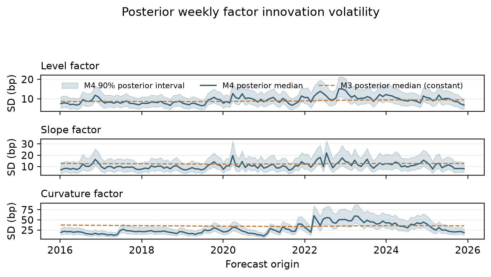
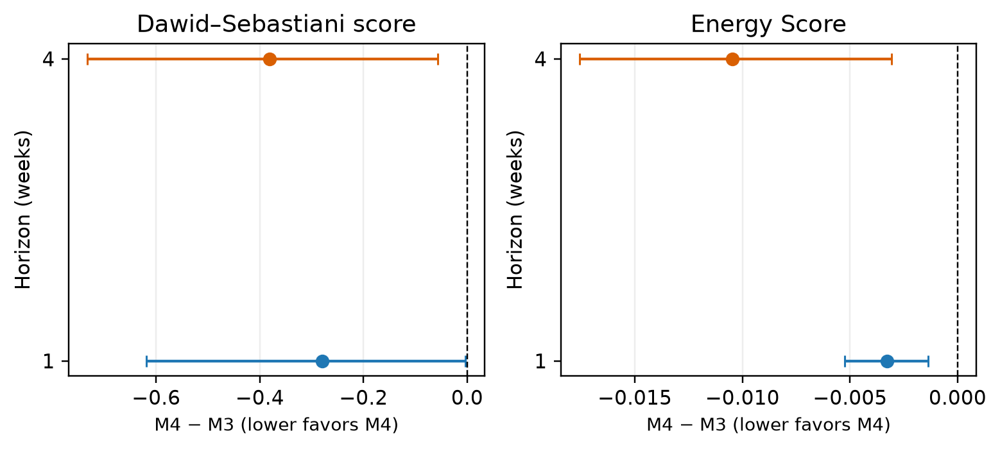
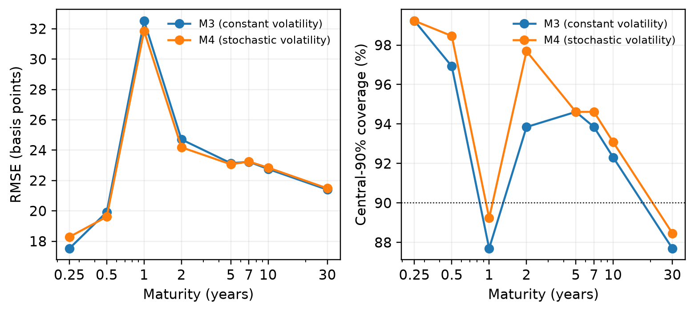

---
format:
  pdf:
    documentclass: scrreprt
    pdf-engine: lualatex
    keep-tex: true
    lof: true
    lot: true
    toc: false
    number-sections: true
fontsize: 12pt
papersize: letter
geometry: margin=1in
linestretch: 1.0
toc-depth: 1
bibliography: ../references.bib
csl: apa.csl
link-citations: true
colorlinks: false
header-includes:
  - |
    \usepackage{chngcntr}
    \counterwithout{equation}{chapter}
    \counterwithout{footnote}{chapter}
    \setkomafont{disposition}{\normalfont\bfseries}
    \RedeclareSectionCommand[beforeskip=0pt,afterskip=1.2\baselineskip]{chapter}
    \setlength{\emergencystretch}{3em}
    \let\MRPListFigures\listoffigures
    \let\MRPListTables\listoftables
    \renewcommand{\listoffigures}{}
    \renewcommand{\listoftables}{}
execute:
  enabled: false
---

```{=latex}
\begin{titlepage}
\centering
\vspace*{1cm}
{\Large\bfseries Probabilistic Forecasting of Canadian Government Yields:\par}
\vspace{0.4cm}
{\Large\bfseries A Bayesian Stochastic-Volatility Extension of Dynamic Nelson--Siegel\par}
\vspace{1.6cm}
{\large Author: Ethan Yao\par}
\vspace{0.7cm}
October 2026\par
\vspace{0.7cm}
Supervisor: Greg Rice\par
\vfill
A project\par
In partial fulfilment of the requirement for\par
Master of Quantitative Finance\par
University of Waterloo\par

\end{titlepage}
\pagenumbering{roman}
\chapter*{Abstract}
\addcontentsline{toc}{chapter}{Abstract}
```

This study investigates whether time-varying factor volatility improves probabilistic forecasts of Canadian government yields. Using weekly Canadian yields at eight maturities, we compare two Bayesian two-step Dynamic Nelson–Siegel models that share the same factor representation and mean dynamics but differ in their assumptions about factor volatility. Starting with a 2000–2015 training sample, both models are re-estimated at 130 common forecast dates, selected every fourth weekly observation during 2016–2025, with the estimation window expanding to incorporate newly observed data. At each date, the models generate joint yield-curve forecasts one and four weeks ahead. The stochastic-volatility extension incorporates a bounded prior on the stationary variance of latent log-volatility, ensuring finite posterior-predictive moments at finite horizons and a well-defined predictive covariance.

Forecast performance is evaluated using the Dawid–Sebastiani Score (DSS), a multivariate Gaussian quasi-likelihood (QLIKE-type) scoring rule that assesses the accuracy of predictive means and covariance matrices, alongside the Energy Score for joint predictive distributions and root mean squared error (RMSE) for point forecasts. Relative to constant volatility, stochastic volatility improves average DSS and Energy Score at both horizons. At four weeks, the Energy Score decreases by 2.51%, whereas RMSE improves by only 0.130 basis points, with a 95% paired interval including zero. However, a random-walk benchmark outperforms both Bayesian models on aggregate DSS, Energy Score, and RMSE. These findings suggest modest improvements in probabilistic forecasting within the DNS framework, rather than general forecasting superiority.

```{=latex}
\clearpage
\chapter*{Acknowledgements}
\addcontentsline{toc}{chapter}{Acknowledgements}
```

I am grateful to my supervisor, Greg Rice, for his guidance and feedback throughout this project. I acknowledge the Bank of Canada as the source of the Canadian zero-coupon yield-curve data.

```{=latex}
\clearpage
\setcounter{tocdepth}{0}
\tableofcontents
\setcounter{tocdepth}{2}
\clearpage
\MRPListTables
\clearpage
\MRPListFigures
\clearpage
\pagenumbering{arabic}
```

# Introduction {#sec-introduction}

## Motivation and research problem

The term structure relates government yields to maturity, and movements can differ across short, intermediate and long maturities. Fixed-income risk therefore depends on the joint distribution of yield changes, not only on separate point forecasts. The Dynamic Nelson–Siegel (DNS) model provides a tractable three-factor representation—level, slope and curvature—for forecasting the curve (@diebold2006forecasting).

Conventional DNS specifications often assume constant factor-innovation variances. This paper asks whether a Bayesian stochastic-volatility extension, motivated by @hautsch2012bayesian, improves out-of-sample probabilistic forecasts of Canadian government yields. The two-step factor extraction is retained, and the extension allows uncertainty in factor innovations to vary over time; the study evaluates this established-model extension rather than proposing a new term-structure representation.

The evaluation emphasizes joint predictive distributions: the Dawid–Sebastiani Score assesses predictive means and covariances, while the Energy Score evaluates simulated yield curves. Interval coverage and RMSE provide complementary calibration and point-forecast measures. Similar conditional mean forecasts can still imply different predictive covariances and tail behavior, so accurate curve reconstruction alone is not evidence of a well-calibrated forecast distribution.

## Contribution and scope

The contribution is a matched comparison of Bayesian DNS with constant and stochastic factor volatility. The models share factors, coefficient priors, forecast origins and reconstruction-error treatment; the stochastic-volatility prior also retains the constant model's interpretation of long-run expected innovation variance. The evaluation uses 130 common one and four-week origins and includes the random walk, PCA–VAR and classical DNS as external benchmarks. The study does not claim general dominance; joint state-space estimation and longer horizons remain outside its scope.

# Methodology and conceptual framework {#sec-literature}

## DNS representation and conventional factor forecasting

The DNS framework separates cross-sectional yield loadings from factor dynamics. @diebold2006forecasting estimates level, slope and curvature factors using fixed Nelson–Siegel loadings and forecasts them with autoregressions. The labels describe maturity-loading patterns, not factor stationarity or economic identification. PCA–VAR provides a secondary benchmark with an empirically estimated basis; its differences from DNS do not isolate the effect of stochastic volatility.

## Bayesian inference for DNS

Bayesian DNS integrates over factor-dynamic parameter uncertainty. Diebold, Li, and Yue provide a related two-step precedent: they use OLS-extracted country factors as observed data in a Bayesian second stage while retaining latent global factors [@diebold2007global]. In contrast, Hautsch and Yang jointly estimate yield factors and volatility in a state-space MCMC model [@hautsch2010svns; @hautsch2012bayesian]. This study adopts the two-step design because the expanding-window evaluation requires repeated MCMC at 130 forecast origins: conditioning on the fixed loadings and cross-sectionally extracted factors reduces each fit to three separate, low-dimensional factor regressions rather than repeated joint latent-state estimation. This makes the matched rolling comparison computationally feasible while still integrating over factor-dynamic parameter uncertainty. It is a deliberate conditional analysis: uncertainty in extracted factors and the selected decay parameter is not propagated.

## Stochastic factor volatility

Stochastic-volatility DNS allows factor log innovation variances to evolve. @hautsch2012bayesian and @caldeira2010bayesian motivate this flexibility in yield applications, while @omori2007stochastic provides a mixture-based inference method. The present no-leverage model changes constant to stochastic factor variance while holding extraction, mean dynamics and forecast design fixed. The resulting comparison is conditional on the specified models and priors, not a causal effect isolated from every distributional difference.

## Probabilistic forecast evaluation

Proper scoring rules motivate evaluating predictive distributions rather than point forecasts alone [@gneiting2007strictly]. The Dawid–Sebastiani Score (DSS), introduced by Dawid and Sebastiani [@dawid1999coherent], assesses the predictive mean and covariance, while the Energy Score evaluates simulated multivariate yield vectors. DSS cannot distinguish predictive distributions with identical first and second moments; the Energy Score supplies complementary information but is not a guarantee of correct tail dependence. The Variogram Score emphasizes pairwise cross-maturity contrasts [@scheuerer2015variogram]. These scores complement marginal interval coverage and point-forecast RMSE.

The score comparisons remain subject to finite-sample and temporal-dependence uncertainty. @hansen2011model introduces the Model Confidence Set as one approach to forecast comparisons when predictive ability is difficult to distinguish. Here it is reported only for the conventional M0–M2 comparison; inference for the Bayesian pair uses paired stationary-bootstrap intervals. Neither procedure establishes universal model superiority.


# Data and information sets {#sec-data}

## Source and provenance

The study uses the Bank of Canada's publicly available zero-coupon Government of Canada yield-curve estimates [@bocdata], covering the period from 2000 to 2025. These daily yield curves are estimated from Government of Canada bonds and treasury bills using the term-structure estimation methodology documented by @bolder2004canadian. The published series provides yields across maturities from three months to 30 years at quarterly-year intervals. Unlike directly observed market yields on individual securities, these estimates provide a consistent term structure across maturities, making them suitable for analyzing yield-curve dynamics and forecasting jointly across different investment horizons.

The empirical analysis focuses on eight representative maturities: 0.25, 0.5, 1, 2, 5, 7, 10, and 30 years, sampled weekly from the daily series. The data are drawn from a historical extract rather than reconstructed real-time publication vintages. Although a limited comparison against the Bank's official series confirmed agreement across all eight maturities for 21 observations in December 2015, the provenance and revision status of the complete historical extract have not been independently verified. Furthermore, the Bank's typical publication delay of approximately two weeks means that observation dates do not necessarily correspond to contemporaneous public information availability. These limitations are considered when interpreting the retrospective forecasting results.

## Cleaning, units and weekly sampling

The analysis uses eight representative maturities, $0.25, 0.5, 1, 2, 5, 7, 10, 30$ years, spanning the short, intermediate, and long ends of the Canadian government yield curve. Daily observations are retained only when yields are available at all eight maturities, ensuring a consistent cross-sectional representation throughout the sample. Yields are converted from decimal form to percentage points by multiplying by 100. To construct the weekly series, the last available complete observation in each ISO calendar week is selected, without averaging or interpolating yields across dates.

The sample is restricted to 2000–2025 and contains 1,356 weekly yield-curve observations. Of these, 835 observations from 2000–2015 form the initial estimation sample, while the remaining 521 observations from 2016–2025 constitute the out-of-sample evaluation period. Summary statistics for the selected maturities are reported in @tbl-data. The selection of forecast origins within the evaluation period is described in Section 3.3.

All forecast evaluations are conducted using yields expressed in percentage points, with one basis point corresponding to 0.01 percentage points. Consistent units are maintained across models because rescaling yields shifts the log-determinant component of DSS and proportionally rescales distance-based measures such as the Energy Score.



{#fig-history width=95%}

## Forecast dates and calendar interpretation

Forecast horizons count weekly observations, not a fixed number of trading days. Every fourth weekly observation in the out-of-sample period is considered as an origin. An origin is retained only if both its one and four-observation-ahead targets lie in 2016–2025. This gives 130 common origins, from 8 January 2016 to 28 November 2025. The otherwise candidate observation near the end of December 2025 is excluded because its four-week target is outside the sample.

Public holidays can change the weekday and elapsed calendar time between observations without changing the weekly index. No interval between successive observations exceeds ten calendar days. Accordingly, a four-week forecast denotes four steps ahead in the weekly sample where its target date follows from the observed calendar rather than a fixed 28-day interval.

# Model specifications {#sec-methods}

## Nelson–Siegel observation equation

The Nelson–Siegel yield representation describes the zero-coupon yield $y_t(\tau)$ observed at time $t$ for maturity $\tau$ in years using three time-varying factors [@diebold2006forecasting]:

$$
\begin{aligned}
y_t(\tau)={}&L_t
+S_t\left(\frac{1-e^{-\lambda\tau}}{\lambda\tau}\right)\\
&+C_t\left(\frac{1-e^{-\lambda\tau}}{\lambda\tau}-e^{-\lambda\tau}\right).
\end{aligned}
$$

The level factor $L_t$ loads equally across maturities; the slope loading declines from the short end toward zero at long maturities; and the curvature loading peaks at intermediate maturities. Thus, the factor labels describe loading shapes, not formal economic identification. The decay parameter $\lambda>0$ controls the slope and curvature loading profiles.

The empirical specification adds a maturity-specific reconstruction error:

$$
y_t(\tau)=L_t+S_t s(\tau;\lambda)+C_t c(\tau;\lambda)+\varepsilon_t(\tau).
$$

Define the slope and curvature loadings as

$$
s(\tau;\lambda)=\frac{1-e^{-\lambda\tau}}{\lambda\tau},
\qquad c(\tau;\lambda)=s(\tau;\lambda)-e^{-\lambda\tau}.
$$ {#eq-loadings}

Let $Y_t$ be the eight-dimensional yield vector, $f_t=(L_t,S_t,C_t)'$, and $\Lambda(\lambda)$ the loading matrix. The matrix observation equation is

$$
Y_t=\Lambda(\lambda)f_t+\varepsilon_t,
\qquad \varepsilon_t\sim N(0,R_t).
$$ {#eq-observation}

For maturity $\tau$, a row of $\Lambda(\lambda)$ is $(1,s(\tau;\lambda),c(\tau;\lambda))$. The decay parameter is in inverse years; a 160-value grid from 0.05 to 2.0 minimizes initial-training-window cross-sectional squared error, selecting $\lambda=0.516038$ for the full forecast exercise.

At each date, the two-step procedure extracts the factors by cross-sectional least squares:

$$
\widehat f_t=(\Lambda'\Lambda)^{-1}\Lambda'Y_t.
$$ {#eq-extraction}

The estimator is computed by least squares without explicitly forming the inverse. By the OLS normal equations, each maturity-residual vector is orthogonal to the loading columns, $\Lambda'\widehat\varepsilon_t=0$, and lies in their five-dimensional orthogonal complement. This cross-sectional projection condition does not imply zero correlation over time between residual series at different maturities: in the initial 835-observation window, their mean absolute pairwise correlation is 0.659611, reaching 0.988809 for the 3-month and 1-year yields. We retain diagonal $R_t$, with maturity-specific expanding-window residual mean squares floored at $10^{-6}$ squared percentage points, to preserve the common plug-in forecast construction across M2–M4 and avoid adding a separately regularized cross-maturity covariance estimator to the accepted comparison. This is a practical consistency choice, not an assumption supported by the residual correlations. $R_t$ enters forecasts, not the factor likelihood or MCMC. Separately, $B=\operatorname{diag}(b_L,b_S,b_C)$ and $Q=\operatorname{diag}(e^{m_j})$ in M3 or $Q_t=\operatorname{diag}(e^{h_{j,t}})$ in M4. Extracted factors are observed inputs; only their dynamics and volatility change.

## Conventional two-step DNS

M2 fits a separate Gaussian AR(1) mean equation to each extracted factor:

$$
f_{j,t+1}=a_j+b_j f_{j,t}+\eta_{j,t+1},
\quad \eta_{j,t+1}\sim N(0,q_j).
$$ {#eq-ar}

For the classical benchmark the fitted intercept and slope are unrestricted least-squares estimates. To distinguish forecast moments from the stochastic-volatility parameters defined below, denote the horizon-$h$ forecast mean and variance of factor $j$ by $\mu^{\mathrm{fc}}_{j,h}$ and $V^{\mathrm{fc}}_{j,h}$:

$$
\mu^{\mathrm{fc}}_{j,h}=b_j^h f_{j,t}+a_j\sum_{k=0}^{h-1}b_j^k,
\qquad V^{\mathrm{fc}}_{j,h}=q_j\sum_{k=0}^{h-1}b_j^{2k}.
$$ {#eq-ar-moments}

The yield covariance is $\Lambda\operatorname{diag}(V^{\mathrm{fc}}_h)\Lambda'+R_t$. Parameter uncertainty is not added to this classical plug-in forecast. Factor innovation independence is an explicit restriction; PCA–VAR instead estimates a full covariance for its three factor innovations.

## Bayesian constant-volatility DNS

M3 is the primary control. It retains the factor AR(1) mean equation and assumes a constant innovation variance $\exp(m_j)$. The intercept $a_j$ determines the drift, while $b_j$ controls persistence. For $|b_j|<1$, their implied long-run factor mean is $\mu_j=a_j/(1-b_j)$. We specify independent priors on this mean and persistence and derive the intercept:

$$
\mu_j\sim N\!\left(\bar f_{j,\mathrm{train}},(2s_{j,\mathrm{train}})^2\right),
\qquad b_j\sim N(\hat b_{j,\mathrm{OLS}},0.03^2)\ \text{truncated to }(-1,1),
\qquad a_j=(1-b_j)\mu_j.
$$ {#eq-coefficient-prior}

Here $\bar f_{j,\mathrm{train}}$ and $s_{j,\mathrm{train}}$ are the initial-factor mean and sample SD, and $\hat b_{j,\mathrm{OLS}}$ is the auxiliary AR(1) slope. For level, slope and curvature, their means are 4.329855, −2.174505 and −1.109836; SDs are 1.055927, 1.406094 and 1.824830; OLS persistence centers are 0.997223, 0.995512 and 0.976815. These hyperparameters are fixed across expanding windows.

The normal prior is placed directly on the long-run mean, which has finite moments even when persistence approaches one; an independent diffuse intercept prior would make $a_j/(1-b_j)$ heavy-tailed. Its multiplier 2 is a deliberately broad, project-specific scale: the central 90% interval spans $\pm3.29$ training SDs (multipliers 1 and 3 give $\pm1.65$ and $\pm4.93$). In 100,000 training-only draws, the revised joint prior put the mean outside the observed range in 23–34% of draws, versus 72–89% under the original prior. Because both the mean parameterization and persistence prior changed, this supports the joint revision, not multiplier 2 alone.

The truncated-normal persistence family uses the initial-sample OLS centers and restricts draws to the stationary region; its SD of 0.03 is a project-specific choice, not a literature-calibrated value. It yields central 90% intervals of 0.939–0.998 (level), 0.938–0.998 (slope) and 0.924–0.996 (curvature), with median half-lives of 21.6–32.2 weeks. Prior-only SDs of 0.015 and 0.06 widen the cross-factor 5th–95th half-life envelope to 14–635 and 4.8–177 weeks. The training-only audit changed the mean prior jointly, so it does not validate SD 0.03 in isolation.

The constant innovation variance has the prior

$$
m_j\sim N(\mu_{0j},1).
$$ {#eq-constant-variance-prior}

The parameter $m_j$ is the log of the long-run expected factor innovation variance. To define its prior center precisely, let $\tilde f_{j,t}$ denote the extracted factor in the initial 835-observation training sample. For each factor, estimate an auxiliary OLS AR(1),
$$
(\hat\alpha_j^{\mathrm{OLS}},\hat\beta_j^{\mathrm{OLS}})
=\arg\min_{\alpha,\beta}\sum_{t=2}^{835}
(\tilde f_{j,t}-\alpha-\beta\tilde f_{j,t-1})^2,
\qquad
\hat e_{j,t}=\tilde f_{j,t}-\hat\alpha_j^{\mathrm{OLS}}
-\hat\beta_j^{\mathrm{OLS}}\tilde f_{j,t-1},
$$
and set
$$
\mu_{0j}=\log\!\left(\frac{1}{834}\sum_{t=2}^{835}\hat e_{j,t}^{\,2}\right).
$$
For level, slope and curvature, $\mu_{0j}$ is $-4.888703$, $-4.122200$ and $-1.969807$, corresponding to innovation-variance medians $0.007531$, $0.016209$ and $0.139484$ squared percentage points. The centers are fixed across windows.

The Gaussian prior on log variance keeps the innovation variance positive after exponentiation. SD one gives prior mean innovation variances of 0.0124, 0.0267 and 0.2300, with a central 90% range of 0.19–5.18 times each median; the former SD of five gave means 162,755 times larger. The 100,000-draw training-only audit gives revised median curve-change RMS of 0.167–0.174 at one week and 0.357–0.365 at four weeks, near training 95th-percentile thresholds 0.1845 and 0.3849. Original-prior medians were 4.63–4.70 and 10.32–10.44, with over 99.9% above threshold. Because several priors changed jointly, the audit does not establish SD one as optimal. These empirical-Bayes choices followed evaluation of the original specification but used training-only evidence, not evaluation-period scores.

## Bayesian DNS with stochastic factor volatility

The main extension, M4, changes the factor innovation variance while retaining the same factor extraction, maturity loadings, AR(1) mean structure, coefficient priors, long-run expected-variance interpretation and reconstruction-error treatment as M3:

$$
f_{j,t}=a_j+b_j f_{j,t-1}+\eta_{j,t},
\qquad \eta_{j,t}\mid h_{j,t}\sim N(0,e^{h_{j,t}}),
$$ {#eq-sv-factor}

$$
h_{j,t}=\omega_j+\phi_j(h_{j,t-1}-\omega_j)+u_{j,t},
\qquad u_{j,t}\sim N(0,\sigma_{u,j}^2).
$$ {#eq-sv-state}

The latent state $h_{j,t}$ allows the factor innovation variance to change over time. Before reparameterization, $\omega_j$ is the unconditional mean of log variance, whereas $m_j=\log E[\exp(h_{j,t})]$ is the log of the long-run expected innovation variance. If the stationary log-volatility variance (denoted $v_j$ below) is $v_j$, then $h_{j,t}\sim N(\omega_j,v_j)$ and $E[\exp(h_{j,t})]=\exp(\omega_j+v_j/2)$; hence $m_j=\omega_j+v_j/2$. The persistence parameter $\phi_j$ has the transformed prior

$$
\frac{\phi_j+1}{2}\sim\operatorname{Beta}(20,1.5),
\qquad E[\phi_j]=2\frac{20}{21.5}-1\approx0.86.
$$ {#eq-volatility-persistence-prior}

Kim, Shephard, and Chib motivate the Beta family by stationarity and near-unit-root concerns [@kim1998stochastic]. Omori et al. explain the high-persistence rationale for these numerical parameters and apply them to daily TOPIX returns in a leveraged SV model [@omori2007stochastic]. Here, $\mathrm{Beta}(20,1.5)$ gives mean 0.8605 and central 90% interval 0.649–0.983, implying weekly half-lives of 4.61 weeks at the mean and 1.60–39.71 weeks over the interval. The daily univariate source applications do not calibrate a weekly DNS prior; no alternative Beta hyperparameters were tested.

To retain the same interpretation of $m_j$ as in M3, let $v_j$ be the stationary variance of log volatility and set

$$
\omega_j=m_j-v_j/2,\qquad \sigma_{u,j}^2=v_j(1-\phi_j^2),\qquad
h_{j,1}\sim N(\omega_j,v_j).
$$ {#eq-finite-reparam}

Then, under the stationary log-volatility process,
$E[\exp(h_{j,t})\mid m_j,\phi_j,v_j]=\exp(m_j)$. The models share a prior interpretation for long-run expected innovation variance, but not their full predictive distributions: M4 additionally allows volatility to vary over time.

The symbols $\mu^{\mathrm{fc}}_{j,h}$ and $V^{\mathrm{fc}}_{j,h}$ above denote forecast moments; $m_j$ and $v_j$ here are parameters of the stochastic-volatility specification.

For $v_j$, the main specification uses a rate-one exponential prior truncated to $(0,U)$:

$$
p_U(v_j)=\frac{e^{-v_j}}{1-e^{-U}}\,1_{(0,U)}(v_j),
\qquad U=4.
$$ {#eq-finite-prior}

The exponential family favors smaller stationary log-volatility variances; rate one and $U=4$ are project-specific regularization choices. The truncated prior has mean 0.925, median 0.675 and 95th percentile 2.697; rates 0.5 and 2 would change the mean to 1.374 and 0.499. The rate-one scale is comparable to noisy training-only auxiliary estimates of $v_j$ (0, 0.65 and 0.95), not a precise empirical calibration. At the bound, $\operatorname{SD}(\log\sigma_{j,t})=1$, giving a stationary 95% volatility range 0.141–7.10 times its conditional median; this is a boundary scenario, not a typical range. The prior-predictive assessment follows the principle of checking implied observations against training data [@gelman2017prior]: the RMS movement medians/95th percentiles are 0.168/0.423 at one week and 0.357/1.063 at four weeks, versus training 95th percentiles 0.1845/0.3849, with about 46% of four-week draws above that threshold. Raising $U$ from four to eight changes the four-week 99th percentile by about 0.1%, but tails remain broad. No yield-movement simulation varied the rate, and the saved posterior cannot establish behavior above $U=4$.

Bounded $v_j$ and proper coefficient priors imply finite posterior-predictive moments at finite horizons. Stationarity gives an untruncated rate-one exponential prior finite prior-predictive second moments but an infinite innovation fourth moment. Thus $U=4$ is sufficient for the posterior-moment proof, not shown necessary for prior moments; unbounded posterior tails are unproved. This does not imply finite infinite-horizon factor variance as $b_j$ approaches one.

Posterior-predictive simulation propagates the factor and log-volatility states at each future weekly step and adds the common reconstruction error:

$$
Y_{t+h}^{(s)}=\Lambda f_{t+h}^{(s)}+\varepsilon_{t+h}^{(s)},
\qquad \varepsilon_{t+h}^{(s)}\sim N(0,\widehat R_t).
$$ {#eq-predictive}

Inference uses a Gaussian-mixture representation for log-squared innovations, with an in-chain Metropolis correction targeting the exact likelihood [@kim1998stochastic; @omori2007stochastic].

## Conventional forecasting benchmarks

M0, the essential external benchmark, sets the future mean equal to the current yield curve. At horizon $h$, its covariance is the sample covariance of overlapping historical $h$-step yield changes within the expanding window. It is a zero-drift mean specification; covariance eigenvalues follow the fixed training-only floor.

M1 provides secondary external context. It centers the expanding yield panel, estimates its first three principal components, and fits a VAR(1) with an intercept to their scores. For score dynamics $g_{t+1}=d+Ag_t+v_{t+1}$ with innovation covariance $Q$, the recursive forecast is

$$
m_{k+1}=d+Am_k,\qquad V_{k+1}=AV_kA'+Q,
\quad m_0=g_t,\ V_0=0.
$$ {#eq-var-forecast}

The yield mean adds the training center to the basis-projected score mean; the covariance adds diagonal cross-sectional reconstruction error. The PCA basis and VAR are refitted at every origin, and finite-horizon forecasts do not impose a stationarity restriction on the estimated VAR.

| Model | Specification | Role in evaluation |
|---|---|---|
| M0 | Yield random walk; historical-change covariance | Essential external benchmark |
| M1 | Three PCA factors with VAR(1) | Secondary external benchmark |
| M2 | Two-step DNS; independent Gaussian AR(1) factors | Conventional DNS benchmark |
| M3 | Bayesian two-step DNS; constant factor volatility | Primary control |
| M4 | Bayesian two-step DNS; finite-moment stochastic factor volatility | Main extension |

: Forecasting specifications and their roles in the comparison. {#tbl-ladder}

# Experimental design and evaluation {#sec-design}

## Expanding-window design

All models are evaluated on the same target curves and at the same two horizons. Factor extraction, PCA centering, dynamics, residual covariance and regularization use only observations dated no later than each forecast origin. The initial 2000–2015 window selects $\lambda$, and the scoring period is 2016–2025. Common origins ensure comparisons use the same interest-rate episodes.

The classical benchmarks yield 780 model–horizon–origin forecasts, with predictive means and covariances computed analytically and 1,024 Gaussian scenarios used for ensemble scores. The Bayesian comparison yields 520 forecasts: 130 origins, two horizons and two models. Each Bayesian fit uses four chains, 3,000 warm-up iterations and 6,000 retained draws per chain, followed by 2,048 posterior-predictive scenarios per model–horizon–origin.

Bayesian means and covariances use conditional analytic factor moments averaged over posterior draws, including between-draw variation in conditional means. Yield covariance adds the common reconstruction covariance. Ensemble simulation propagates each future volatility and factor step. This reduces moment-estimation noise without replacing the non-Gaussian predictive scenarios used for Energy Score and intervals.

## Mean–covariance and Gaussian QLIKE scores

The primary evaluation criterion is the Dawid–Sebastiani Score (DSS), which assesses the accuracy of joint predictive means and covariance matrices. It can be interpreted as a multivariate Gaussian quasi-likelihood (QLIKE-type) loss, extending the familiar Gaussian variance-forecasting objective to the eight-dimensional yield curve. For forecast error $e_{t,h}=Y_{t+h}-\widehat{\mu}_{t,h}$ and positive-definite predictive covariance $\widehat{\Sigma}_{t,h}$, the score is

$$
\operatorname{DSS}_{t,h}
=\log|\widehat{\Sigma}_{t,h}|
+e_{t,h}^{\top}\widehat{\Sigma}_{t,h}^{-1}e_{t,h}.
$$ {#eq-dss}

The log-determinant term penalizes excessive predictive dispersion, while the quadratic term penalizes forecast errors relative to the predicted covariance structure. Their combination balances forecast uncertainty against realized errors; lower DSS values indicate better mean–covariance forecasts. In the univariate case, the expression reduces to $\log\widehat{\sigma}^{2}+e^{2}/\widehat{\sigma}^{2}$, the familiar Gaussian QLIKE-type form. Unlike conventional volatility QLIKE based on a realized variance proxy, the present score evaluates an observed yield vector directly, without requiring an estimated covariance target.

For an eight-dimensional Gaussian forecast, the negative log predictive density is related to DSS by

$$
-\log p(Y_{t+h})
=\frac12\left[8\log(2\pi)+\operatorname{DSS}_{t,h}\right].
$$ {#eq-logscore}

Thus, DSS is equivalent to twice the Gaussian negative log score up to an additive constant. For Gaussian classical forecasts, this corresponds to the fitted predictive density. For Bayesian posterior-predictive mixtures, however, DSS is a Gaussian moment-based quasi-log score, not the exact mixture negative log predictive density. It evaluates the first two predictive moments without fully distinguishing distributions sharing the same mean and covariance. The Energy Score therefore provides a complementary assessment of the joint predictive distribution.

## Ensemble and marginal evaluation

For predictive draws $X^{(m)}$ and target $y$, the Energy Score estimate is

$$
\widehat{ES}=\frac1M\sum_{m=1}^M\|X^{(m)}-y\|
-\frac{1}{M(M-1)}\sum_{m<n}\|X^{(m)}-X^{(n)}\|.
$$ {#eq-energy}

The second term uses distinct draw pairs. This Monte Carlo estimator targets the distributional Energy Score under independent predictive simulation, rather than the finite-ensemble plug-in convention with an $M^2$ denominator. Both classical and Bayesian forecasts use the distinct-pair convention, although their scenario counts differ and therefore their Monte Carlo precision is not identical. Independent-seed checks at representative origins assess Bayesian predictive stability; the time-series bootstrap does not integrate MCMC or scenario-simulation uncertainty.

Classical marginal central 90% intervals use analytic Gaussian quantiles. Bayesian intervals use the 5th and 95th percentiles of saved mixture scenarios, not normal intervals reconstructed from the DSS covariance. Coverage is pooled across maturities descriptively, while inference resamples whole origins. Coverage is marginal, not simultaneous eight-dimensional curve coverage. The classical Variogram Score and PIT plots remain supplementary diagnostics; no new Bayesian Variogram Score or formal PIT test is claimed.

Pooled RMSE is the square root of mean squared error across origins and maturities, not the average of origin-level root mean squared errors. MAE is the pooled mean absolute error. Percentages and percentage-point quantities are kept distinct.

## Inference and computational diagnostics

The primary comparison is the paired M4-minus-M3 score difference at each common origin; lower DSS and Energy Score are better. We use a stationary bootstrap [@politis1994stationary] with 9,999 replicates, an expected block length of eight forecast origins and 95% percentile intervals. Expected block lengths of four and twelve assess sensitivity to the dependence assumption. Geometrically distributed blocks preserve local temporal dependence; block length is measured in forecast origins, not weeks.

Each resampled index vector selects both models, all maturities and the same observed origins. RMSE is recomputed from resampled squared errors before forming a difference. Thus an interval is not a bootstrap of already-rooted origin errors, nor does it treat maturities as independent dates. The stationary resampling scheme assumes the observed loss dependence is informative about comparison uncertainty; structural change in a decade-long rate sample is an important limitation. Intervals are descriptive, unadjusted for multiple metrics or horizons, and do not establish a population-wide model ranking.

Four-chain convergence is assessed using rank-normalized split $\widehat R\leq1.01$ and bulk and tail effective sample sizes of at least 400 [@vehtari2021rank]. Synthetic recovery and independent-seed checks at initial, stress and late windows assess sampler and predictive stability. At every origin, predictive covariances are checked for positive definiteness and forecast scores are reconstructed from the stored moments and scenarios. These checks assess numerical reliability, not the economic adequacy of the model.

For M0–M2, we report HAC summaries and a restricted Model Confidence Set. That comparison has a different model universe and resampling specification from the primary M3–M4 analysis.

# Empirical results {#sec-results}

## Forecast sample and diagnostics

The rolling evaluation contains 130 common origins and 520 Bayesian model–horizon forecasts. The maximum rank-normalized $\widehat R$ is 1.00965; the minimum bulk and tail effective sample sizes are 1,057.6 and 2,094.5. The conventional benchmarks use the same origins.

## Posterior parameter behavior

To show how the data update the stochastic-volatility parameters, @tbl-posterior-parameters reports the final fit at the 28 November 2025 origin. The table summarizes the 24,000 retained M4 draws (four chains of 6,000 draws), pooled across chains. The intervals are equal-tailed 90% posterior intervals; this is the latest rolling fit, not a pooling of parameters across forecast origins.



The truncated persistence-prior medians are 0.979, 0.978 and 0.968 for level, slope and curvature, respectively; the posterior medians are higher and their intervals narrower. The corresponding long-run-mean prior centers are 4.330, −2.175 and −1.110, compared with posterior medians of 2.724, −0.113 and −1.645. The slope mean remains uncertain, consistent with persistence close to one. The prior medians (5th–95th percentiles) are 0.886 [0.649, 0.983] for $\phi_j$ and 0.675 [0.050, 2.697] for $v_j$. Posterior $v_j$ is more concentrated than its prior for each factor, while posterior $\phi_j$ remains in the persistent range favored by its prior. The posterior $m_j$ medians remain near their training-calibrated centers. These comparisons show parameter-specific updating alongside prior regularization, not proof that every estimate is insensitive to the prior.

Across all 130 accepted M4 fits, the largest factor-specific posterior 99th percentile of $v_j$ is 2.87 (curvature); the largest posterior probability above 3.5 is 0.24%. Four curvature fits assign more than 5% probability to $v_j>2$, but none assigns more than 0.8% to $v_j>3$. The largest individual draw is 3.99999, as the truncated support permits draws arbitrarily near four. These results do not indicate sustained posterior concentration near the bound, but a model restricted to $v_j<4$ cannot show what posterior mass or forecasts would arise above four.

## Primary four-week comparison



At four weeks, stochastic-volatility M4 improves mean DSS from −21.454 to −21.835 and Energy Score from 0.4171 to 0.4066 relative to constant-volatility M3. The paired M4-minus-M3 differences are −0.3805 for DSS and −0.01048 for Energy Score; the latter is a 2.51% reduction from M3's mean score. The point-forecast change is smaller: pooled RMSE falls from 23.514 to 23.384 basis points, a difference of −0.130 with a 95% interval of [−0.407, 0.145]. Thus the main gain is in distributional scores rather than clearly improved point accuracy.

The volatility estimates in @fig-factor-volatility illustrate the time-varying uncertainty represented by M4. The figure reports posterior estimates of terminal weekly factor innovation standard deviations at each forecast origin, not direct observations of volatility. The curvature-factor median rises sharply in 2022, reaches 60.5 basis points on 25 March 2022 and remains elevated in early 2023 before declining. Level and slope volatility also rise around 2022, but less markedly.

{#fig-factor-volatility width=95%}

## One-week comparison



At one week, M4 reduces DSS by 0.279 and Energy Score by 0.00329, about 1.29% of M3's mean Energy Score. The RMSE difference is +0.0154 basis points and its interval includes zero. The within-pair score changes therefore have the same direction at both horizons, with a larger Energy Score gain at four weeks.

```{=latex}
\clearpage
```

## Paired uncertainty, calibration and maturity patterns



The paired DSS and Energy Score intervals exclude zero in favor of M4 at both horizons for the primary expected block length of eight origins. RMSE and coverage-difference intervals contain zero. These are paired time-series comparisons, not tests treating the 1,040 maturity–origin cells as independent observations. At four weeks, the DSS interval is [−0.732, −0.056] and the Energy Score interval is [−0.0176, −0.0031].

{#fig-finite-paired width=95%}



The score intervals remain below zero at expected block lengths four and twelve. This supports the direction of the within-pair result under these dependence assumptions, but does not remove uncertainty about structural breaks, finite-sample bootstrap accuracy or multiple comparisons. The one-week DSS upper endpoint is close to zero and should not be overstated.

At four weeks, M3's pooled marginal 90% coverage is 93.27% and M4's is 94.42%. M4 therefore moves farther above the nominal rate, not closer to it. The coverage difference of 1.15 percentage points has a 95% interval containing zero. Mean interval width rises slightly, from 92.199 to 92.679 basis points. At one week, coverage is 94.33% for both models, with widths of 52.586 and 52.672 basis points. Both models overcover in this pooled sense; improved proper scores do not imply better marginal calibration or narrower forecasts.

{#fig-finite-maturity width=95%}

At four weeks, one-year coverage rises from 87.69% under M3 to 89.23% under M4, while 30-year coverage rises from 87.69% to 88.46%. RMSE changes unevenly across maturities: M4 improves the one-year component but worsens the three-month component. The pooled result is therefore not a uniform maturity-by-maturity improvement.

## External benchmark comparison

The random walk M0 remains stronger than both Bayesian DNS models on reported aggregate DSS, Energy Score and RMSE at both horizons. At four weeks it has DSS −36.006, Energy Score 0.351 and RMSE 21.318 basis points, compared with M4's 0.407 and 23.384 basis points for the latter two measures. Its marginal coverage is lower (87.12%) and its average interval is narrower (63.37 versus 92.68 basis points), so lower scores do not imply uniformly better calibration. PCA–VAR M1 also has lower four-week DSS, Energy Score and RMSE than the Bayesian pair; M2 is the conventional DNS reference. These external rankings are descriptive; paired inference is conducted for M3 versus M4, not for all five specifications.

# Discussion and limitations {#sec-discussion}

## What stochastic volatility adds

Conditional on the shared two-step DNS representation and reconstruction model, M4 improves DSS and Energy Score relative to M3. Their agreement is useful because DSS depends on the first two moments whereas Energy Score uses simulated curve distances; neither establishes that all aspects of tail dependence are represented. The 2.51% four-week Energy Score reduction is modest, and the experiment does not isolate which episodes or factors drive it.

## Why the random walk remains competitive

At both horizons, the random walk has lower aggregate DSS, Energy Score and RMSE than stochastic-volatility M4. Its RMSE is 9.972 basis points at one week and 21.318 at four weeks, versus 13.893 and 23.384 for M4; its four-week Energy Score is 0.351 versus 0.407. Its four-week marginal 90% coverage is lower (87.12% versus 94.42%), however, and its mean interval is narrower (63.37 versus 92.68 basis points). The lower scores therefore do not imply uniformly better calibration.

Several design features could contribute, though the experiment does not isolate their effects. The random walk forecasts each yield from its latest value and estimates the eight-dimensional covariance directly from historical changes, avoiding short-run mean estimation while retaining observed cross-maturity co-movement. DNS instead uses a fixed three-factor representation, factor AR dynamics, independent factor innovations and diagonal reconstruction noise. These restrictions may miss movements outside the factor span or in low-variance maturity contrasts. Stochastic volatility adapts uncertainty but does not relax these restrictions, so need not eliminate the associated forecast error.

Limited short-horizon predictability is one possible explanation, but it is not directly tested. PCA–VAR also outperforms M4 on four-week DSS, Energy Score and RMSE, so the external advantage is not specific to the random-walk design. The paired bootstrap compares M4 only with M3; external rankings are descriptive, not tests of superiority over the random walk.

## Model and prior limitations

Extracted factors are treated as observations, so factor-extraction and fixed-$\lambda$ uncertainty are omitted. Independent factor innovations and diagonal reconstruction noise also restrict cross-maturity dependence. The finite-moment prior is substantive: matching $m$ aligns long-run expected innovation variance, not higher moments. The empirical-Bayes calibration uses training data also present in the likelihood. Training-only prior-predictive and saved-posterior diagnostics suggest that $U=4$ is not obviously binding, but do not establish forecasting-score robustness to alternative bounds or posterior behavior above four.

Finite-horizon predictive moments do not establish finite unconditional stationary factor variance when the coefficient prior allows $|b|$ arbitrarily close to one. The single synthetic recovery exercise is a computational diagnostic, not repeated-sampling evidence. Convergence diagnostics assess sampling behavior, not model truth.

## Data, inference and practical implications

The historical vintage and publication delays prevent a real-time or executable-trading interpretation; the assumed-delay robustness exercise is classical only. With 130 origins, stationary-bootstrap intervals are conditional and descriptive, without multiplicity correction or a model-confidence-set claim for the Bayesian pair. They do not capture representation or prior choice, and coverage remains marginal rather than a formal joint-calibration test.

For a researcher choosing between the two specified Bayesian DNS models, M4 offers a small probabilistic-score improvement over M3. For an applied forecaster choosing among the models studied here, the random walk remains the strongest benchmark. Additional computation and complexity should be justified by that external comparison, not merely by a favorable within-family score.

# Conclusions {#sec-conclusions}

Across 130 common origins, finite-moment Bayesian stochastic volatility modestly improves DSS and Energy Score over matched constant-volatility DNS at one and four weeks. At four weeks the paired differences are −0.381 and −0.0105, with bootstrap intervals excluding zero. The RMSE gain is only 0.130 basis points and its interval includes zero; both Bayesian models overcover marginal 90% intervals, and the random walk has stronger aggregate scores. The result is a within-DNS probabilistic improvement, not general dominance or evidence of deployable trading gains. Future work should prioritize release-time data, extraction uncertainty, richer dependence and broader prior robustness.

```{=latex}
\appendix
```

# Analytical derivations and numerical checks {#sec-appendix}

## Least-squares factor extraction

For fixed $\lambda$, minimize $g(f)=(Y-\Lambda f)'(Y-\Lambda f)$. Differentiation gives $\partial g/\partial f=-2\Lambda'Y+2\Lambda'\Lambda f$. Setting the derivative to zero yields @eq-extraction when the three columns have full rank. Least squares avoids explicitly computing an inverse, which would be less stable if loadings were poorly conditioned.

As $x=\lambda\tau$ approaches zero, $(1-e^{-x})/x$ approaches one. The implementation uses `expm1` to avoid cancellation for small positive $x$. Curvature approaches zero at the short end. At long maturities both nonlevel loadings approach zero. These limits establish interpretation and basic sign checks; they do not identify factors econometrically without further assumptions.

## AR and VAR forecast moments

Repeated substitution gives $f_{t+h}=b^hf_t+a\sum_{k=0}^{h-1}b^k+\sum_{k=0}^{h-1}b^k\eta_{t+h-k}$. Taking expectations yields the mean in @eq-ar-moments. Independent zero-mean innovations eliminate cross terms, giving $q\sum b^{2k}$ for its variance. The finite-sum form remains well defined when a fitted slope is near one.

The matrix version replaces $b^k$ with $A^k$ and yields @eq-var-forecast. If the origin state has filtered covariance $P_t$, an additional term $A^hP_t(A^h)'$ appears, accounting for uncertainty in the initial state.

## Yield predictive covariance

For a fixed loading matrix and independent observation noise, $\operatorname{Var}(Y\mid\mathcal I_t)=\Lambda\operatorname{Var}(f\mid\mathcal I_t)\Lambda'+R_t$. Reconstruction uncertainty is added once at the future observation, not at every transition. In a Bayesian model, factor variance must include both conditional innovation uncertainty and dispersion in conditional means across posterior draws.

Estimating an eight-dimensional covariance from a small ensemble can add noise in low-variance directions. Analytic addition of $R_t$ to a factor-level posterior covariance is a useful stability check, but changing the estimator must be documented consistently. The classical forecasts avoid this issue through exact fitted moments.

## Bayesian posterior targets and transformations

For factor $j$, condition on $x_1$, let $n=T-1$, and define its innovation as
$r_{j,t}=x_t-(1-b_j)\mu_j-b_jx_{t-1}$. The exact targets are

$$
\begin{aligned}
\pi_{3j}(\mu_j,b_j,m_j\mid x)&\propto
\prod_{t=2}^{T}\mathcal N\!\left(x_t;(1-b_j)\mu_j+b_jx_{t-1},e^{m_j}\right)
p(\mu_j)p(b_j)p(m_j),\\
\pi_{4j}(\mu_j,b_j,m_j,\phi_j,v_j,h_{j,1:n}\mid x)&\propto
\prod_{s=1}^{n}\mathcal N\!\left(x_{s+1};(1-b_j)\mu_j+b_jx_s,e^{h_{j,s}}\right)\\
&\qquad{}\times p(\mu_j)p(b_j)p(m_j)p(\phi_j)p_U(v_j)
p(h_{j,1:n}\mid m_j,\phi_j,v_j).
\end{aligned}
$$ {#eq-bayesian-targets}

Here $p(\mu_j)$, $p(b_j)$, $p(m_j)$, $p(\phi_j)$ and $p_U(v_j)$ are the specified normal, truncated-normal, normal, transformed-Beta and truncated-exponential priors. The $n$ states $h_{j,1:n}$ align with the transitions from $x_1$ through $x_T$. Neither target contains a yield-level likelihood, $R_t$, or an estimated $\lambda$; factor posteriors are fitted separately.

## Finite-moment prior and transformed target

For one factor, let $n$ be the number of innovations and $e_t=h_t-\omega-\phi(h_{t-1}-\omega)$. With $\omega=m-v/2$ and $q=v(1-\phi^2)$, the stationary path density has log form

$$
\begin{aligned}
\log p(h\mid m,\phi,v)={}&-\frac n2\log(2\pi)-\frac n2\log v
-\frac{n-1}{2}\log(1-\phi^2)\\
&-\frac{1}{2v}\left[(h_1-m+v/2)^2+\frac{\sum_{t=2}^n e_t^2}{1-\phi^2}\right].
\end{aligned}
$$ {#eq-finite-path}

The initial observation contribution cannot be omitted. The sampler works in $\theta=(m,u,s)$ with $u=\operatorname{atanh}(\phi)$ and $s=\log v$. The independent-prior density gains Jacobian $\log(1-\phi^2)+s$. Equivalently, the determinant from these coordinates to $(\omega,\phi,q)$ is $v(1-\phi^2)^2$. The induced physical-coordinate prior is not a product of independent priors for $\omega$ and $q$. The coefficient prior is defined directly on $(\mu,b)$, so no Jacobian is needed there; if written in $(a,b)$, it includes the factor $1/|1-b|$.

At fixed $m,\phi,h$, the $v$ target contains $p_U(v)v^{-n/2}\exp[-A(v)/(2v)]$, where $A(v)$ is the bracketed term in @eq-finite-path and itself depends on $v$. Thus it is not the old inverse-gamma full conditional. Exact-target correction of the reversible mixture proposal retains both the transformed prior and this stationary density.

The constant-volatility chain updates $(\mu,b)$ by Gaussian/truncated-normal full conditionals and $m$ by an exact slice step. In the stochastic-volatility chain, mixture-based FFBS proposes the path with an exact log-$\chi^2$ Metropolis correction; $m$ has a Gaussian conditional, $u$ a Metropolis update, and $s$ a non-centred slice update. The mixture is a proposal, not the posterior target.

## Propriety and finite-horizon moments

Conditional on the fixed empirical-Bayes hyperparameters, the factor likelihood satisfies

$$
L(x\mid a,b,h)\leq(2\pi)^{-n/2}\exp\!\left(-\frac12\sum_{t=1}^n h_t\right).
$$ {#eq-likelihood-bound}

After integrating $m\sim N(\mu_0,1)$, the log-volatility vector is Gaussian conditional on $v,\phi$, with mean $(\mu_0-v/2)\mathbf1$ and covariance $\mathbf1\mathbf1'+vC_\phi$, where $(C_\phi)_{ij}=\phi^{|i-j|}$. The symbol $C_\phi$ denotes the log-volatility correlation matrix and is distinct from the yield-curve covariance $R_t$. Every entry is bounded in absolute value by $1+U$. The logarithm of the expectation of the likelihood bound is therefore bounded above by

$$
-\frac{n\mu_0}{2}+\frac{nU}{4}+\frac{n^2(1+U)}8,
$$ {#eq-normalizer-bound}

apart from the finite $(2\pi)^{-n/2}$ constant. Proper coefficient priors and positivity on a set of positive prior probability give a finite, strictly positive posterior normalizer.

Append a finite future log-volatility path. Multiplying the likelihood bound by any finite exponential linear functional of this extended Gaussian path still has a uniformly finite moment-generating function, because $v<U$. Hence future innovation variances have finite posterior moments of all finite orders. At finite horizon $H$, the factor mean is bounded by $|x_T|+H|a|$ since $|b|<1$. The induced intercept satisfies $|a|\leq2|\mu|$ and has all polynomial moments under the Gaussian long-run-mean prior. Gaussian innovation moments, finite-sum inequalities and the exponential-moment bound then imply finite-order posterior-predictive factor moments. Fixed linear loadings and finite Gaussian reconstruction noise preserve this property for yields. This finite-horizon statement does not integrate an infinite-horizon factor variance proportional to $(1-b^2)^{-1}$.

## Conditional stochastic-volatility forecast moments

At step $k$, conditional on a posterior state,

$$
E[e^{h_{T+k}}\mid\theta,h_T]
=\exp\!\left\{\omega+\phi^k(h_T-\omega)+\frac v2(1-\phi^{2k})\right\}.
$$ {#eq-sv-forecast-variance}

The factor forecast mean is the AR expression in @eq-ar-moments. Its conditional variance is the sum of @eq-sv-forecast-variance weighted by $b^{2(H-k)}$ for $k=1,\ldots,H$. Innovations at different future dates have zero cross moments conditional on volatility, despite dependent volatility levels. Averaging conditional variances and adding the posterior variance of conditional means gives total factor predictive variance. Independent factor posteriors yield a diagonal factor covariance; projection through $\Lambda$ and addition of $R_t$ give the yield covariance used in DSS.

In one synthetic run, 95% intervals covered $b,m,\phi,v$ but missed $a$ (0.04; [0.0510, 0.1235]) and $\mu$ (0.2667; [0.3163, 0.6284]). This checks computation, not repeated-sampling coverage.

## Score reconstruction and data integrity

Across 130 origins, 780 classical and 520 Bayesian records were checked for common keys, covariance definiteness, interval and DSS reconstruction; representative Energy Scores were independently reproduced. These checks verify saved calculations, not model assumptions.

**Existing classical robustness.** The restricted M0–M2 90% Model Confidence Set retains M0 for both losses and horizons, excluding the Bayesian pair; zero finite-bootstrap exceedances do not imply zero population probability.



A separate exercise assumes a 14-day delay and bridges to each four-week target. M0 remains strongest (DSS −30.628; RMSE 0.275 percentage points); this is not an exact release-history reconstruction or an M3–M4 release-time comparison.




# Bibliography {.unnumbered}

```{=latex}
\small
```

::: {#refs}
:::
