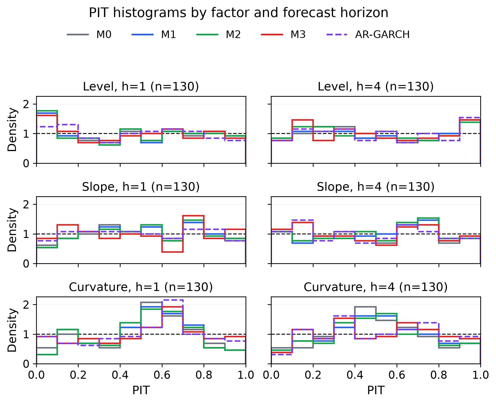

---
format:
  pdf:
    documentclass: scrreprt
    pdf-engine: lualatex
    keep-tex: true
    lof: true
    lot: true
    toc: false
    number-sections: true
fontsize: 12pt
papersize: letter
geometry: margin=1in
linestretch: 1.0
toc-depth: 1
bibliography: ../references.bib
csl: apa.csl
link-citations: true
colorlinks: false
header-includes:
  - |
    \usepackage{chngcntr}
    \counterwithout{equation}{chapter}
    \counterwithout{footnote}{chapter}
    \setkomafont{disposition}{\normalfont\bfseries}
    \RedeclareSectionCommand[beforeskip=0pt,afterskip=1.2\baselineskip]{chapter}
    \setlength{\emergencystretch}{3em}
    \let\MRPListFigures\listoffigures
    \let\MRPListTables\listoftables
    \renewcommand{\listoffigures}{}
    \renewcommand{\listoftables}{}
execute:
  enabled: false
---

```{=latex}
\begin{titlepage}
\centering
\vspace*{1cm}
{\Large\bfseries Probabilistic Forecasting of Canadian Government-Yield Factors:\par}
\vspace{0.4cm}
{\Large\bfseries A Bayesian Stochastic-Volatility Extension of Dynamic Nelson--Siegel\par}
\vspace{1.6cm}
{\large Author: Ethan Yao\par}
\vspace{0.7cm}
November 2026\par
\vspace{0.7cm}
Supervisor: Greg Rice\par
\vfill
A project\par
In partial fulfilment of the requirement for\par
Master of Quantitative Finance\par
University of Waterloo\par

\end{titlepage}
\pagenumbering{roman}
\chapter*{Abstract}
\addcontentsline{toc}{chapter}{Abstract}
```

This study investigates whether incorporating stochastic volatility into the Dynamic Nelson–Siegel (DNS) framework improves probabilistic forecasts of Canadian government yield-curve risk factors. Using weekly government yields at eight maturities from 2000 to 2025, the yield curve is represented by three interpretable factors—level, slope, and curvature—capturing parallel shifts, changes in steepness, and movements in the curve's shape. The analysis compares conventional random-walk and autoregressive benchmarks with Bayesian DNS models featuring constant and time-varying factor volatility. Forecasts are evaluated at one- and four-week horizons across 130 common expanding-window forecast origins during 2016–2025. The primary evaluation uses the continuous ranked probability score (CRPS) to assess marginal predictive distributions, supplemented by the Dawid–Sebastiani score (DSS), point-forecast accuracy, and probabilistic calibration diagnostics.

The empirical findings suggest that the value of stochastic volatility varies across yield-curve factors. Improvements in probabilistic forecasting are most pronounced for curvature, particularly at the longer forecast horizon, while the corresponding effects for level and slope are comparatively limited. These results highlight the importance of examining individual yield-curve risk factors rather than relying exclusively on aggregate forecasting performance. By allowing factor-specific uncertainty to evolve over time, Bayesian stochastic-volatility DNS provides a flexible framework for characterizing interest-rate dynamics beyond conventional point forecasts. From a practical fixed-income perspective, the resulting factor-level predictive distributions offer interpretable inputs for yield-curve scenario analysis, interest-rate exposure assessment, and risk management applications sensitive to changes in the shape of the term structure.


```{=latex}
\clearpage
\chapter*{Acknowledgements}
\addcontentsline{toc}{chapter}{Acknowledgements}
```

I am grateful to my supervisor, Greg Rice, for his guidance and feedback throughout this project. I acknowledge the Bank of Canada as the source of the Canadian zero-coupon yield-curve data.

```{=latex}
\clearpage
\setcounter{tocdepth}{0}
\tableofcontents
\setcounter{tocdepth}{2}
\clearpage
\MRPListTables
\clearpage
\MRPListFigures
\clearpage
\pagenumbering{arabic}
```

# Introduction {#sec-introduction}

## Motivation and research problem

Government yield-curve movements are commonly characterized by three factors—level, slope, and curvature—representing parallel shifts, changes in steepness, and changes in intermediate-maturity shape [@litterman1991common; @diebold2006forecasting]. These movements affect fixed-income valuations, hedging, and interest-rate exposures, while regulatory frameworks recognize the importance of both parallel and non-parallel yield-curve shocks [@bcbs2016irrbb]. Beyond forecasting expected yield movements, characterizing their predictive uncertainty is therefore relevant to interest-rate scenario analysis and risk assessment.

The Dynamic Nelson–Siegel (DNS) framework provides a parsimonious representation of these factors [@diebold2006forecasting]. Conventional autoregressive factor models generally assume constant innovation variances, potentially overlooking changes in uncertainty across market conditions. Bayesian stochastic-volatility extensions allow innovation variances to evolve dynamically [@hautsch2012bayesian]. However, their incremental forecasting value may differ across factors because level, slope, and curvature exhibit distinct dynamics and maturity sensitivities. This motivates the central research question: Does Bayesian stochastic volatility improve marginal probabilistic forecasts of yield-curve factors, and how does its predictive contribution vary across factors and forecast horizons?

The study extracts Nelson–Siegel factors from eight Canadian government yield maturities using fixed loadings and cross-sectional least squares, then models their dynamics separately. Bayesian autoregressive specifications with constant and stochastic volatility are evaluated against random-walk and conventional autoregressive benchmarks across 130 expanding-window forecast origins from 2016 to 2025, at one- and four-week horizons. The continuous ranked probability score (CRPS) serves as the primary measure of probabilistic forecast quality, supplemented by the Dawid–Sebastiani score (DSS), point-forecast errors, and marginal calibration diagnostics.

## Contribution and scope

This study provides a controlled comparison of Bayesian constant- and stochastic-volatility DNS factor forecasts. Both specifications share the same factor extraction, autoregressive mean dynamics, priors for common parameters, and forecast design, isolating the incremental contribution of time-varying innovation uncertainty. By evaluating predictive distributions separately across factors and horizons, the analysis examines whether additional volatility flexibility offers comparable forecasting benefits for different yield-curve movements.

# Methodology and conceptual framework {#sec-literature}

## DNS representation and conventional factor forecasting

The DNS framework separates cross-sectional yield loadings from factor dynamics. @diebold2006forecasting estimates level, slope and curvature factors using fixed Nelson–Siegel loadings and forecasts them with autoregressions. The labels describe maturity-loading patterns, not factor stationarity or economic identification. This paper compares forecasts of those extracted factors.

## Bayesian inference for DNS

Bayesian estimation of Dynamic Nelson–Siegel (DNS) models incorporates uncertainty in factor-dynamic parameters into posterior-predictive distributions, providing a probabilistic alternative to conventional plug-in forecasts. A related two-step approach is developed by @diebold2007global, who treat country-specific factors extracted by ordinary least squares (OLS) as observed inputs in a Bayesian second stage while retaining latent global factors. In contrast, @hautsch2012bayesian develop a Bayesian state-space approach that jointly estimates latent yield-curve factors and stochastic volatility.

This study adopts a two-step Bayesian specification to balance statistical flexibility with computational tractability. Given the expanding-window design with 130 forecast origins, fixing the Nelson–Siegel maturity loadings and extracting factors cross-sectionally reduces estimation to three separate, low-dimensional factor models, avoiding repeated joint latent-state inference. Bayesian posterior simulation then accounts for uncertainty in the factor-dynamic parameters and, where applicable, latent volatility states. The analysis remains conditional on the extracted factors and the initially selected decay parameter, whose estimation uncertainty is not propagated. Factor-level forecast evaluation uses the posterior draws obtained from the completed expanding-window estimation.

## Stochastic factor volatility

Conventional DNS factor dynamics often assume constant innovation variances, whereas stochastic-volatility specifications allow uncertainty surrounding factor movements to evolve over time. Bayesian stochastic-volatility extensions have been investigated in term-structure applications by @hautsch2012bayesian and @caldeira2010bayesian, with @omori2007stochastic providing a computational foundation for mixture-based posterior inference.

The present specification introduces factor-specific latent log-volatility processes into otherwise matched Bayesian DNS autoregressions, without incorporating a leverage effect. The constant- and stochastic-volatility models share the same factor extraction, autoregressive mean structure, priors for common parameters, and forecast design. This controlled comparison isolates the incremental forecasting contribution of time-varying factor volatility within the specified modelling framework. By permitting volatility dynamics to differ across level, slope, and curvature, the approach also allows their marginal predictive distributions to respond differently to changing interest-rate uncertainty.

## Probabilistic forecast evaluation

Proper scoring rules provide a principled framework for assessing predictive distributions rather than relying exclusively on point-forecast accuracy [@gneiting2007strictly]. The primary evaluation criterion is the continuous ranked probability score (CRPS), applied separately to each extracted factor at one- and four-week horizons. CRPS assesses the agreement between a forecast's cumulative distribution and its subsequently observed realization, incorporating both predictive concentration and calibration.

The Dawid–Sebastiani score (DSS) [@dawid1999coherent] provides a complementary assessment of predictive means and variances. In its univariate form, DSS corresponds to a Gaussian quasi-likelihood (QLIKE-type) loss, although it does not represent the exact negative log predictive density for non-Gaussian posterior mixtures. Root mean squared error (RMSE), probability integral transform (PIT) diagnostics, and central prediction-interval coverage provide additional evidence on point accuracy and marginal calibration. Because factor dynamics are estimated independently, the present evaluation focuses on marginal distributions rather than jointly modelling cross-factor dependence. Accordingly, no multivariate Energy Score or joint yield-curve coverage assessment is reported.

The primary statistical comparison examines paired CRPS differences between Bayesian DNS with stochastic volatility (M3) and its constant-volatility counterpart (M2), separately for each factor and forecast horizon. A stationary bootstrap [@politis1994stationary] accounts for temporal dependence across common forecast origins, while Holm adjustment controls the family-wise error rate across the six factor–horizon comparisons. Conventional factor random-walk and autoregressive benchmarks provide additional descriptive context. Together, these evaluations assess the extent to which stochastic volatility contributes to marginal predictive performance and whether the observed improvements differ across yield-curve factors and forecasting horizons.


# Data and information sets {#sec-data}

## Source and provenance

The study uses the Bank of Canada's publicly available zero-coupon Government of Canada yield-curve estimates [@bocdata], constructed from Government of Canada bonds and treasury bills using the methodology documented by @bolder2004canadian. The published daily series covers maturities from three months to 30 years at quarterly-year intervals, providing a consistent term-structure representation suitable for Nelson–Siegel factor extraction. As model-estimated yields rather than directly observed security prices, the series provides the basis for constructing statistical proxies for level, slope, and curvature movements.

## Cleaning, units and weekly sampling

The analysis selects eight maturities, $(0.25, 0.5, 1, 2, 5, 7, 10, 30)$ years, representing the short, intermediate, and long segments of the Canadian government yield curve. Daily observations are retained only when all eight yields are available. The last complete observation in each ISO calendar week is selected to construct the weekly series, without averaging or interpolation. Yields are converted from decimal form to percentage points, ensuring consistent measurement across maturities and forecast evaluations.

The resulting sample contains 1,356 weekly observations spanning 2000–2025. The initial estimation period, 2000–2015, comprises 835 observations, while the remaining 521 observations from 2016–2025 form the out-of-sample evaluation period. Descriptive statistics are reported in @tbl-data, with the selection of forecast origins detailed in Section 3.3.

Both observed yields and extracted Nelson–Siegel factors are expressed in percentage points, where one basis point equals 0.01 percentage points. Consequently, the continuous ranked probability score (CRPS) for each factor is reported in percentage-point units.



{#fig-history width=95%}

## Forecast dates and calendar interpretation

Forecast horizons count weekly observations, not a fixed number of trading days. Every fourth weekly observation in the out-of-sample period is considered as an origin. An origin is retained only if both its one and four-observation-ahead targets lie in 2016–2025. This gives 130 common origins, from 8 January 2016 to 28 November 2025. The otherwise candidate observation near the end of December 2025 is excluded because its four-week target is outside the sample.

Public holidays can change the weekday and elapsed calendar time between observations without changing the weekly index. No interval between successive observations exceeds ten calendar days. Accordingly, a four-week forecast denotes four steps ahead in the weekly sample where its target date follows from the observed calendar rather than a fixed 28-day interval.

# Model specifications {#sec-methods}

## Nelson–Siegel observation equation

The Dynamic Nelson–Siegel (DNS) framework represents the term structure of interest rates using three time-varying factors associated with level, slope, and curvature movements [@diebold2006forecasting]. For a zero-coupon yield $y_t(\tau)$ observed at time $t$ and maturity $\tau$ (in years), the representation is

$$
\begin{aligned}
y_t(\tau)={}&L_t
+S_t\left(\frac{1-e^{-\lambda\tau}}{\lambda\tau}\right)\\
&+C_t\left(\frac{1-e^{-\lambda\tau}}{\lambda\tau}-e^{-\lambda\tau}\right).
\end{aligned}
$$

Here, $L_t$ captures movements common to all maturities, $S_t$ governs the short-to-long maturity contrast, and $C_t$ captures curvature concentrated around intermediate maturities. These interpretations arise from the functional form of the maturity loadings rather than from formal economic identification. The decay parameter $\lambda>0$ determines the shape of the slope and curvature loadings, defined as

$$
s(\tau;\lambda)=\frac{1-e^{-\lambda\tau}}{\lambda\tau},
\qquad
c(\tau;\lambda)=s(\tau;\lambda)-e^{-\lambda\tau}.
$$ {#eq-loadings}

The slope loading decreases toward zero as maturity increases, whereas the curvature loading reaches its maximum near $\lambda\tau=1.793$. The decay parameter is selected by minimizing cross-sectional squared reconstruction errors over the initial 2000–2015 training sample, using a 160-point grid between 0.05 and 2.0 inverse years. The resulting estimate, $\lambda=0.516038$, places the curvature maximum at approximately 3.48 years and is held fixed throughout the forecasting experiment.

For the eight selected maturities, let $Y_t$ denote the observed yield vector and $\Lambda(\lambda)$ the $8\times3$ loading matrix with rows $(1,s(\tau_i;\lambda),c(\tau_i;\lambda))$. Conditional on the fixed loadings, the three-factor vector $\tilde f_t=(L_t,S_t,C_t)'$ is extracted independently at each observation date by cross-sectional ordinary least squares (OLS):

$$
\tilde f_t=(\Lambda'\Lambda)^{-1}\Lambda'Y_t.
$$ {#eq-extraction}

The estimation is implemented using a numerical least-squares solver rather than explicitly calculating the matrix inverse. With full-column-rank loadings, the resulting yield reconstruction satisfies

$$
Y_t=\Lambda(\lambda)\tilde f_t+r_t,
\qquad
\Lambda(\lambda)'r_t=0,
$$ {#eq-observation}

where $r_t$ is the vector of cross-sectional reconstruction residuals. Consequently, the extracted factors are deterministic projections of the observed yield curve, while the residuals lie in the five-dimensional orthogonal complement of the Nelson–Siegel loading space. The OLS orthogonality condition holds within each observation date but does not imply independence across residual maturities or over time. Indeed, the initial training sample exhibits substantial cross-maturity residual correlation, with a mean absolute pairwise correlation of approximately 0.660.

The subsequent Bayesian analysis treats the extracted factors as observed proxies and models their time-series dynamics rather than jointly estimating latent factors and yield-level measurement errors. Accordingly, reconstruction residuals are not assigned a separate probabilistic measurement-error covariance in the factor likelihood. Factor dynamics are estimated independently for level, slope, and curvature, so the resulting forecasts characterize their marginal predictive distributions without explicitly modelling cross-factor dependence. This conditional two-step specification provides the foundation for the constant and stochastic-volatility comparisons developed below.

## Conventional two-step DNS

The conventional two-step Dynamic Nelson–Siegel (DNS) approach models the temporal evolution of the level, slope, and curvature factors extracted from the observed yield curve. Following @diebold2006forecasting, each factor is represented by a first-order autoregressive AR(1) process. The classical benchmark (M1) specifies

$$
f_{j,t+1}=a_j+b_j f_{j,t}+\eta_{j,t+1},
\quad \eta_{j,t+1}\sim N(0,q_j).
$$ {#eq-ar}

where $j\in{L,S,C}$ denotes the yield-curve factor, $a_j$ is the intercept, $b_j$ measures autoregressive persistence, and $q_j$ is the constant innovation variance. Parameters are estimated separately for each factor by ordinary least squares (OLS) using observations available through each forecast origin. Unlike the Bayesian specifications introduced below, the classical persistence estimate is unrestricted.

Conditional on the fitted parameters and the latest extracted factor value, the $h$-step-ahead predictive distribution is Gaussian, with mean and variance

$$
\begin{aligned}
\mu^{\mathrm{fc}}_{j,h}
&=\hat b_j^h\tilde f_{j,t}
+\hat a_j\sum_{k=0}^{h-1}\hat b_j^k,\\
V^{\mathrm{fc}}_{j,h}
&=\hat q_j\sum_{k=0}^{h-1}\hat b_j^{2k}.
\end{aligned}
$$ {#eq-ar-moments}

These expressions account for the accumulation of future factor innovations but condition on the estimated coefficients. Consequently, parameter-estimation uncertainty is not incorporated into the classical predictive distributions. The three factor regressions are estimated independently, providing separate marginal forecasts without explicitly modelling cross-factor dependence.

## Bayesian constant-volatility DNS

The Bayesian constant-volatility specification (M2) serves as the primary control for evaluating the contribution of stochastic factor volatility. It retains the Gaussian AR(1) mean dynamics while incorporating parameter uncertainty through posterior inference. For each extracted factor,

$$
\tilde f_{j,t}=(1-b_j)\mu_j+b_j\tilde f_{j,t-1}+\eta_{j,t},
\qquad \eta_{j,t}\sim N(0,e^{m_j}).
$$ {#eq-m3-factor}

where $\mu_j$ denotes the long-run factor mean, $b_j$ governs persistence, and $m_j$ determines the log innovation variance. The parameterization implies $a_j=(1-b_j)\mu_j$ and, for $|b_j|<1$, a stationary conditional factor process.

Rather than specifying an independent prior on the intercept, the model places a Gaussian prior directly on the long-run mean, together with a stationary truncated-normal prior on persistence:

$$
\begin{aligned}
\mu_j&\sim N \left(
\bar f_{j,\mathrm{train}},
(2s_{j,\mathrm{train}})^2
\right),\\
b_j&\sim N \left(
\hat b_{j,\mathrm{OLS}},0.03^2
\right)\text{ truncated to }(-1,1),\\
a_j&=(1-b_j)\mu_j.
\end{aligned}
$$ {#eq-coefficient-prior}

Here, $\bar f_{j,\mathrm{train}}$ and $s_{j,\mathrm{train}}$ denote the sample mean and standard deviation of each extracted factor over the initial 2000–2015 training period, while $\hat b_{j,\mathrm{OLS}}$ is the corresponding auxiliary AR(1) persistence estimate. These empirical-Bayes hyperparameters are calibrated using the initial 835 weekly observations and held fixed across subsequent expanding estimation windows.

Specifying the prior directly on $\mu_j$ ensures finite prior moments for the long-run factor mean, avoiding the potentially heavy-tailed ratio $a_j/(1-b_j)$ induced by independent diffuse priors on the intercept and persistence. The prior standard deviation of twice the training factor standard deviation allows substantial uncertainty around the historical mean. For persistence, the truncated-normal prior restricts $b_j$ to the stationary region $(-1,1)$, with a standard deviation of $0.03$ chosen as a study-specific regularization scale. This specification implies prior median mean-reversion half-lives of approximately 32, 31, and 22 weeks for level, slope, and curvature, respectively, while accommodating near-unit-root persistence. Prior-only comparisons with standard deviations of $0.015$ and $0.06$ illustrate how alternative scales affect the implied half-life distributions. The selected value therefore represents an intermediate degree of persistence regularization among the considered alternatives.

The constant innovation variance is parameterized on the logarithmic scale:

$$
m_j\sim N(\mu_{0j},1),
\qquad
\mu_{0j}
=\log \left(
\frac{1}{834}\sum_{t=2}^{835}
\hat e_{j,t}^{2}
\right),
$$ {#eq-constant-variance-prior}

where $\hat e_{j,t}$ denotes the residual from an auxiliary OLS AR(1) fitted to the initial training sample. This construction centers the log-variance prior on the historical factor-innovation scale while allowing uncertainty around that estimate. The resulting innovation variance $e^{m_j}$ is strictly positive and has finite prior moments.

These training-calibrated priors constitute an empirical-Bayes specification because the initial observations inform both the hyperparameters and the subsequent likelihood. Posterior simulation integrates uncertainty in the factor-dynamic parameters, yielding predictive distributions that account for both future innovations and parameter uncertainty.

## Bayesian DNS with stochastic factor volatility

The stochastic-volatility extension (M3) relaxes the constant-innovation-variance assumption while preserving the factor representation, autoregressive mean dynamics, and priors for parameters shared with M2. Following the Bayesian stochastic-volatility approach of @hautsch2012bayesian, each factor follows

$$
\tilde f_{j,t}
=a_j+b_j\tilde f_{j,t-1}+\eta_{j,t},
\qquad
\eta_{j,t}\mid h_{j,t}
\sim N(0,e^{h_{j,t}}),
$$ {#eq-sv-factor}

with latent log-volatility dynamics

$$
h_{j,t}
=\omega_j+\phi_j(h_{j,t-1}-\omega_j)+u_{j,t},
\qquad
u_{j,t}\sim N(0,\sigma_{u,j}^2).
$$ {#eq-sv-state}

Here, $h_{j,t}$ represents the time-varying log innovation variance, $\omega_j$ its stationary mean, $\phi_j$ volatility persistence, and $\sigma_{u,j}^2$ the variance of log-volatility innovations. The factor and volatility innovations are conditionally Gaussian and independent, so the specification excludes leverage effects. The three factor processes are again estimated separately.

The volatility persistence parameter is assigned a transformed Beta prior,

$$
\frac{\phi_j+1}{2}
\sim\operatorname{Beta}(20,1.5),
$$ {#eq-volatility-persistence-prior}

which places greater prior probability on persistent but stationary volatility dynamics. The specification draws on the stochastic-volatility inference literature [@kim1998stochastic; @omori2007stochastic], although the selected hyperparameters are not treated as independently calibrated to Canadian weekly yield factors.

To maintain comparability with the constant-volatility model, the stochastic-volatility process is reparameterized in terms of $m_j$, the log of the long-run expected innovation variance, and $v_j$, the stationary variance of log volatility:

$$
\begin{aligned}
\omega_j&=m_j-\frac{v_j}{2},\\
\sigma_{u,j}^2&=v_j(1-\phi_j^2),\\
h_{j,1}&\sim N(\omega_j,v_j).
\end{aligned}
$$ {#eq-finite-reparam}

Under stationarity, this implies

$$
E[e^{h_{j,t}}\mid m_j,\phi_j,v_j]=e^{m_j}.
$$

The two Bayesian models therefore share the same prior interpretation for long-run expected factor-innovation variance, while M3 additionally permits its conditional realization to vary over time.

For the stationary log-volatility variance, the model adopts a rate-one exponential prior truncated at an upper bound $U=4$:

$$
p_U(v_j)
=\frac{e^{-v_j}}{1-e^{-U}}
\mathbf{1}_{(0,U)}(v_j),
\qquad U=4.
$$ {#eq-finite-prior}

The rate-one truncated exponential prior regularizes the stationary log-volatility variance toward smaller values, while the finite upper bound provides a sufficient condition for the existence of finite-horizon posterior-predictive moments, as established in the Appendix. The numerical choice $U=4$ is assessed through training-only prior-predictive sensitivity experiments using $U\in{2,4,8}$, with 100,000 simulations per specification. The resulting one and four-week yield-movement distributions show limited sensitivity to the bound where increasing $U$ from four to eight changes the four-week 99th percentile of the RMS yield-curve movement by approximately 0.1%. Posterior diagnostics further indicate limited concentration near the imposed boundary, with the largest origin-specific posterior 99th percentile of $v_j$ equal to 2.87. The prior-predictive assessment follows the principle of evaluating prior implications in the context of observable outcomes [@gelman2017prior].

Posterior inference uses a Gaussian-mixture representation of log-squared innovations with a Metropolis correction targeting the exact likelihood [@kim1998stochastic; @omori2007stochastic]. At each forecast origin, posterior draws are propagated through the factor and latent-volatility dynamics for one or four weekly steps. The resulting predictive distributions incorporate uncertainty in model parameters, future factor innovations, and evolving volatility states.

The present analysis evaluates these marginal factor distributions directly. It does not introduce an additional yield-reconstruction error process or estimate a joint covariance structure across the three factors.

## Factor-level forecast benchmarks

To assess the incremental forecasting value of Bayesian inference and stochastic volatility, the study compares four specifications under identical forecast origins and horizons.

The simplest benchmark (M0) is a factor random walk, which assumes that each factor's expected future value equals its current observation. Its predictive distribution is approximated by

$$
\tilde f_{j,t+h}\mid\mathcal F_t
\sim N\!\left(
\tilde f_{j,t},
h\widehat{\sigma}_{\Delta f_j}^{2}
\right),
$$ {#eq-factor-rw}

where $\widehat{\sigma}_{\Delta f_j}^{2}$ is estimated from historical weekly factor changes through the forecast origin. The variance scales linearly with the forecast horizon under the random-walk assumption.

The conventional DNS benchmark (M1) instead models each factor using the unrestricted OLS AR(1) specification in @eq-ar, with forecast moments given by @eq-ar-moments. The Bayesian constant-volatility model (M2) incorporates posterior parameter uncertainty under stationary factor dynamics, while the stochastic-volatility extension (M3) additionally allows innovation uncertainty to evolve over time.

All four models produce marginal predictive distributions for level, slope, and curvature at one- and four-week horizons. The classical specifications use Gaussian plug-in forecasts, whereas the Bayesian models integrate over accepted posterior parameter draws and future factor innovations. Comparisons are conducted at common forecast origins, ensuring that differences in forecast performance are assessed against the same factor realizations and market periods.

| Model | Specification | Role in evaluation |
|---|---|---|
| M0 | Factor random walk; training-only change variance | Random-walk benchmark |
| M1 | Two-step DNS; unrestricted OLS AR(1) by factor | Conventional DNS benchmark |
| M2 | Bayesian two-step DNS; constant factor volatility | Bayesian control |
| M3 | Bayesian two-step DNS; finite-moment stochastic factor volatility | Bayesian extension |

: Forecasting specifications and their roles in the comparison. {#tbl-ladder}

# Experimental design and evaluation {#sec-design}

## Expanding-window design

The forecasting experiment uses an expanding-window design to assess the out-of-sample probabilistic performance of the level, slope, and curvature factors. The initial estimation period spans 2000–2015, comprising 835 weekly observations used to select the Nelson–Siegel decay parameter and calibrate the Bayesian priors. The evaluation period covers 2016–2025, with 130 common forecast origins selected at intervals of four weekly observations. At each origin, the estimation window expands to incorporate subsequent observations, and forecasts are generated one and four weekly observations ahead. All models use information dated no later than the corresponding forecast origin, ensuring consistent historical information sets and directly comparable forecast targets.

The experiment evaluates four factor-forecasting specifications: a random walk (M0), a conventional autoregressive model (M1), Bayesian DNS with constant volatility (M2), and Bayesian DNS with stochastic volatility (M3). Across three factors, two forecast horizons, and 130 origins, the design produces 3,120 marginal factor forecasts, of which 1,560 correspond to the Bayesian specifications. Bayesian inference uses four Markov chain Monte Carlo (MCMC) chains per model and factor, with 3,000 warm-up iterations and 6,000 retained posterior draws per chain.

For the classical benchmarks, predictive means and variances are obtained from the fitted model parameters. The random-walk variance is estimated from historical weekly factor differences and scaled by the forecast horizon, whereas the autoregressive benchmark uses unrestricted ordinary least squares (OLS) estimates and the mean squared fitted innovation residual. For the Bayesian models, forecast moments integrate over posterior parameter uncertainty using the law of total expectation and variance:

$$
\begin{aligned}
E[f_{j,t+h}\mid\mathcal F_t]
&=E_\theta\!\left[
E[f_{j,t+h}\mid\theta,\mathcal F_t]
\right],\\
\operatorname{Var}(f_{j,t+h}\mid\mathcal F_t)
&=E_\theta\!\left[
\operatorname{Var}(f_{j,t+h}\mid\theta,\mathcal F_t)
\right]\\
&\quad+\operatorname{Var}_\theta\!\left[
E[f_{j,t+h}\mid\theta,\mathcal F_t]
\right].
\end{aligned}
$$

Here, $\theta$ represents the relevant model parameters and latent volatility states. Posterior-predictive simulation additionally propagates future factor innovations and, for the stochastic-volatility specification, future volatility dynamics. This provides the predictive distributions required for probabilistic evaluation while retaining a common forecasting design across models.

## Continuous ranked probability score and DSS

The primary evaluation criterion is the univariate CRPS. For predictive distribution $F$ and realized factor value $y$, it is

$$
\operatorname{CRPS}(F,y)=
E_F|X-y|-\frac12E_F|X-X'|,
\qquad X,X'\stackrel{\mathrm{iid}}{\sim}F.
$$ {#eq-crps}

CRPS assesses the agreement between the predictive distribution and the realized outcome, rewarding forecasts that combine appropriate uncertainty quantification with predictive concentration. Lower values indicate better probabilistic performance. Unlike a point-forecast loss, CRPS evaluates the full marginal predictive distribution, making it particularly suitable for assessing the contribution of time-varying factor volatility.

For the Gaussian random-walk and autoregressive benchmarks, CRPS is evaluated analytically. For the Bayesian models, its expectation terms are estimated using two independent sets of 8,192 posterior-predictive factor scenarios per origin, factor, and horizon. Eight batches of 1,024 scenario pairs are used to assess Monte Carlo precision. Because the extracted factors are expressed in percentage points, CRPS retains the same measurement units.

The Dawid–Sebastiani score (DSS) provides a complementary evaluation of predictive means and variances [@dawid1999coherent]. For forecast error $e_{j,t,h}=\tilde f_{j,t+h}-\widehat\mu_{j,t,h}$ and predictive variance $\widehat V_{j,t,h}>0$, the univariate score is

$$
\operatorname{DSS}_{j,t,h}
=\log \widehat V_{j,t,h}
+\frac{e_{j,t,h}^{\,2}}{\widehat V_{j,t,h}}.
$$ {#eq-dss}

The log-variance term and the variance-standardized squared error jointly assess forecast dispersion and accuracy. For Gaussian predictive distributions, DSS is equivalent to twice the negative log predictive density up to the additive constant $\log(2\pi)$. For Bayesian posterior-predictive mixtures, it remains a moment-based Gaussian quasi-likelihood (QLIKE-type) score rather than the exact negative log predictive density.

Although DSS resembles the QLIKE loss used in volatility-forecast evaluation, the present analysis does not construct a separate variance-only QLIKE comparison. Such an evaluation would require a suitable common variance target or proxy, whereas squared forecast errors here depend on model-specific predictive means. Consequently, the robustness arguments for imperfect volatility proxies developed by @patton2011volatility do not directly justify an additional variance-only comparison. CRPS therefore remains the primary criterion for assessing marginal probabilistic forecasting performance.

## Marginal calibration and point-forecast evaluation

Probabilistic forecast evaluation is supplemented by probability integral transform (PIT) diagnostics and central prediction-interval coverage. For predictive distribution $F_{j,t,h}$ and observed factor realization $\tilde f_{j,t+h}$, the PIT is

$$
u_{j,t,h}
=F_{j,t,h}(\tilde f_{j,t+h}).
$$

For the Bayesian constant-volatility model, PIT values are computed by averaging conditional Gaussian cumulative distribution functions over posterior parameter draws. For the stochastic-volatility model, the calculation additionally integrates over simulated future volatility paths, accounting for uncertainty in the factor innovation variance throughout the forecast horizon.

Central 50%, 80%, and 90% prediction intervals are obtained analytically for the Gaussian benchmarks and from posterior-predictive quantiles for the Bayesian models. Empirical coverage and average interval width are reported separately for each factor and horizon. PIT distributions provide complementary evidence on marginal calibration, while interval width measures forecast concentration. These diagnostics are interpreted descriptively given the finite number of forecast origins.

Point-forecast accuracy is evaluated using root mean squared error (RMSE) and mean absolute error (MAE), calculated from predictive means:

$$
\begin{aligned}
\operatorname{RMSE}_{j,h}
&=\sqrt{\frac{1}{N}\sum_{t=1}^{N}
\left(\tilde f_{j,t+h}-\widehat\mu_{j,t,h}\right)^2},\\
\operatorname{MAE}_{j,h}
&=\frac{1}{N}\sum_{t=1}^{N}
\left|\tilde f_{j,t+h}-\widehat\mu_{j,t,h}\right|,
\end{aligned}
$$

where $N=130$ denotes the number of common forecast origins. These measures help distinguish improvements in predictive distributions from changes in conditional mean accuracy.

All evaluations are conducted separately for level, slope, and curvature. Because the models do not explicitly estimate cross-factor dependence, the analysis does not assess a jointly specified multivariate factor distribution or full yield-curve calibration. Accordingly, multivariate Energy Scores and joint coverage statistics are outside the present evaluation.

## Inference and computational diagnostics

The primary statistical comparison examines the difference in CRPS between Bayesian stochastic-volatility DNS (M3) and its constant-volatility counterpart (M2), separately for each factor and forecast horizon. For factor $j$ and horizon $h$, the average paired score difference is

$$
\widehat\Delta_{j,h}
=\frac{1}{N}\sum_{t=1}^{N}
\left(
\operatorname{CRPS}{M3,j,t,h}
-\operatorname{CRPS}{M2,j,t,h}
\right).
$$

Negative differences favor stochastic volatility. Pairing forecasts at common origins controls for variation in the evaluation sample and allows comparisons to focus on differences in predictive performance under identical realized factor outcomes.

Statistical uncertainty is assessed using the stationary bootstrap of @politis1994stationary, which accommodates temporal dependence in the sequence of paired score differences. The primary procedure uses 9,999 bootstrap replications with an expected block length of four forecast origins, producing 95% percentile confidence intervals and two-sided hypothesis tests. The same resampled origin indices are applied across all six factor–horizon comparisons to preserve their dependence structure.

Because the analysis examines three factors at two horizons, the six primary p-values are adjusted using Holm's multiple-testing procedure to control the family-wise error rate. Additional bootstrap results using expected block lengths of eight and twelve origins assess sensitivity to the assumed dependence structure. Comparisons with the classical random-walk and autoregressive benchmarks are reported descriptively.

Monte Carlo simulation introduces an additional source of numerical uncertainty. For each Bayesian forecast, the CRPS Monte Carlo standard error is estimated from independent scenario batches. Assuming independently generated simulation streams across models and origins, the Monte Carlo standard error of the average paired difference is estimated as

$$
\operatorname{MCSE}(\widehat\Delta_{j,h})
=\frac{1}{N}
\sqrt{\sum_{t=1}^{N}
\left(s_{M2,j,t,h}^2+s_{M3,j,t,h}^2\right)},
$$

where $s_{m,j,t,h}$ denotes the estimated simulation standard error for the corresponding CRPS. This measure quantifies finite-simulation precision and is distinguished from the bootstrap uncertainty associated with variation across forecast origins.

Posterior simulation quality is assessed using rank-normalized split $\widehat R$ and bulk and tail effective sample sizes, following @vehtari2021rank. These diagnostics evaluate convergence and the reliability of posterior simulation, while the predictive scores and calibration measures assess forecasting performance. Statistical conclusions are conditional on the specified factor representations, model assumptions, and evaluation sample; the paired tests do not independently establish statistically significant differences in the effects of stochastic volatility between factors.

# Empirical results {#sec-results}

## Forecast sample and posterior diagnostics

The evaluation comprises 130 forecast origins between January 2016 and November 2025, covering one- and four-week horizons. Across four models and three Nelson–Siegel factors, the experiment produces 3,120 marginal forecasts, including 1,560 Bayesian forecasts. Posterior inference satisfies the adopted numerical acceptance criteria: the maximum rank-normalized $\widehat R$ is 1.00965, and minimum bulk and tail effective sample sizes exceed 1,000 and 2,000, respectively. These diagnostics support the numerical reliability of posterior simulation without implying predictive calibration [@vehtari2021rank].

## Posterior parameter behavior

To assess posterior learning under stochastic volatility, @tbl-posterior-parameters summarizes the final Bayesian fit at 28 November 2025, using 24,000 retained draws per factor. Relative to their training-calibrated priors, posterior distributions generally exhibit greater concentration, particularly for the stationary log-volatility variance $v_j$. Factor persistence remains high, while uncertainty in long-run means reflects the difficulty of estimating equilibrium levels for highly persistent interest-rate factors.



The posterior distributions also provide evidence about the influence of volatility regularization. Across the 130 fits, the largest posterior 99th percentile of $v_j$ is 2.87, below the imposed upper bound of four, and posterior probability near that boundary is limited. The results suggest that posterior estimates are not persistently concentrated against the truncation boundary, although they do not establish robustness to alternative prior specifications.

## Marginal probabilistic forecasting performance

@tbl-factor-crps reports average CRPS for each factor and horizon. Stochastic-volatility DNS (M3) achieves lower CRPS than the Bayesian constant-volatility specification (M2) across all six comparisons, with the largest improvements observed for curvature.

| Factor | Horizon | M0 | M1 | M2 | M3 |
|---|---:|---:|---:|---:|---:|
| Level | 1 | 0.05964 | 0.05962 | 0.05980 | 0.05968 |
| Level | 4 | 0.11277 | 0.11280 | 0.11249 | 0.11185 |
| Slope | 1 | 0.06836 | 0.06861 | 0.06870 | 0.06830 |
| Slope | 4 | 0.14587 | 0.14684 | 0.14624 | 0.14411 |
| Curvature | 1 | 0.15826 | 0.15614 | 0.15639 | 0.15102 |
| Curvature | 4 | 0.32748 | 0.31702 | 0.31744 | 0.30195 |

: Mean marginal CRPS across 130 forecast origins, in factor percentage points. Lower values indicate better probabilistic forecasts. {#tbl-factor-crps}

Relative to constant volatility, curvature CRPS decreases by approximately 3.4% at one week and 4.9% at four weeks, whereas improvements for level and slope are considerably smaller. The stochastic-volatility specification also records the lowest curvature CRPS among all four models. These findings suggest that the incremental value of time-varying volatility is most apparent for uncertainty surrounding changes in yield-curve shape. Formal inference on these differences is presented below.

As a complementary distributional measure, the DSS evaluates predictive means and variances, while MAE assesses point-forecast accuracy. @tbl-factor-dss-mae summarizes both metrics for the two Bayesian specifications.

| Factor | Horizon | M2 DSS | M3 DSS | M2 MAE | M3 MAE |
|---|---:|---:|---:|---:|---:|
| Level | 1 | −3.415 | −3.419 | 0.0830 | 0.0830 |
| Level | 4 | −2.188 | −2.261 | 0.1581 | 0.1581 |
| Slope | 1 | −3.161 | −3.192 | 0.0949 | 0.0947 |
| Slope | 4 | −1.528 | −1.598 | 0.2018 | 0.2000 |
| Curvature | 1 | −1.455 | −1.563 | 0.2076 | 0.2083 |
| Curvature | 4 | 0.003 | −0.080 | 0.4166 | 0.4181 |

: Mean DSS and MAE across 130 origins for Bayesian constant-volatility (M2) and stochastic-volatility (M3) DNS. Lower values are preferable for both metrics; MAE is measured in factor percentage points. {#tbl-factor-dss-mae}

M3 achieves lower DSS across all six factor–horizon comparisons, providing descriptive support for the CRPS findings. In contrast, MAE differences are small and do not consistently favor stochastic volatility. The results suggest that its forecasting contribution primarily concerns predictive uncertainty rather than conditional mean accuracy. DSS differences are reported as supplementary evidence without separate significance testing.

## Point accuracy and marginal calibration

Probabilistic improvements do not necessarily coincide with improvements in conditional mean forecasts. @tbl-factor-auxiliary compares RMSE and nominal 90% interval coverage for the two Bayesian specifications.

| Factor | Horizon | M2 RMSE | M3 RMSE | M2 coverage | M3 coverage |
|---|---:|---:|---:|---:|---:|
| Level | 1 | 0.1066 | 0.1065 | 83.8% | 86.2% |
| Level | 4 | 0.2019 | 0.2021 | 85.4% | 89.2% |
| Slope | 1 | 0.1246 | 0.1246 | 90.0% | 90.0% |
| Slope | 4 | 0.2779 | 0.2766 | 90.8% | 88.5% |
| Curvature | 1 | 0.2786 | 0.2798 | 95.4% | 88.5% |
| Curvature | 4 | 0.5890 | 0.5918 | 95.4% | 93.1% |

: Bayesian point accuracy and marginal calibration across 130 origins. RMSE is in factor percentage points; nominal interval coverage is 90%. {#tbl-factor-auxiliary}

Point-forecast accuracy is broadly similar between the two Bayesian models. Notably, M3's improvement in four-week curvature CRPS occurs alongside a slightly higher RMSE, reinforcing that its distributional advantage does not arise from more accurate conditional mean predictions alone.

Coverage results vary across factors. Stochastic volatility brings curvature coverage closer to the nominal 90% level at both horizons, while level and slope exhibit mixed patterns. At four weeks, curvature's nominal 50% interval coverage also moves from 70.0% under M2 to 54.6% under M3, indicating substantially reduced central overcoverage.

Marginal calibration is further examined through the probability integral transform (PIT) distributions in @fig-factor-pit.

{#fig-factor-pit width="85%"}

The PIT histograms show deviations from uniformity that differ across factors and horizons. Curvature forecasts under constant volatility exhibit noticeable concentration in central PIT bins, consistent with their excessive interval coverage. Stochastic volatility generally reduces this concentration, particularly at the four-week horizon, although irregularities remain. Level and slope display less consistent changes in histogram shape.

## Paired Bayesian comparison

The primary inferential comparison considers paired M3-minus-M2 CRPS differences. Negative values favor stochastic volatility. @tbl-factor-paired reports stationary-bootstrap confidence intervals and Holm-adjusted p-values for the six factor–horizon comparisons.

| Factor | Horizon | Mean difference | 95% interval | Raw p | Holm p |
|---|---:|---:|---:|---:|---:|
| Level | 1 | −0.00012 | [−0.00073, 0.00046] | 0.702 | 1.000 |
| Level | 4 | −0.00063 | [−0.00289, 0.00105] | 0.534 | 1.000 |
| Slope | 1 | −0.00041 | [−0.00165, 0.00085] | 0.525 | 1.000 |
| Slope | 4 | −0.00213 | [−0.00640, 0.00224] | 0.338 | 1.000 |
| Curvature | 1 | −0.00536 | [−0.01053, −0.00016] | 0.042 | 0.210 |
| Curvature | 4 | −0.01549 | [−0.02807, −0.00263] | 0.018 | 0.106 |

: Paired CRPS differences using a stationary bootstrap with an expected block length of four origins. Confidence intervals are unadjusted; Holm-adjusted p-values account for six comparisons. {#tbl-factor-paired}

Curvature exhibits the largest estimated CRPS reductions, and its unadjusted confidence intervals exclude zero at both horizons. However, neither comparison remains significant after adjustment for multiple testing. The results therefore provide suggestive evidence of a curvature-specific forecasting benefit rather than confirmatory evidence of stochastic-volatility superiority.

The estimated curvature improvements are substantially larger than their corresponding scenario-simulation Monte Carlo standard errors, indicating that finite-simulation noise is unlikely to account for the observed score reductions.

## Factor-isolated interest-rate risk illustration

To illustrate the financial interpretation of the predictive distributions, factor-level forecasts are translated into interest-rate exposure using a first-order duration approximation. At the final forecast origin, the four-week 90% interval for the level factor's contribution to the five-year yield is approximately [−31.8, 30.5] basis points under constant volatility and [−25.5, 23.0] basis points under stochastic volatility.

For a stylized $1 million fixed-income position with modified duration of five, these intervals correspond to approximate first-order P&L ranges of [−$15,300, $15,900] and [−$11,500, $12,800], respectively. The illustration demonstrates how differences in marginal predictive uncertainty translate into interest-rate exposure estimates. It varies only the level factor, holding slope and curvature fixed, and therefore represents a factor-isolated sensitivity analysis rather than a calibrated portfolio VaR or joint yield-curve risk forecast.

# Discussion and limitations {#sec-discussion}

## Interpretation of the forecasting results

The central contribution of this study is to evaluate the incremental value of stochastic volatility at the level of individual Nelson–Siegel risk factors, rather than assessing yield-curve forecasts solely through aggregate accuracy. By comparing Bayesian constant- and stochastic-volatility specifications under matched factor extraction, mean dynamics, prior assumptions, and forecast origins, the analysis provides a controlled assessment of how time-varying innovation uncertainty affects marginal predictive distributions.

The results reveal a distinct empirical pattern. Improvements in CRPS are negligible for level, modest for slope, and largest for curvature, where stochastic volatility reduces average CRPS by approximately 3.4% at one week and 4.9% at four weeks. These reductions exceed estimated Monte Carlo simulation error, suggesting that the observed differences are not artifacts of finite predictive simulation. However, neither curvature comparison remains statistically significant after Holm adjustment, and cross-factor heterogeneity has not been formally tested. The evidence therefore suggests a potentially greater role for stochastic volatility in forecasting curvature uncertainty, rather than establishing a universal or statistically confirmed factor-specific advantage.

Importantly, the curvature improvements are not accompanied by corresponding gains in point-forecast accuracy. This distinction illustrates why evaluating predictive distributions is valuable: models with similar conditional mean forecasts can provide different assessments of uncertainty. The findings consequently support examining probabilistic performance as a separate dimension of yield-curve forecasting, particularly when forecasting uncertainty is itself relevant to financial decisions.

## Implications for fixed-income risk management

The factor-level interpretation provides a direct connection between statistical forecasting and fixed-income risk analysis. Level, slope, and curvature represent different patterns of yield-curve movements, with potentially different implications for maturity-specific exposures, hedging strategies, and interest-rate scenarios. A model that characterizes uncertainty in these movements can therefore offer information beyond the expected direction of interest rates.

The relatively larger curvature improvements are particularly relevant to exposures sensitive to changes in the intermediate portion of the yield curve. The empirical results suggest that explicitly modelling time-varying volatility may be more informative for these shape-related movements than for approximately parallel shifts. Conversely, the competitive performance of random-walk and autoregressive benchmarks for level and slope indicates that additional model complexity does not necessarily provide commensurate forecasting benefits for every risk factor.

This distinction has practical implications for model development. Rather than applying increasingly complex volatility specifications uniformly across all yield-curve factors, financial institutions may benefit from evaluating their incremental predictive contribution separately. The duration-based illustration further demonstrates how marginal factor distributions can be translated into interpretable interest-rate exposure ranges. These applications motivate the use of probabilistic factor forecasts as components of risk analysis, although their economic value in actual hedging or portfolio decisions has not been directly tested.

## Modelling assumptions and statistical limitations

The analysis remains conditional on the two-step DNS representation. Factors are extracted using fixed Nelson–Siegel loadings and subsequently treated as observed inputs, without propagating uncertainty in factor extraction or the selected decay parameter. Moreover, the factor models are estimated independently, so cross-factor dependence is not represented in the predictive distributions. Consequently, the results support marginal factor forecasting and factor-isolated sensitivities, but not calibrated joint yield-curve scenarios, portfolio value-at-risk, or expected shortfall.

The stochastic-volatility specification captures time variation in innovation variance but retains Gaussian conditional innovations, independent factor dynamics, and no leverage effects. Training-sample residual diagnostics indicate conditional heteroskedasticity and departures from Gaussianity, supporting the investigation of volatility dynamics without establishing that the chosen specification fully explains those features. Although stochastic volatility can generate heavy-tailed marginal distributions through variance mixtures, it does not directly accommodate conditional asymmetry or more general innovation distributions.

Prior specification introduces additional uncertainty. The Bayesian models share priors for common parameters and match the interpretation of long-run expected innovation variance, improving comparability. The bounded log-volatility variance prior also ensures finite-horizon predictive moments. Nevertheless, its numerical hyperparameters remain regularization choices. Training-only prior-predictive checks and posterior diagnostics provide evidence of plausibility, but do not establish forecasting robustness to alternative persistence or volatility priors.

Finally, the historical data extract and publication delays restrict the analysis to retrospective observation-time forecasting. The stationary bootstrap accounts for dependence across the 130 forecast origins, while Monte Carlo standard errors quantify predictive simulation noise; neither incorporates uncertainty arising from model specification, historical data vintages, or factor extraction. The conclusions should therefore be interpreted within the stated forecasting design rather than as evidence of real-time trading or risk-management performance.

# Conclusions {#sec-conclusions}

This study investigates whether Bayesian stochastic volatility improves marginal probabilistic forecasts of Canadian government yield-curve factors. Using a controlled comparison of constant- and stochastic-volatility Dynamic Nelson–Siegel specifications across 130 expanding-window forecast origins, it evaluates the predictive distributions of level, slope, and curvature at one- and four-week horizons.

The principal finding is that the estimated benefit of stochastic volatility is concentrated in curvature, particularly at the longer horizon, while level and slope exhibit comparatively small changes. These improvements are evident in probabilistic scores rather than conditional mean accuracy, highlighting the importance of distinguishing forecasting uncertainty from forecasting expected yield movements. Although the curvature results are suggestive, they do not establish superiority after adjustment for multiple comparisons.

The study contributes a factor-specific perspective on probabilistic term-structure forecasting and a transparent Bayesian comparison that accounts for parameter uncertainty while maintaining a common interpretation of long-run innovation variance. Its practical relevance lies in identifying where more flexible volatility modelling may provide additional information for interest-rate scenario analysis and maturity-sensitive risk assessment. More broadly, the findings suggest that model complexity should be evaluated according to its contribution to the predictive distribution of each risk factor, rather than assumed beneficial across the entire yield curve.

Future research could extend this framework to joint factor dependence, uncertainty in factor extraction, and real-time data vintages, enabling a more complete assessment of joint yield-curve scenarios and their economic value for portfolio risk management.

```{=latex}
\appendix
```

# Analytical derivations and numerical checks {#sec-appendix}

## Least-squares factor extraction and autoregressive forecasts

For a fixed Nelson–Siegel decay parameter $\lambda$, the extracted factor vector minimizes the cross-sectional squared reconstruction error,

$$
g(f)=(Y_t-\Lambda f)'(Y_t-\Lambda f).
$$

Differentiating with respect to $f$ gives

$$
\frac{\partial g(f)}{\partial f}
=-2\Lambda'Y_t+2\Lambda'\Lambda f.
$$

Setting this derivative to zero yields the least-squares estimator in @eq-extraction, provided $\Lambda$ has full column rank. The associated normal equations imply $\Lambda'r_t=0$, so the reconstruction residual is orthogonal to the loading space at each observation date.

The Nelson–Siegel loadings also have well-defined limiting behavior:

$$
\begin{aligned}
\lim_{\tau\to0}s(\tau;\lambda)&=1,
&\lim_{\tau\to0}c(\tau;\lambda)&=0,\\
\lim_{\tau\to\infty}s(\tau;\lambda)&=0,
&\lim_{\tau\to\infty}c(\tau;\lambda)&=0.
\end{aligned}
$$

These limits motivate the level, slope, and curvature interpretations but do not establish formal economic identification.

For a factor following the Gaussian AR(1) process in @eq-ar, repeated substitution gives

$$
f_{t+h}
=b^hf_t+a\sum_{k=0}^{h-1}b^k
+\sum_{k=0}^{h-1}b^k\eta_{t+h-k}.
$$

Under independent zero-mean innovations with variance $q$, the conditional forecast moments are

$$
\begin{aligned}
E[f_{t+h}\mid f_t]
&=b^hf_t+a\sum_{k=0}^{h-1}b^k,\\
\operatorname{Var}(f_{t+h}\mid f_t)
&=q\sum_{k=0}^{h-1}b^{2k}.
\end{aligned}
$$

These expressions correspond to @eq-ar-moments and remain well-defined at finite horizons even when the estimated persistence is close to unity.

## Bayesian posterior specifications

Consider one extracted factor series $x_1,\ldots,x_T$ and let $n=T-1$ denote the number of observed transitions. Conditional on the initial factor observation, both Bayesian models use the autoregressive mean

$$
E[x_{t+1}\mid x_t,\mu,b]
=(1-b)\mu+bx_t.
$$

For the constant-volatility specification (M2), the posterior density is proportional to

$$
\begin{aligned}
&p(\mu,b,m\mid x_{1:T})\\
&\quad\propto
p(\mu)p(b)p(m)
\prod_{t=1}^{T-1}
\mathcal N\!\left(
x_{t+1};
(1-b)\mu+bx_t,
e^m
\right).
\end{aligned}
$$

The stochastic-volatility extension (M3) replaces the constant innovation variance with latent log-volatility states. Let $h_t$ describe the innovation variance associated with the transition from $x_t$ to $x_{t+1}$. The joint posterior target becomes

$$
\begin{aligned}
&p(\mu,b,m,\phi,v,h_{1:n}\mid x_{1:T})\\
&\quad\propto
p(\mu)p(b)p(m)p(\phi)p_U(v)\\
&\qquad\times p(h_{1:n}\mid m,\phi,v)\\
&\qquad\times
\prod_{t=1}^{n}
\mathcal N\!\left(
x_{t+1};
(1-b)\mu+bx_t,
e^{h_t}
\right).
\end{aligned}
$$ {#eq-bayesian-targets}

The priors are those defined in Section 4: Gaussian for the long-run mean and log expected innovation variance, truncated Gaussian for factor persistence, transformed Beta for volatility persistence, and truncated exponential for stationary log-volatility variance.

Both posterior formulations condition on the cross-sectionally extracted factor observations. They contain no separate yield-level measurement equation, and uncertainty in factor extraction or the fixed Nelson–Siegel decay parameter is not incorporated into the posterior likelihood.

The long-run factor mean is parameterized directly through $a=(1-b)\mu$. If the prior were instead expressed in $(a,b)$ coordinates, the induced density would include the Jacobian factor $1/|1-b|$. Specifying the prior directly on $(\mu,b)$ avoids ambiguity in the intended prior distribution.

## Stationary log-volatility density and parameter transformations

For the stochastic-volatility model, define

$$
\omega=m-\frac v2,
\qquad
q=v(1-\phi^2),
$$

with stationary initialization $h_1\sim N(\omega,v)$. For $t=2,\ldots,n$, let

$$
e_t=h_t-\omega-\phi(h_{t-1}-\omega).
$$

The stationary log-volatility path density is

$$
\begin{aligned}
\log p(h_{1:n}\mid m,\phi,v)
={}&-\frac n2\log(2\pi)
-\frac n2\log v\\
&-\frac{n-1}{2}\log(1-\phi^2)\\
&-\frac{1}{2v}
\left[
(h_1-m+v/2)^2
+\frac{\sum_{t=2}^{n}e_t^2}{1-\phi^2}
\right].
\end{aligned}
$$ {#eq-finite-path}

This expression includes the stationary initial-state density as well as the subsequent volatility transitions.

The persistence and stationary-variance parameters can be represented in unconstrained coordinates,

$$
u=\operatorname{atanh}(\phi),
\qquad s=\log v,
$$

subject to $s<\log U$. The Jacobian for the transformation from $(u,s)$ to $(\phi,v)$ is

$$
\left|
\frac{\partial(\phi,v)}{\partial(u,s)}
\right|
=v(1-\phi^2).
$$

Accordingly, the log posterior expressed in the transformed coordinates includes the Jacobian adjustment

$$
\log(1-\phi^2)+s.
$$

The transformation from $(m,u,s)$ to $(\omega,\phi,q)$ instead has determinant $v(1-\phi^2)^2$. Thus, independent priors specified on $(m,\phi,v)$ do not imply independent priors on $(\omega,\phi,q)$.

Because $\omega=m-v/2$, the stationary path density depends on $v$ through both its variance and its mean. Consequently, the conditional posterior for $v$ is not generally an inverse-gamma distribution. Posterior inference must retain the complete target density, including the stationary initialization and relevant transformation factors.

## Posterior propriety and finite-horizon predictive moments

The stochastic-volatility specification restricts the stationary log-volatility variance to $0<v<U$, with $U=4$ in the main analysis. This restriction provides a sufficient condition for finite posterior-predictive moments at every finite forecast horizon.

For fixed parameters and latent log-volatility states, the Gaussian factor likelihood satisfies

$$
L(x\mid\mu,b,h)
\leq
(2\pi)^{-n/2}
\exp\!\left(
-\frac12\sum_{t=1}^{n}h_t
\right),
$$ {#eq-likelihood-bound}

because each Gaussian exponential residual term is at most one.

Under the stationary specification, conditional on $(m,\phi,v)$, the log-volatility vector is Gaussian with mean $(m-v/2)\mathbf1$ and covariance $vC_\phi$, where

$$
(C_\phi)_{ij}=\phi^{|i-j|}.
$$

Integrating over the independent prior $m\sim N(\mu_0,1)$ gives

$$
h_{1:n}\mid\phi,v
\sim
N\!\left(
(\mu_0-v/2)\mathbf1,
\mathbf1\mathbf1'+vC_\phi
\right).
$$

Since $|\phi|<1$ and $v<U$, every covariance entry is bounded in absolute value by $1+U$. The Gaussian moment-generating function therefore implies

$$
\begin{aligned}
\log E\!\left[
\exp\!\left(-\frac12\sum_{t=1}^{n}h_t\right)
\middle|\phi,v
\right]
\leq{}&
-\frac{n\mu_0}{2}
+\frac{nU}{4}\\
&+\frac{n^2(1+U)}8.
\end{aligned}
$$ {#eq-normalizer-bound}

The right-hand side is finite for fixed $n$ and $U$. Together with the proper coefficient priors and the positivity of the likelihood, this establishes a finite, strictly positive posterior normalizing constant.

The same argument extends to any finite number of future log-volatility states. Their joint Gaussian moment-generating function remains finite for every finite exponential linear functional under the bounded stationary-variance prior. Hence the future factor innovation variances possess posterior moments of every finite order.

For the autoregressive factor process, $|b|<1$ and $a=(1-b)\mu$ imply $|a|\leq2|\mu|$. The Gaussian prior on $\mu$ possesses finite polynomial moments. At a fixed forecast horizon $H$,

$$
E[x_{T+H}\mid\mu,b,x_T]
=b^Hx_T+(1-b^H)\mu,
$$

whose absolute value is bounded by $|x_T|+2|\mu|$. Combining this bound with the finite innovation moments and the finite number of forecast steps establishes finite-order posterior-predictive moments for the factor.

In particular, the predictive variance required for the Dawid–Sebastiani score exists. This is a finite-horizon result: it does not imply that the unconditional infinite-horizon factor variance remains finite after integrating over persistence parameters arbitrarily close to unity. Nor does the prior bound restrict realized volatility or guarantee empirical forecast calibration.

## Posterior-predictive moments and CRPS evaluation

For the stochastic-volatility specification, let $h_n$ denote the last estimated log-volatility state and $H$ the forecast horizon. Conditional on posterior parameters and $h_n$, future log volatility has mean

$$
E[h_{n+k}\mid\theta,h_n]
=\omega+\phi^k(h_n-\omega)
$$

and variance $v(1-\phi^{2k})$. Its conditional expected innovation variance is therefore

$$
E[e^{h_{n+k}}\mid\theta,h_n]
=
\exp\!\left[
\omega+\phi^k(h_n-\omega)
+\frac v2(1-\phi^{2k})
\right].
$$ {#eq-sv-forecast-variance}

The corresponding conditional factor forecast mean and variance are

$$
\begin{aligned}
\mu_H(\theta)
&=b^Hx_T+(1-b^H)\mu,\\
V_H(\theta,h_n)
&=\sum_{k=1}^{H}
b^{2(H-k)}
E[e^{h_{n+k}}\mid\theta,h_n].
\end{aligned}
$$

The variance expression follows because future factor innovations have zero conditional cross moments, even though their volatility states are serially dependent.

Integrating over posterior uncertainty gives

$$
\begin{aligned}
\widehat\mu_H
&=E_{\mathrm{post}}[\mu_H(\theta)],\\
\widehat V_H
&=E_{\mathrm{post}}[V_H(\theta,h_n)]
+\operatorname{Var}_{\mathrm{post}}[\mu_H(\theta)].
\end{aligned}
$$

The second term captures variation in conditional forecast means across posterior parameter draws. Together, these expressions provide the marginal predictive moments used in @eq-dss.

For Gaussian benchmarks with predictive mean $\mu$ and standard deviation $\sigma>0$, CRPS admits the analytical expression

$$
\operatorname{CRPS}(N(\mu,\sigma^2),y)
=
\sigma\left[
z(2\Phi(z)-1)
+2\varphi(z)-\frac1{\sqrt\pi}
\right],
$$ {#eq-crps-gaussian}

where $z=(y-\mu)/\sigma$, and $\Phi$ and $\varphi$ are the standard normal cumulative distribution and density functions.

For Bayesian predictive mixtures, two independent predictive samples $X_1,\ldots,X_M$ and $X'_1,\ldots,X'_M$ yield the Monte Carlo estimator

$$
\widehat{\operatorname{CRPS}}
=
\frac1M\sum_{i=1}^{M}|X_i-y|
-\frac1{2M}\sum_{i=1}^{M}|X_i-X'_i|.
$$ {#eq-crps-mc}

For independent draws from the predictive distribution, this estimator is unbiased for the population CRPS. The study uses $M=8{,}192$ per sample and evaluates simulation precision separately from uncertainty across forecast origins.

All predictive scores in the present analysis are computed on the extracted factors individually. The marginal factor moments do not constitute an estimated joint yield-curve predictive covariance, and no additional yield-reconstruction variance enters their DSS or CRPS calculations.


# Bibliography {.unnumbered}

```{=latex}
\small
```

::: {#refs}
:::
