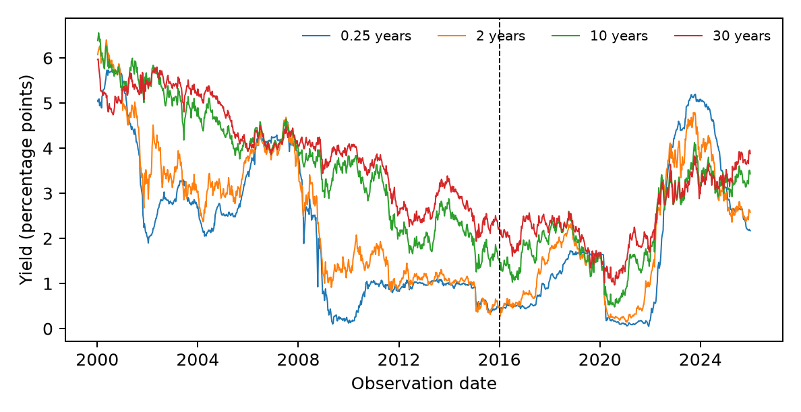
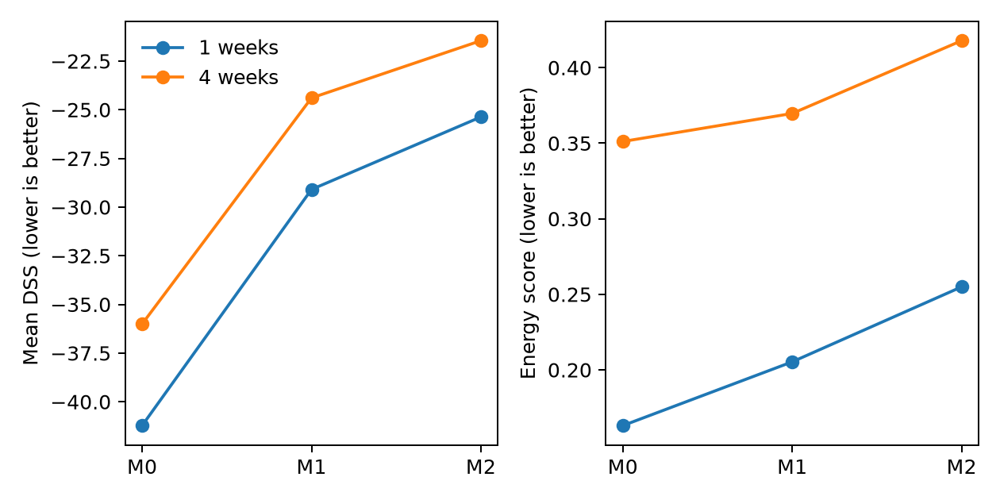
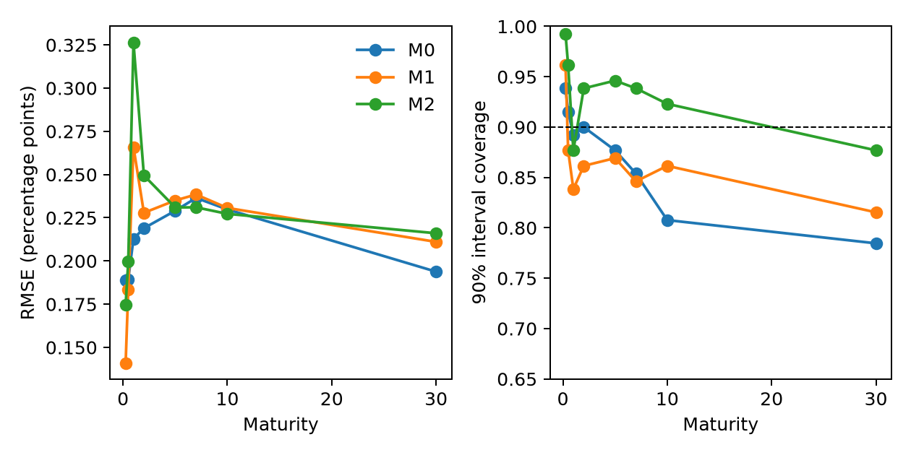
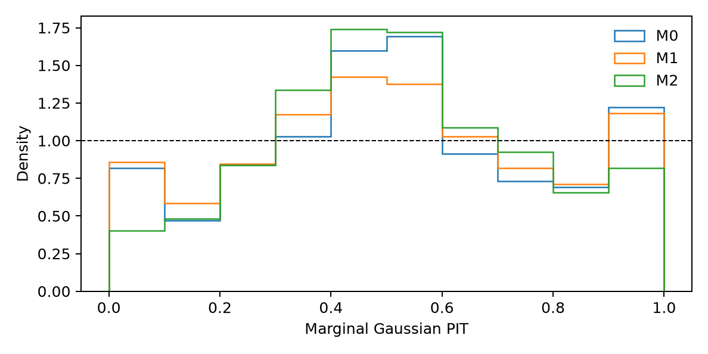

---
format:
  pdf:
    documentclass: scrreprt
    pdf-engine: lualatex
    keep-tex: true
    toc: false
    number-sections: true
fontsize: 12pt
papersize: letter
geometry: margin=1in
linestretch: 1.2
bibliography: ../references.bib
csl: apa.csl
link-citations: true
colorlinks: false
header-includes:
  - |
    \usepackage{chngcntr}
    \counterwithout{equation}{chapter}
    \counterwithout{footnote}{chapter}
    \setkomafont{disposition}{\normalfont\bfseries}
    \setlength{\emergencystretch}{3em}
execute:
  enabled: false
---

```{=latex}
\begin{titlepage}
\centering
\vspace*{1cm}
{\Large\bfseries Probabilistic Forecasting of Canadian Government Yields:\par}
\vspace{0.4cm}
{\Large\bfseries A Bayesian Stochastic-Volatility Extension of Dynamic Nelson--Siegel\par}
\vspace{1.6cm}
{\large Author: Ethan [full name to be confirmed]\par}
\vspace{0.7cm}
October 2026\par
\vspace{0.7cm}
Supervisor(s): [to be confirmed]\par
\vfill
A project\par
In partial fulfilment of the requirement for\par
Master of Quantitative Finance\par
University of Waterloo\par
\vspace{1cm}
\textbf{INTERNAL FIRST DRAFT -- SCIENTIFICALLY INCOMPLETE}\par
Not for submission: supervisor approval of AI use and validation of the Bayesian comparison remain outstanding.
\end{titlepage}
\pagenumbering{roman}
\chapter*{Abstract}
\addcontentsline{toc}{chapter}{Abstract}
```

This study investigates whether stochastic factor volatility improves probabilistic forecasts of Canadian government yields within a two-step Dynamic Nelson–Siegel framework. The proposed experiment compares six models at one- and four-week horizons, using eight zero-coupon maturities, an initial 2000–2015 estimation window and expanding-window forecasts over 2016–2025. A completed six-model computation produced 1,560 forecast records at 130 origins, but subsequent verification identified implementation defects and severe stochastic-volatility chain non-convergence. Those outputs are quarantined and do not establish an advantage for Bayesian stochastic volatility. A separately tested rerun of three classical benchmarks produced 780 forecast records with analytic predictive moments. At four weeks, the random walk attained a mean Dawid–Sebastiani score of −36.006, compared with −24.394 for PCA–VAR and −21.453 for two-step Nelson–Siegel. Its pooled yield RMSE was 0.213 percentage points and its pooled marginal 90% interval coverage was 87.1%. These findings are descriptive results for a historical data vintage, not real-time implementable forecasts: the public yield-curve series has a publication lag. This partial first draft preserves the approved Bayesian research question, documents the failed inference, and provides reproducible classical results. The primary constant-volatility versus stochastic-volatility Bayesian comparison remains unresolved.

```{=latex}
\clearpage
\chapter*{Acknowledgements and research disclosure}
\addcontentsline{toc}{chapter}{Acknowledgements and research disclosure}
```

This internal draft was prepared with AI assistance for literature retrieval, programming, computational auditing and writing. The student must review the code, understand the methods, independently assess all scientific claims and discuss the permitted use of AI with the supervisor before using this material for the research paper. The MQF guidelines explicitly require prior discussion of AI use; that approval has not been established in the project materials. This disclosure does not substitute for approval.

The Bank of Canada is acknowledged as the source of the Canadian zero-coupon yield-curve data. No endorsement by the Bank is implied. Source access and bibliographic verification are distinguished from complete-paper review in the accompanying literature inventory. The originally supplied proposal, guidelines and raw data have been retained. No submission or communication with the university has been made.

The draft is deliberately incomplete where the evidence is incomplete. In particular, a successful numerical process exit is not evidence of correct Bayesian inference. Results from the failed stochastic-volatility computation are retained for diagnosis but are not presented as empirical findings supporting the hypothesis. The validated tables are generated from a separate classical-benchmark run.

```{=latex}
\clearpage
\tableofcontents
\clearpage
\listoftables
\clearpage
\listoffigures
\clearpage
\pagenumbering{arabic}
```

# Introduction {#sec-introduction}

## Motivation and research problem

A government yield curve relates the interest rate on a zero-coupon claim to the time remaining until its payment. A short-maturity rate and a long-maturity rate need not move together. Consequently, a single forecast of a policy rate or a ten-year yield is not a forecast of the entire curve. Fixed-income risk management requires scenarios describing both the size of yield movements and the way movements at different maturities occur together.

The Dynamic Nelson–Siegel (DNS) representation compresses the curve into three factors with level, slope and curvature loading patterns. This provides a parsimonious starting point for forecasting and an interpretable alternative to a high-dimensional unrestricted yield model. The approved proposal builds on the dynamic forecasting framework of @diebold2006forecasting and the Bayesian stochastic-volatility literature represented by @hautsch2012bayesian.

The central research question is unchanged from the proposal: **does incorporating Bayesian stochastic volatility into DNS factor dynamics improve out-of-sample probabilistic forecasts of Canadian government yields relative to constant-volatility DNS models and standard forecasting benchmarks?** The question concerns predictive uncertainty, not merely whether fitted curves closely reproduce observed yields. A model can have a small cross-sectional reconstruction error and still produce a poorly calibrated distribution for future curves.

A useful distinction is between a point forecast and a predictive distribution. The first summarizes a future curve by its conditional mean. The second assigns probabilities to alternative future curves. Two models can have similar conditional means yet differ materially in forecast variances, interval widths and cross-maturity dependence. The proposal therefore makes a mean–covariance score the primary criterion and supplements it with an ensemble-based distributional score.

## Intended contribution and scope of this draft

The intended contribution is a controlled comparison between Bayesian DNS models with constant and stochastic factor volatility. Both are to use identical extracted factors, stationary univariate AR(1) mean equations, reconstruction-error treatment and forecast dates. The stochastic-volatility specification adds latent time-varying factor variances. Conventional models provide external competitiveness checks rather than single-change causal comparisons.

The present draft does not claim that this contribution has been demonstrated. The original six-model run completed, but an independent mathematical and diagnostic audit found defects. Those defects affect the interpretation of its scores even though the saved arrays are finite. Reproducing an incorrect calculation cannot turn it into a valid scientific result. Accordingly, this paper reports a separately verified classical baseline experiment and documents why the primary Bayesian inference is not accepted.

This distinction is important for interpreting negative results. Failure of an estimation implementation is not evidence against stochastic volatility. Conversely, favorable scores from an unconverged sampler are not evidence for it. The appropriate conclusion is narrower: the completed computation does not resolve the research question, while the validated baseline results establish the standard that a corrected Bayesian model must meet.

## Organization

@sec-literature connects the model and evaluation choices to the literature. @sec-data documents provenance, units and forecast-date construction. @sec-methods gives the complete proposed model ladder. @sec-design defines evaluation and scientific acceptance criteria. @sec-results presents accepted classical results and contrasts them with the quarantined computation. @sec-risk gives a restricted scenario-risk illustration. @sec-conclusions states the defensible conclusions and unfinished work. Appendices derive forecast equations and record numerical verification.

# Literature and conceptual framework {#sec-literature}

## Representation versus dynamics

The proposal uses the Nelson–Siegel cross-section as a representation of yield-curve shape and AR dynamics as a law of motion for its factors. These are separate modeling choices. Re-estimating a curve at each observation produces a sequence of factors, but a forecast additionally requires a probability model for their future values. @diebold2006forecasting provides the central forecasting reference; @diebold2006macroeconomy provides a related dynamic latent-factor treatment linking yields and the macroeconomy.

The interpretation of the three factors follows from their loadings, not from a claim that all factors are stationary or cointegrated. In the convention used here, the level loading is one at every maturity. The slope loading is positive at short maturities and tends toward zero at long maturities. Curvature has a hump-shaped loading. Claims about integration orders or economic identification require further testing and are not inferred from the labels.

A PCA factor model is a useful external comparison because its basis is selected from yield variation rather than prescribed by a parametric maturity function. Its factors do not generally have the same economic interpretation as DNS factors. A favorable comparison between DNS and PCA could reflect representation, mean dynamics, residual covariance or estimation uncertainty. It cannot isolate volatility dynamics in the way the planned Bayesian pair can.

## Stochastic volatility and the controlled comparison

@hautsch2012bayesian and @caldeira2010bayesian are verified bibliographic references on Bayesian Nelson–Siegel models with stochastic volatility. Their relevance is to the modeling possibility, not a guarantee of forecasting improvement in Canada. The specification in the proposal is deliberately a two-step approximation: extracted factors are treated as observations when fitting their second-stage dynamics. It must not be described as equivalent to a unified latent-factor state-space model.

@omori2007stochastic is the methodological reference for efficient stochastic-volatility inference using a mixture approximation. The no-leverage model in the proposal is a restriction relative to the leverage setting named in that article. A valid implementation requires the actual approximation coefficients, parameter conventions and full conditional distributions to agree. Merely citing the article does not validate a transcribed table or a custom Gibbs sampler.

The proposal also identifies @sarkisian2024bayesian as a related Master's thesis. Its institutional provenance is distinct from the countries or instruments used empirically. This draft does not infer a Dutch-yield sample from the university's location. Detailed thesis findings and comparisons to this project are contingent on the access evidence recorded in `docs/literature_inventory.md`.

## What proper scoring rules establish

The literature on proper scoring rules motivates evaluation of predictive distributions rather than exclusively point errors [@gneiting2007strictly]. A scoring rule is proper when the expected score is optimized by reporting the relevant true predictive object. Propriety does not eliminate sampling variability, dependence among verification dates, approximation error in simulated ensembles, or errors in the model implementation.

The Dawid–Sebastiani score (DSS) uses a predictive mean and covariance. Its scoring-rule foundation is related to @dawid1999coherent. In the present multivariate form it cannot distinguish two distributions that share the same mean and covariance. It therefore must not be called a strictly discriminating test of the entire posterior-predictive distribution. An Energy Score provides complementary information about simulated yield vectors, while the Variogram Score emphasizes pairwise cross-maturity contrasts [@scheuerer2015variogram].

@patton2011volatility studies comparison using imperfect volatility proxies. It is relevant motivation for thinking carefully about variance losses, but it does not itself establish robustness of every eight-dimensional covariance score used with estimated zero-coupon curves. The observed yield vector here is the forecast target; it is not a direct observation of a latent conditional covariance matrix.

## Comparison uncertainty and evidence limits

@hansen2011model introduces the Model Confidence Set (MCS). The concept is useful when the data cannot sharply distinguish forecasts. Correct implementation requires a documented equal-predictive-ability statistic, an appropriate elimination rule and resampling that respects loss dependence. A set generated by an arbitrary elimination routine is not validated merely by using the MCS name.

This draft distinguishes verified bibliography metadata from verified paper contents. Crossref responses are cached for the journal articles. Access to publisher abstracts does not count as complete-paper review. Where complete texts remain unavailable, detailed empirical assertions have been omitted rather than reconstructed from titles or secondary descriptions. The literature inventory records remaining access gaps and any full-text evidence obtained.

# Data and information sets {#sec-data}

## Source and provenance

The primary source is the Bank of Canada's public zero-coupon yield-curve series [@bocdata]. Its source page describes daily curves derived from Government of Canada bonds and treasury bills, a quarterly maturity grid from 0.25 through 30 years, decimal yield units, missing observations marked `na`, and a typical two-week update lag. These are estimated curves rather than a panel of directly traded zero-coupon security prices at all maturities. The Bank identifies @bolder2004canadian as the methodology reference.

The project originally contained a raw Canadian CSV. Its original retrieval transaction is not authenticated; a filesystem modification timestamp is not a server download receipt. This limitation is explicit in the manifest. A fresh non-destructive check downloaded December 2015 observations from the official endpoint. The eight selected maturities matched the supplied file exactly on 21 complete dates. This is a source-consistency check for that slice, not proof that every historical row has been independently re-downloaded or that a vintage is unrevised.

The raw file is preserved separately from the processed weekly panel. The canonical processor is `src/prepare_data.py`; the source-check script is `src/source_data_check.py`. Source URLs, retrieval timestamps, checksums and the slice comparison are stored under `docs/sources/`. Previously supplied U.S. data are retained but are not part of the approved Canadian forecasting experiment.

## Cleaning, units and weekly sampling

The selected maturity grid is $(0.25,0.5,1,2,5,7,10,30)$ years. Headers are stripped of leading spaces; dates are parsed and checked for uniqueness. A daily observation is eligible only if all eight selected yields are present. The processor converts decimal yields to percentage points by multiplying by 100 and selects the last eligible observation in each ISO calendar week. This is neither averaging nor interpolation.

The raw Canadian file contains 6,974 daily rows, of which 335 do not supply a complete selected curve. The remaining 6,639 complete rows produce 1,396 weekly observations. These counts refer to the complete supplied file, not the restricted research sample. An earlier diagnostic message incorrectly said zero missing rows were dropped; the canonical manifest corrects that statement.

The research sample excludes the weekly observation dated 31 December 1999 and all dates in 2026. It contains 1,356 weekly observations: 835 through the end of 2015 and 521 in 2016–2025. @tbl-data summarizes this restricted sample. All scores use percentage-point units; hence 0.01 percentage points equals one basis point. Comparisons use identical units across models. Changing units shifts determinant-based scores and rescales distance-based scores.



{#fig-history width=95%}

## Forecast dates and calendar interpretation

Forecast horizons count weekly observations, not a fixed number of trading days. Every fourth weekly observation in the out-of-sample period is considered as an origin. An origin is retained only if both its one- and four-observation-ahead targets lie in 2016–2025. This gives 130 common origins, from 8 January 2016 to 28 November 2025. The otherwise candidate observation near the end of December 2025 is excluded because its four-week target is outside the sample.

Holidays can change the weekday and the number of elapsed calendar days without changing the weekly index horizon. The origin-audit CSV records origin and target dates, training counts and elapsed days. The sample contains no gap exceeding ten calendar days between successive weekly observations. A forecast labeled four weeks should therefore be read as four weekly sampling steps, with the exact target date supplied in the audit.

## Observation-time versus publication-time information

The experiments fit models only to observations dated no later than the origin. Lambda selection also uses only the initial training sample. This prevents future-dated observation leakage within the supplied historical panel. It does **not** establish a real-time forecasting design.

The Bank's typical two-week publication lag means a curve with observation date $t$ would not normally be publicly available to an investor at $t$. In addition, the supplied panel is a later historical vintage. These experiments are therefore **retrospective observation-time forecasts**, not operational forecasts under the public release-time information set. A genuine release-time backtest needs dated releases or a conservative availability-lag rule, with forecast targets and information sets redesigned explicitly. A fixed lag alone cannot eliminate uncertainty about historical revisions.

This is a substantive deviation from a strict interpretation of “information available at the forecast origin.” The observation-date experiment is retained to preserve the proposal's principal design, but the real-time implementation claim is withdrawn. No result in this draft should be interpreted as executable performance at historical trading dates.

# Model specifications {#sec-methods}

## Nelson–Siegel observation equation

Let $Y_t$ be the eight-dimensional yield vector and $f_t=(L_t,S_t,C_t)'$ the factors. For maturity $\tau$ in years define

$$
s(\tau;\lambda)=\frac{1-e^{-\lambda\tau}}{\lambda\tau},
\qquad c(\tau;\lambda)=s(\tau;\lambda)-e^{-\lambda\tau}.
$$ {#eq-loadings}

The row of the loading matrix at $\tau$ is $(1,s,c)$. This fixes the slope sign convention consistently across equations and code. The observation equation is

$$
Y_t=\Lambda(\lambda)f_t+\varepsilon_t,
\qquad \varepsilon_t\sim N(0,R_t).
$$ {#eq-observation}

The decay rate has units of inverse years; it is not a monthly autoregressive parameter. Grid search over 160 values from 0.05 through 2.0 inverse years minimizes initial-window cross-sectional squared errors. The selected value is 0.516038 inverse years and is fixed thereafter. This selection uses the initial window only; sensitivity to the grid and alternative selection losses remains future robustness work.

At each date the two-step factor estimator is

$$
\widehat f_t=(\Lambda'\Lambda)^{-1}\Lambda'Y_t.
$$ {#eq-extraction}

The implementation uses least squares rather than explicitly forming this inverse. Reconstruction variance at each maturity is the origin-specific mean squared reconstruction error, floored at $10^{-6}$ squared percentage points. The diagonal $R_t$ is a modeling approximation, not a proof that residual errors are independent. Small residual eigenvalues can materially affect an eight-dimensional score.

## Complete benchmark ladder and acceptance status

| Model | Proposed specification | Status in this draft |
|---|---|---|
| M0 | Yield random walk; Gaussian historical-change covariance | Independently rerun and reported |
| M1 | Three PCA factors with VAR(1), plus reconstruction noise | Independently rerun and reported |
| M2 | Two-step DNS; independent Gaussian AR(1) factors | Independently rerun and reported |
| M3 | Gaussian DNS state-space; Kalman filter and likelihood estimation | Executed; results not accepted |
| M4 | Bayesian two-step DNS with constant volatility | Executed with deviations; not accepted |
| M5 | Bayesian two-step DNS with stochastic factor volatility | Failed inference audit; quarantined |

: The complete proposal ladder. Non-acceptance is not a silent omission. {#tbl-ladder}

## Random-walk and PCA–VAR forecasts

M0 sets the future mean equal to the current curve. For horizon $h$, its covariance is the sample covariance of overlapping historical $h$-step yield changes within the expanding window. This is a zero-drift mean specification; estimating a change covariance does not insert the historical mean change into the forecast. Covariance eigenvalues are floored using the fixed training-only numerical rule.

M1 centers the expanding yield panel, estimates its first three principal components and fits a VAR(1) with an intercept to their scores. If the score equation is $g_{t+1}=d+Ag_t+v_{t+1}$ with innovation covariance $Q$, the recursive forecast is

$$
m_{k+1}=d+Am_k,\qquad V_{k+1}=AV_kA'+Q,
\quad m_0=g_t,\ V_0=0.
$$ {#eq-var-forecast}

The yield mean adds the training center to the basis-projected score mean. The covariance adds diagonal cross-sectional reconstruction error to the projected score uncertainty. The PCA basis and VAR are refitted at every origin, never estimated on the full sample. Finite-horizon forecasts are computed directly; the validated classical runner does not silently impose stationary coefficient clipping.

## Two-step Gaussian DNS

M2 fits a separate Gaussian AR(1) mean equation to each extracted factor:

$$
f_{j,t+1}=a_j+b_j f_{j,t}+\eta_{j,t+1},
\quad \eta_{j,t+1}\sim N(0,q_j).
$$ {#eq-ar}

For the classical benchmark the fitted intercept and slope are unrestricted least-squares estimates. Conditional on fitted parameters, factor forecast moments are

$$
 m_{j,h}=b_j^h f_{j,t}+a_j\sum_{k=0}^{h-1}b_j^k,
\qquad v_{j,h}=q_j\sum_{k=0}^{h-1}b_j^{2k}.
$$ {#eq-ar-moments}

The yield covariance is $\Lambda\operatorname{diag}(v_h)\Lambda'+R_t$. Parameter uncertainty is not added to this classical plug-in forecast. Factor innovation independence is an explicit restriction; PCA–VAR has a full three-dimensional innovation covariance instead. Thus M1 and M2 differ in more than their cross-sectional basis.

## Gaussian latent-state DNS

M3 estimates factors jointly through a Gaussian observation equation and state transition. The executed version restricts transition and process covariance to be diagonal and separately estimates diagonal measurement covariance. Kalman filtering provides the filtered state and covariance; likelihood maximization estimates parameters.

For transition matrix $A$, filtered covariance $P_t$ and process covariance $Q$, the horizon covariance must be

$$
P_{t+h|t}=A^hP_t(A^h)'+\sum_{k=0}^{h-1}A^kQ(A^k)'.
$$ {#eq-kalmanforecast}

The original implementation applied squared transition powers on each side of $P_t$, incorrectly attenuating its contribution. A regression test against @eq-kalmanforecast exposed the defect and the equation in code was corrected. The prior run's optimizer reported success at all 130 origins, but optimizer success cannot repair a forecast-covariance error or prove global likelihood maximization. A corrected M3 rerun, additional start-value checks and independent state-space validation remain outstanding.

## Bayesian constant-volatility DNS

The intended M4 uses the same factor AR(1) mean equation as M5, stationary $b_j$, fixed prior specifications and posterior-predictive simulation at each origin. The original execution instead drew directly from a truncated conjugate normal–inverse-gamma posterior. Independent exact posterior draws can be useful, but this is a deviation from the proposal's rolling MCMC requirement and must be stated rather than described as MCMC.

More importantly, its coefficient prior scaled with the innovation variance, while M5 used an unscaled coefficient prior. Consequently, the pair did not isolate only volatility dynamics. Their predictive scores cannot be interpreted as a controlled test of the primary hypothesis. A revised pair must match the AR coefficient priors and explain how the constant variance prior relates to the stochastic-volatility prior. These specifications must be fixed without evaluating alternative choices on out-of-sample scores.

## Bayesian stochastic-volatility DNS

The approved M5 factor dynamics are

$$
f_{j,t}=a_j+b_j f_{j,t-1}+\eta_{j,t},
\qquad \eta_{j,t}\mid h_{j,t}\sim N(0,e^{h_{j,t}}),
$$ {#eq-sv-factor}

$$
h_{j,t}=\omega_j+\phi_j(h_{j,t-1}-\omega_j)+u_{j,t},
\qquad u_{j,t}\sim N(0,\sigma_{u,j}^2).
$$ {#eq-sv-state}

The factors are estimated separately, with $|b_j|<1$ and $|\phi_j|<1$. A posterior draw must propagate both the factor and log-volatility processes at every future weekly step, not only plug a posterior mean volatility into a Gaussian forecast. Reconstruction noise must be added to each scenario:

$$
Y_{t+h}^{(m)}=\Lambda f_{t+h}^{(m)}+\varepsilon_{t+h}^{(m)},
\qquad \varepsilon_{t+h}^{(m)}\sim N(0,\widehat R_t).
$$ {#eq-predictive}

This includes uncertainty represented by the second-stage posterior, but not full uncertainty from estimating factors in the first stage. Lambda is also fixed after initial estimation. Bayesian output therefore remains conditional on these approximations, even after a correct sampler converges.

The original custom sampler used an incorrectly transcribed seven-component mixture rather than a verified Omori specification. Its variance update also omitted the stationary initial-state contribution. These are implementation failures, not authorized methodological simplifications. The saved original run and source snapshot remain available for diagnosis. Corrections to isolated equations do not retrospectively validate its forecasts or loss-comparison tests.

# Experimental design and evaluation {#sec-design}

## Expanding-window design

Every accepted forecast uses the same target vector and pair of horizons. Factor extraction, PCA centering, dynamics, residual covariance and regularization are based only on the expanding history through the origin observation. The initial 2000–2015 window selects lambda. The scoring period is 2016–2025. Common origins avoid comparing models on different interest-rate episodes.

The validated rerun produces 130 origins times two horizons times three accepted models, or 780 forecast records. Its means and covariances are computed analytically. Ensembles of 1,024 Gaussian curves per forecast are generated only for distributional scores and scenario illustrations. The fixed seed is recorded in the run metadata. An archive retains each scenario array, target, mean, covariance and key; no numerical table depends on hand transcription.

The earlier six-model run used 300 burn-in and 500 retained SV draws per factor at each origin, with a two-chain diagnostic of 1,000 retained draws per chain at the final origin. It used 256 predictive scenarios for scores. These settings describe what actually ran; they are not recommended as sufficient. The diagnostic failure demonstrates that the settings did not establish valid inference.

## Mean–covariance and Gaussian log scores

For error $e=Y_{t+h}-\widehat\mu_{t,h}$ the primary score is

$$
\operatorname{DSS}=\log|\widehat\Sigma|+e'\widehat\Sigma^{-1}e.
$$ {#eq-dss}

Smaller is better. Computation uses a Cholesky factor, triangular solves and a log determinant rather than a direct inverse. Positive-definite covariance is essential. If $\Sigma$ is nearly singular, small errors in maturity contrasts can generate large quadratic terms; a low-dimensional fit alone does not guarantee a good DSS.

For an eight-dimensional Gaussian forecast the negative log density is

$$
-\log p(Y)=\tfrac12\{8\log(2\pi)+\operatorname{DSS}\}.
$$ {#eq-logscore}

The verified runner saves this value separately. For non-Gaussian Bayesian mixtures this formula is only a Gaussian moment-based quasi-log score; it must not be presented as an exact mixture log predictive density. No accepted Bayesian mixture density score is available in this draft.

## Ensemble and marginal evaluation

For predictive draws $X^{(m)}$ and target $y$, the Energy Score estimate is

$$
\widehat{ES}=\frac1M\sum_{m=1}^M\|X^{(m)}-y\|
-\frac{1}{M(M-1)}\sum_{m<n}\|X^{(m)}-X^{(n)}\|.
$$ {#eq-energy}

The second term uses distinct draw pairs and is an unbiased Monte Carlo estimator under independent predictive draws. For a finite empirical ensemble, the conventional plug-in score instead uses a denominator proportional to $M^2$. Both conventions must not be mixed across models without explanation. The accepted rerun uses the same distinct-pair estimator and ensemble size throughout.

The Variogram Score uses power $p=0.5$ and equal weights on unordered maturity pairs. Marginal central 90% Gaussian intervals are computed analytically from each accepted covariance diagonal. Coverage is reported by maturity and pooled descriptively; maturities at a date are not independent replications. Probability-integral-transform (PIT) histograms are diagnostic plots, not formal independence tests.

Pooled RMSE is the square root of mean squared error across origins and maturities. It is not the average of origin-level root mean squared errors. The latter appeared under an ambiguous label in the original output. MAE is the pooled mean absolute error. Percentages and percentage-point quantities are kept distinct.

## Statistical comparisons and acceptance gates

Paired loss differences are formed on the same origins. Three-lag Bartlett HAC standard errors describe uncertainty in their average, with the lag measured in forecast origins, not weekly observations. Although four-step targets are approximately non-overlapping, losses can remain serially dependent because estimation windows overlap and volatility is persistent. Approximate normal intervals are reported descriptively, not as proof of a universal ranking.

The original MCS implementation did not establish agreement with the published elimination rule or dependence-aware studentization. Its saved sets are therefore not reported as validated MCS findings. Formal MCS and Bayesian predictive-ability tests are pending a corrected model ladder. Tiny asymptotic p-values from two- or five-origin smoke tests have no evidential role.

Acceptance requires more than successful execution: coherent equations, correct conditional distributions, no future-dated fit input, positive-definite forecast covariance, reconstructible scores and adequate posterior diagnostics. For Bayesian work, independent representative chains, rank-normalized split diagnostics, bulk and tail effective sample sizes, trace plots and Monte Carlo stability of predictive scores are needed. The legacy diagnostics alone are insufficient and already fail plainly.

# Empirical results and scientific audit {#sec-results}

## Accepted four-week results

@tbl-h4 contains primary-horizon results for the separately verified classical runner. The random walk has the lowest average DSS and Energy Score among M0–M2. Its pooled RMSE is also lowest. This ranking applies to the stated historical sample, common origin grid, parameter estimates and observation-time information set.



The difference in DSS is larger than the difference in point error. At four weeks, the random walk's mean DSS is −36.006, versus −24.394 for PCA–VAR and −21.453 for classical DNS. The corresponding Energy Scores are 0.351, 0.370 and 0.418. The pooled RMSEs are 0.213, 0.220 and 0.236 percentage points. These are actual saved rerun outputs, rounded for exposition.

The random walk is not uniformly calibrated. Its central 90% interval coverage averages 87.1%, below the nominal 90%. DNS coverage is 93.2%, but with wider intervals. Coverage near a target level alone does not establish superiority; excessively wide forecasts can attain high coverage while losing sharpness. Proper scores and interval width should therefore be considered together.

{#fig-scores width=95%}

## One-week results and maturity dependence

@tbl-h1 reports the common-origin one-week forecasts. The random walk again has the lowest aggregate DSS, Energy Score and pooled RMSE among the accepted models. These results do not imply that a weekly random walk will dominate at longer horizons, with different factors, or after a corrected stochastic-volatility model is introduced.



@fig-maturity shows that the horizon-level mean hides differences across maturities. A model can have reasonable marginal coverage yet misrepresent joint dependence. @fig-pit pools marginal PITs to visualize distributional shape, but pooling dependent maturities does not create an enlarged independent time series. Formal calibration tests would require a dependence-aware design and separate treatment of maturity-specific hypotheses.

{#fig-maturity width=95%}

{#fig-pit width=95%}

## Paired score uncertainty



@tbl-comparison compares classical DNS with the random walk using common-date loss differences. A positive value means DNS has the larger loss. These comparisons are descriptive checks of the accepted calculation. They do not replace the primary Model 4 versus Model 5 comparison and should not be repurposed as evidence that stochastic volatility is unnecessary.

The finite sample contains different interest-rate environments, but this draft does not assign regimes by inspecting which partitions produce favorable significance. Formal regime splits, prior sensitivity and covariance-floor sensitivity should be specified before their results are used to refine the hypothesis. The Variogram Score is included as an optional descriptive metric; it is not a substitute for those missing experiments.

## Completed execution is not completed inference

The six-model computation produced 1,560 records, finite arrays and positive-definite covariances. It took 3,266.1 seconds. Its state-space optimizer reported success on all 130 origins. Those are reproducible execution facts, not accepted Bayesian scientific results.

The final-origin SV chains showed split $\widehat R$ as high as 3.597 and a legacy ESS estimate as low as 5.324. @tbl-failed-diag gives the actual diagnostics. The mean-equation coefficients can mix better than volatility persistence and intercept parameters; acceptable diagnostics for one subset cannot validate the remainder. The ESS implementation is approximate and is not the rank-normalized bulk/tail procedure required for a modern posterior audit.



An independent moment test found that the transcribed mixture implied a log-innovation mean of approximately −0.6655, whereas the analytical expectation of $\log\chi^2_1$ is approximately −1.2704. This discrepancy rejects the approximation before considering sophisticated posterior diagnostics. Another regression test showed that the variance update omitted its stationary initial-state contribution. These defects and non-convergence preclude interpreting original favorable M5 scores as evidence of better forecasting.

Other departures matter independently. The M4 and M5 coefficient priors were not matched. M4 used direct posterior draws instead of specified MCMC. M3's covariance propagation was incorrect. Conventional predictive means were unnecessarily estimated from small simulated ensembles rather than exact fitted means. Finally, original aggregated `rmse_curve` was a mean of curve-level RMSEs, not pooled RMSE. The separate classical rerun resolves the latter two issues for M0–M2 and separates unaccepted models.

## Robustness achieved and still required

Accepted artifacts pass checks for date uniqueness, common origins, target boundaries, units, finite scenarios, covariance definiteness and exact score reconstruction. An official-source slice matches supplied raw data. Independent analytical tests verify classical factor moments and Nelson–Siegel loadings. These are verification checks, not a full economic robustness study.

Missing scientific robustness includes corrected multi-chain SV estimation, matched prior sensitivity, multiple representative diagnostic windows, state-space likelihood-start sensitivity, a release-lag design, vintage sensitivity, reconstruction-covariance alternatives, stronger ensemble stability checks and a validated MCS. The sample and origin schedule have not been reduced to conceal estimation failure. Rather, the scope of accepted results has been narrowed explicitly.

# Fixed-income scenario illustration {#sec-risk}

## Risk object and approximation

For an equal-market-value basket with maturity weights $w_i=1/8$, this draft maps yield scenarios into a first-order duration-shock loss,

$$
\ell_{t,h}^{(m)}=\sum_{i=1}^8 w_i\tau_i\frac{Y_{i,t+h}^{(m)}-Y_{i,t}}{100}.
$$ {#eq-loss}

This is a local sensitivity illustration in units of initial basket value. It is not a realized total-return backtest. It holds duration exposure at the origin, ignores aging, coupon cash flows, financing, convexity, rebalancing and transaction costs. The duration mapping is not asserted exact under an unverified yield-compounding convention. Presenting it as an investable bond portfolio return would overstate the evidence.

VaR at confidence level $\alpha$ is the empirical loss quantile, and ES is the simulated mean loss above that quantile. At 99% confidence, an ensemble of 1,024 curves contains few tail observations, so ES is noisy. The complete risk-scenario CSV retains both 95% and 99% outputs, but the main table emphasizes the less sparse 95% illustration. More tail simulation and stability analysis are needed before a risk-management conclusion.

## Illustration and backtesting limits



@tbl-risk uses only accepted classical distributions. Exception counts are compared with nominal 5% tail probability. Reported unconditional-coverage p-values are exploratory asymptotic diagnostics for the duration-shock target. A nonsignificant result would not prove model adequacy, especially with only 130 origins and few tail events.

Christoffersen-style transition diagnostics exist in the legacy code, but their adequacy at sparse exception counts and under this risk definition has not been independently established. No accepted ES-specific backtest is provided. Computing a simulated ES is not equivalent to testing ES forecasts. Bayesian scenario VaR/ES and formal comparative risk backtests remain pending because their predictive distributions are not accepted.

# Conclusions and outstanding research {#sec-conclusions}

## What available evidence establishes

For the specified Canadian historical panel and 130 common evaluation origins, the separately verified random-walk benchmark outperforms PCA–VAR and two-step Gaussian DNS on average DSS, Energy Score and pooled RMSE at both tested horizons. At four weeks, its mean DSS is −36.006 and pooled RMSE is 0.213 percentage points. Marginal interval coverage is below nominal, so forecast accuracy should not be confused with complete calibration.

The principal Bayesian research question remains unanswered. A six-model process completed, but defective stochastic-volatility inference and unmatched priors invalidate the controlled comparison. The scientific response is to retain failure evidence, correct the implementation, test it independently and rerun the Bayesian pair only after a representative pilot passes acceptance gates. It is not to select favorable scores or describe non-converged posterior draws as established uncertainty estimates.

## Work required before a complete paper

The exact no-leverage mixture must be verified against its source and full conditional updates must agree with the documented prior and initial-state treatment. The constant-volatility and stochastic-volatility models need matched coefficient priors and a clear account of rolling estimation. Independent chains must be assessed at early, middle and late windows with reliable diagnostics and score-stability checks. M3 requires a corrected and independently checked forecast covariance and likelihood fit.

A full paper additionally needs remaining literature-access gaps resolved where possible, a release-time interpretation or explicitly revised real-time design, validated multiple-model inference and risk backtests appropriate to an actual portfolio definition. The official guidelines require the student's own understanding, review and prior discussion of AI use with the supervisor. No automated statement can establish that approval.

This first draft is a reproducible, reviewable partial artifact rather than a completed research finding. Its main methodological lesson is specific: an expanded volatility model does not earn credibility from execution success alone. Verification of the likelihood approximation, posterior exploration, forecast information set and scoring calculations is integral to answering the economic question.

# Analytical derivations and numerical checks {#sec-appendix}

## Least-squares factor extraction

For fixed $\lambda$, minimize $g(f)=(Y-\Lambda f)'(Y-\Lambda f)$. Differentiation gives $\partial g/\partial f=-2\Lambda'Y+2\Lambda'\Lambda f$. Setting the derivative to zero yields @eq-extraction when the three columns have full rank. Least squares avoids explicitly computing an inverse, which would be less stable if loadings were poorly conditioned.

As $x=\lambda\tau$ approaches zero, $(1-e^{-x})/x$ approaches one. The implementation uses `expm1` to avoid cancellation for small positive $x$. Curvature approaches zero at the short end. At long maturities both nonlevel loadings approach zero. These limits establish interpretation and basic sign checks; they do not identify factors econometrically without further assumptions.

## AR and VAR forecast moments

Repeated substitution gives $f_{t+h}=b^hf_t+a\sum_{k=0}^{h-1}b^k+\sum_{k=0}^{h-1}b^k\eta_{t+h-k}$. Taking expectations yields the mean in @eq-ar-moments. Independent zero-mean innovations eliminate cross terms, giving $q\sum b^{2k}$ for its variance. The finite-sum form remains well defined when a fitted slope is near one.

The matrix version replaces $b^k$ with $A^k$ and yields @eq-var-forecast. If the origin state has filtered covariance $P_t$, an additional term $A^hP_t(A^h)'$ appears. This explains why applying $A^{2h}$ on both sides, as in original M3 code, is wrong: it multiplies diagonal uncertainty by fourth rather than second powers of the horizon transition.

## Yield predictive covariance

For a fixed loading matrix and independent observation noise, $\operatorname{Var}(Y\mid\mathcal I_t)=\Lambda\operatorname{Var}(f\mid\mathcal I_t)\Lambda'+R_t$. Reconstruction uncertainty is added once at the future observation, not at every transition. In a Bayesian model, factor variance must include both conditional innovation uncertainty and dispersion in conditional means across posterior draws.

Estimating an eight-dimensional covariance from a small ensemble can add noise in low-variance directions. Analytic addition of $R_t$ to a factor-level posterior covariance is a useful stability check, but changing the estimator must be documented consistently. The accepted classical run avoids this issue through exact fitted moments.

## Stationary stochastic-volatility update

Write $h_t=c+\phi h_{t-1}+u_t$ with $c=(1-\phi)\omega$. Under stationarity, $h_1\sim N(c/(1-\phi),q/(1-\phi^2))$, where $q=\sigma_u^2$. For an inverse-gamma prior of shape $a_0$ and scale $b_0$, the full conditional has

$$
a_n=a_0+\frac n2,\qquad
b_n=b_0+\frac12\left[\sum_{t=2}^n(h_t-c-\phi h_{t-1})^2
 +(1-\phi^2)\left(h_1-\frac{c}{1-\phi}\right)^2\right].
$$ {#eq-sv-update}

The initial-state term and degree-of-freedom contribution are required if the remaining sampler uses a stationary initial density. Original code omitted the contribution even though a correct helper existed. A regression test now checks that the sampler uses that helper. This repair is necessary, not sufficient, for acceptance.

For standard normal $z$, the analytical mean of $\log z^2$ is $\psi(1/2)+\log 2$, and variance is $\psi_1(1/2)$. These are direct checks for a Gaussian approximation to the log-square distribution. Moment agreement is not a full density-accuracy test, but the original mixture failed even the mean check.

## Score reconstruction and data integrity

The accepted archive contains 780 distinct forecast keys. Recomputing DSS from every saved mean, covariance and target reproduces the score CSV up to roundoff; maximum absolute discrepancy is approximately $2.84\times10^{-14}$. The minimum covariance eigenvalue is positive. These checks address consistency between predictions and reporting, not the truth of assumptions.

The processor previously wrote test-fixture provenance into the global source manifest, contaminating it with a temporary three-row example. A failing isolation test established the cause; manifests are now written next to their own outputs. The real panel and manifest were rebuilt. Tests use the approved scratch directory and do not overwrite raw sources.

# Supplementary maturity results {.unnumbered}



The table retains each maturity rather than treating a curve-level average as a complete description. Additional calibration by confidence level, subperiod and origin remains future work. Saved arrays make extensions reproducible without refitting accepted benchmarks, but post-hoc summaries must be identified as such.

# Bibliography {.unnumbered}

::: {#refs}
:::
